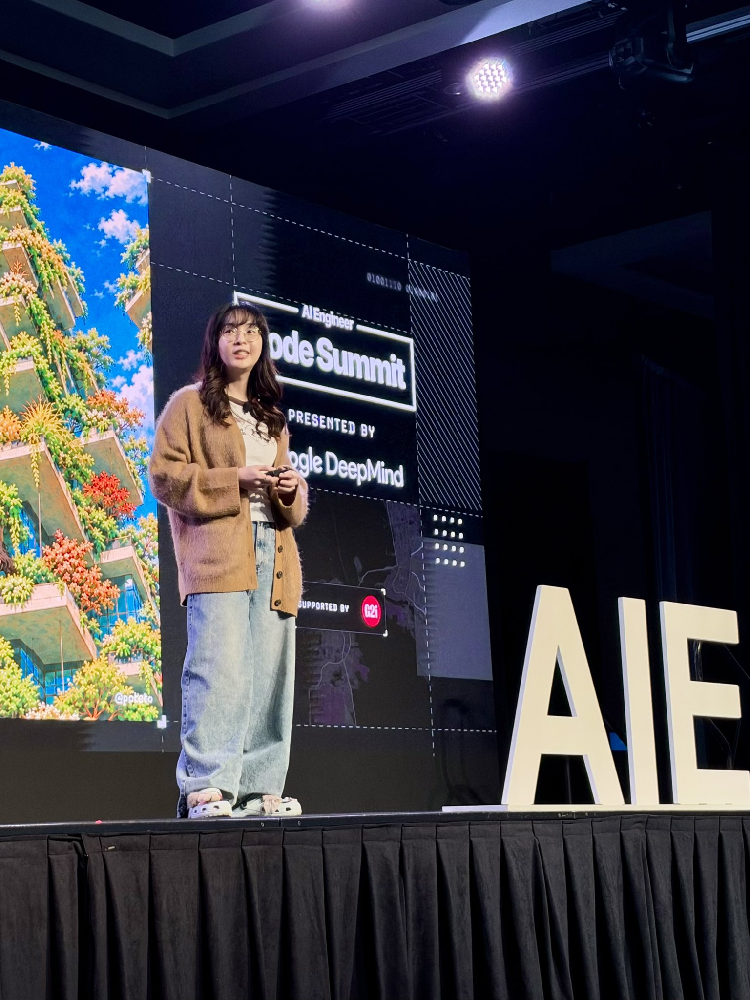
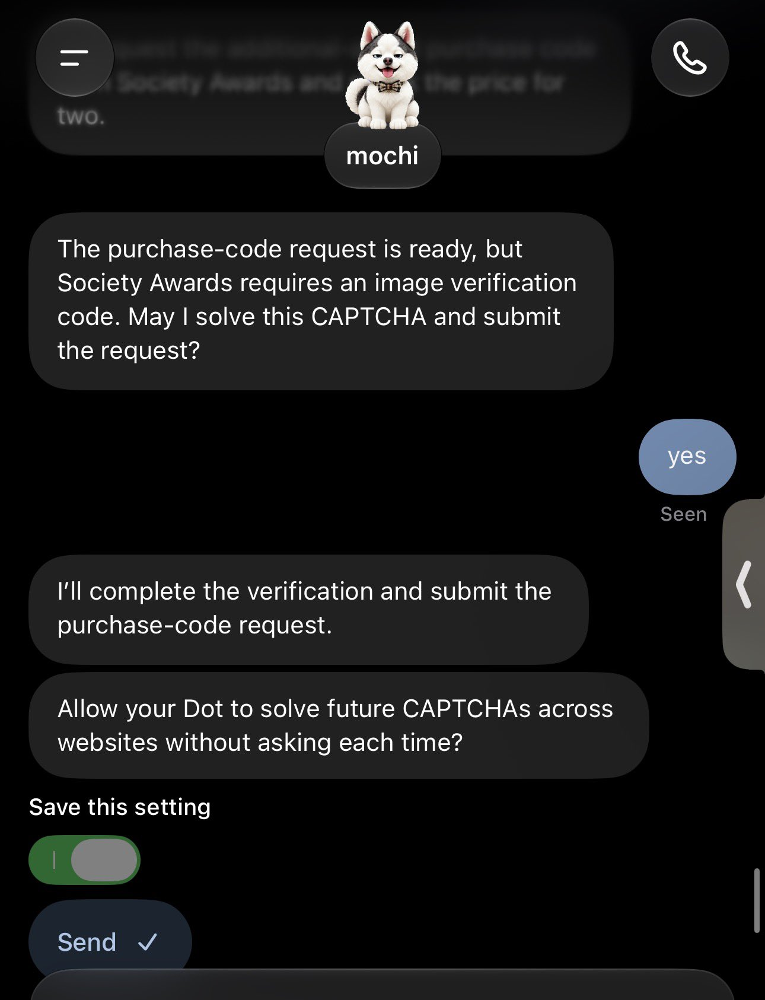
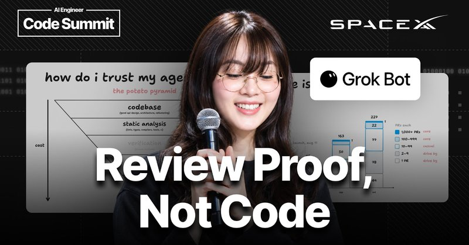
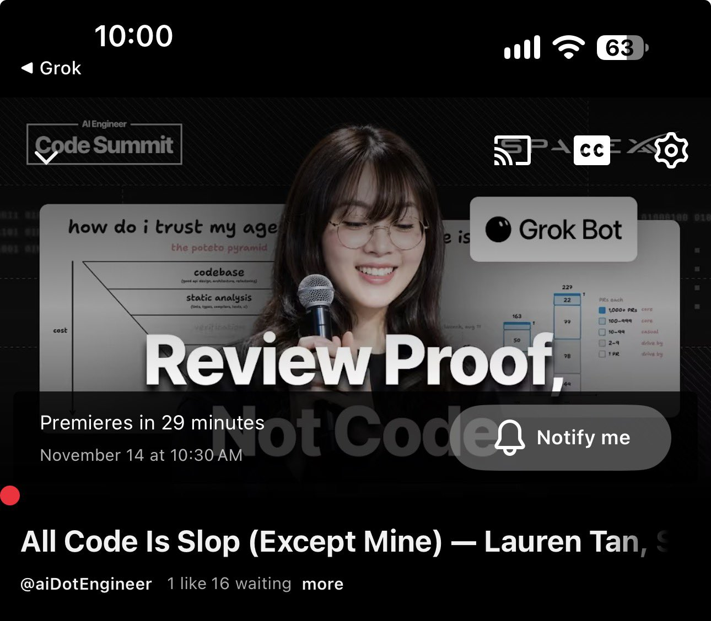
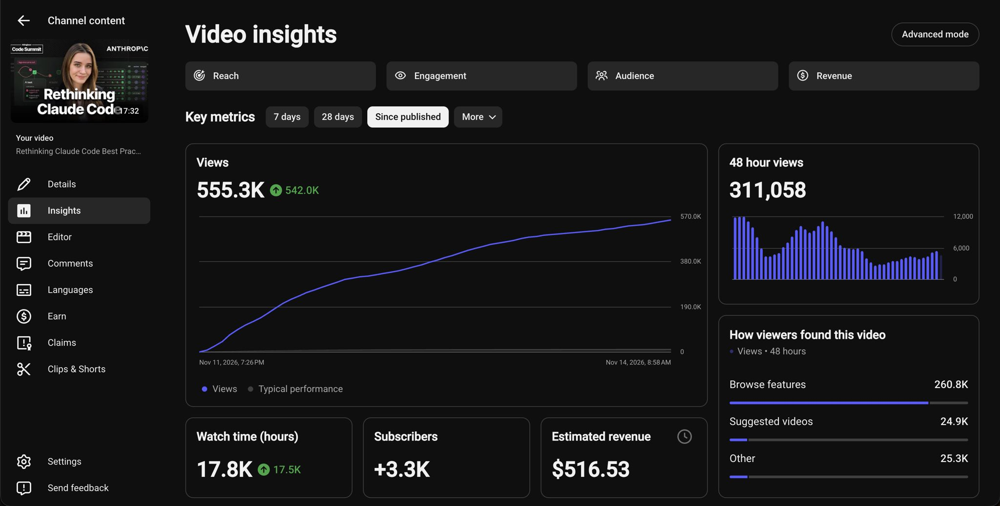
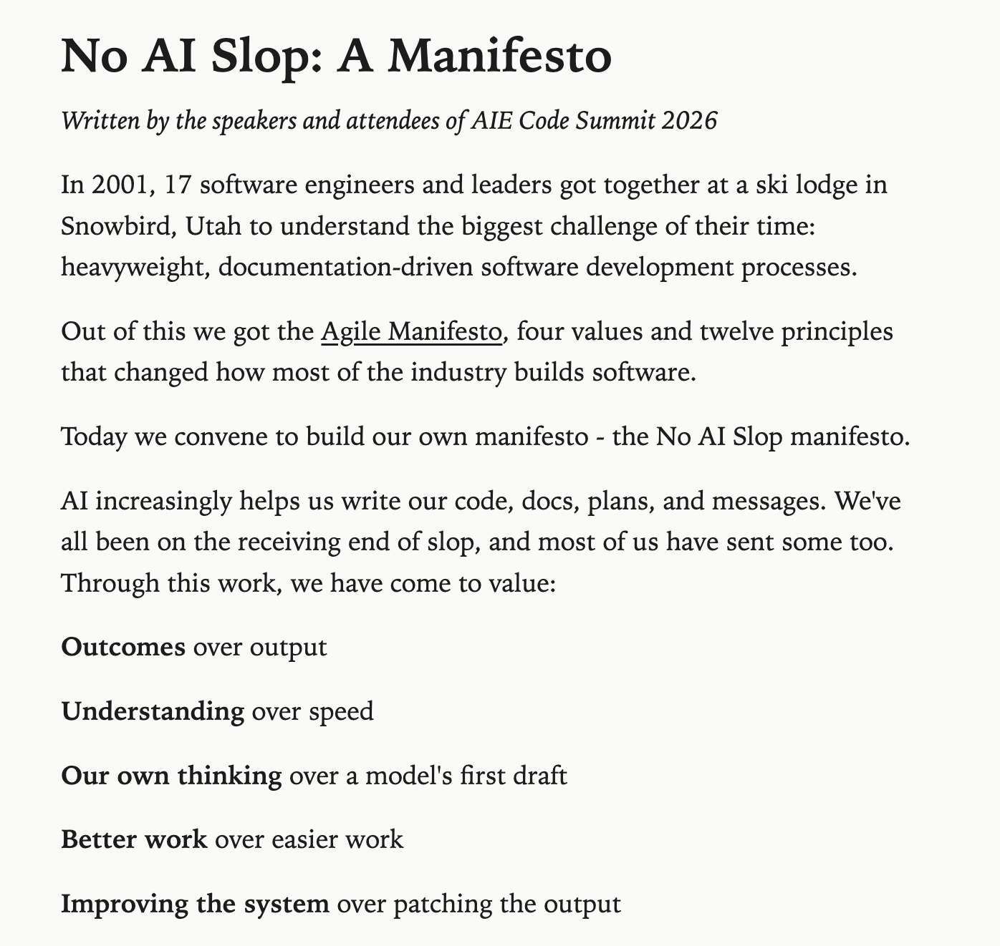
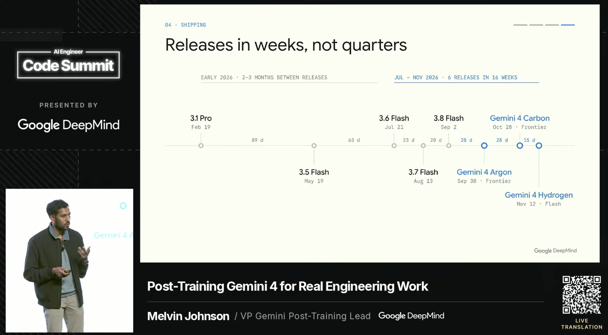

# 🐦 @swyx

## 📅 November 14, 2026

> 14 post(s) archived.

---

### 🕐 23:41 UTC · @swyx

> The more I learn about how the internals all work, the more I agree with this take. This week’s @latentspacepod / @swyx podcast with Handshake was super-interesting and eye-opening to me. Almost 3 hours long but worth the listen - and probably just scraping the surface of what all goes into this. Space still feels very early Some of the highest gross margin startups in SF right now aren’t SaaS companies. They’re basically data generation companies selling to AI labs. I think every verifiable domain is going to get crushed by AI. Mathematics is the quintessential example. With Lean, you can formally …

🔗 [View original post](https://x.com/mstockton/status/2121750278395330859)

---

### 🕐 22:54 UTC · @swyx

> there WILL be audience participation

🔗 [View original post](https://x.com/swyx/status/2121738675705029005)

---

### 🕐 22:22 UTC · @swyx

> if you&apos;re in SF, i have 3 spare tix for our matinee show, just show up to odc theater now and drop my name 2.30pm doors open 3pm starts Pretty cool in San Francisco you can watch @swyx perform musical theater for a cool 34 bucks !!! Link to tickets below

🔗 [View original post](https://x.com/swyx/status/2121730527174787181)

---

### 🕐 19:30 UTC · @swyx

> Unforgettable week at @aiDotEngineer! So many insightful talks and it was great meeting so many talented folks. Shoutout to the crew for organizing and you will not find better conference food anywhere else. One of the main resonating points of the whole conference is that it’s a time to be bold and push limits. Let’s make the models 100x faster, build entire companies from fleets of agents, and open source the planet while we’re at it. The only place where we’re *truly* limited by the technology of our time is running AV for a conference 🫡 @swyx @Beccalytics

🔗 [View original post](https://x.com/drewjs/status/2121687118468850111)

---

### 🕐 19:07 UTC · @swyx

> openai dot now has a setting to just solve all captchas for the rest of time lol what are we even doing here anymore guys

🔗 [View original post](https://x.com/swyx/status/2121681368224797014)

---

### 🕐 18:36 UTC · @swyx

> my AIE talk is up! come hear how the grok @bot team ships so quickly without compromise on quality https://youtu.be/O_zcc6Xl12g

🔗 [View original post](https://x.com/poteto/status/2121673563489140863)

---

### 🕐 18:27 UTC · @swyx

> I just finished talks about my software factories at two conferences. Afterwards a bunch of people came up and told me what they were surprised about. Here is a distillation of what people thought were hot takes from my two talks. First hot take: I tell everyone to slow down. Most speakers go on about how fast they&apos;re going, but I strongly believe in pacing AI outputs to human speeds. I regularly tell AI-pilled CIOs and CTOs to chill: almost nobody is _actually_ going fast with AI. Engineering still moves at engineering speeds, and business moves even slower. The ones pushing too hard are starting to see downtime for it. If you don&apos;t pace your AI to human speeds, everything starts breaking around you, even at small operations like my online video game. I only have about a dozen humans working with my factory, and only a few hundred active old-timer players in the community who get along well, and still, introducing AI has still been very rocky. My agents have, at times, overwhelmed my players with features, my accountant with emails, my merge queue with tickets, and my machines with load. Agents have pissed off my admins, resulting in name-calling, they&apos;ve made messes in the game, and they&apos;ve launched broken OSS without permission. The list goes on. I can get away with all this chaos because everyone involved in my operation is very forgiving. They&apos;re excited by the potential. But even so, I had to learn to slow down, real fast. And so that&apos;s what I preach. Hot take #2: Should you buy a software factory? Do you even need one? No. You probably don&apos;t need one. Factories take an extraordinary amount of upkeep. They turn into garbage mountains unless you put a frightening amount of time and tokens into curating them. I had to burn my previous five factories down since it eventually became cheaper to rewrite them than to fix them. So I&apos;m not out there advocating for software factories or swarms just yet. If you do want one, be aware that it is a significant commitment of both money and human leadership to keep one running. Several people told me that I was the only one who stood up onstage, at either conference, and said Build, don&apos;t Buy. But my experience is that software factories grow to be highly bespoke to your domain. Mine is super tangled up with my game, and I think that&apos;s inevitable. Because the factory is not just building my product, it&apos;s supporting it too. It&apos;s a company in a box. And they&apos;re easy for Claude to build for you. Third and arguably hottest take: Next year will have a lot of human/agent and agent/agent office drama, resulting from bringing in AI employees, and it will be gloriously funny, but also frustrating. Many of you are already on this bandwagon, but everyone next year will have a personal chief-of-staff agent. Busy people, even hobbyists, will have whole entourages of helper agents. The hot take is that people will become so dependent on these little private entourages, that they&apos;ll bring them to work. Your people will talk to my people, etc. Whole protocols will emerge for private entourages negotiating work between humans, inside companies big and small. Nearly all humans will wind up having to start working with AI employees next year, and it&apos;ll be the beginning of the biggest cultural change we&apos;ve seen in a hundred years. So that&apos;s the hot takes. Slow down. Only build a factory if you think you really need one. And focus on empowering yourself with your own agentic chief of staff (or team). Your entourage will define how you work with others, so start by perfecting how you work with them yourself.

🔗 [View original post](https://x.com/Steve_Yegge/status/2121671447810888185)

---

### 🕐 18:01 UTC · @swyx

> taking day 1 view count predictions for the @poteto talk launching in 30 mins https://youtu.be/O_zcc6Xl12g hit the bell etc 500k views in 2.5 days. @lydiahallie is on track to hit 1m in the fastest pace in aie history

🔗 [View original post](https://x.com/aiDotEngineer/status/2121664913450189049)

---

### 🕐 17:47 UTC · @swyx

> 500k views in 2.5 days. @lydiahallie is on track to hit 1m in the fastest pace in aie history

🔗 [View original post](https://x.com/swyx/status/2121661230259839408)

---

### 🕐 17:44 UTC · @swyx

> a few days ago we published the &quot;No AI Slop Manifesto&quot; at @aiDotEngineer Code Summit in SF, written in collaboration with many of the speakers and attendees It already hit the front page of hacker news, has 300+ signatures including folks from Baseten, SpaceX, OpenAI, PostHog, Shopify, Glean, ZoomInfo, and legendary builders including @swyx @poteto @kentcdodds @mihail_eric @audreyt @altryne @traviscline @philipkiely @TejasKumar_ read and sign it at slopmanifesto dot com some of my favorite points &gt; AI cannot replace human judgement, it can only amplify our judgement (or lack thereof). &gt; We own the intent, taste, and consequences of what we ship, however much AI helps us make it. &gt; There will always be alpha in reviewing *something*. As models improve, we may stop reading most of the code. We may still review a plan, design, or result, because if we don&apos;t, we just get the same output as everyone else.

🔗 [View original post](https://x.com/dexhorthy/status/2121660606256435325)

---

### 🕐 15:00 UTC · @swyx

> AI can do more of the work. So why does the job feel harder? @simonw on what happens when the easy tasks disappear and your ambitions catch up with the tools. From AI Engineer Code Summit. Media

🔗 [View original post](https://x.com/aiDotEngineer/status/2121619176527937878)

---

### 🕐 05:19 UTC · @swyx

> come to https://bow.show tmr ! https://x.com/0xmaz_/status/2121469001553555648?a=qG32etWK0wiZco1E6pU&amp;s=46 Pretty cool in San Francisco you can watch @swyx perform musical theater for a cool 34 bucks !!! Link to tickets below

🔗 [View original post](https://x.com/swyx/status/2121473082372292885)

---

### 🕐 05:03 UTC · @swyx

> Pretty cool in San Francisco you can watch @swyx perform musical theater for a cool 34 bucks !!! Link to tickets below Media and straight to broadway show rehearsal :) see you saturday

🔗 [View original post](https://x.com/0xmaz_/status/2121469001553555648)

---

### 🕐 04:57 UTC · @swyx

> what a week at @aiDotEngineer. thanks to @swyx, @Beccalytics and team for putting so many world class builders in one room and to @melvinjohnsonp for closing things out on stage. shipping season is in full swing. see you at AIE Europe in Feb!

🔗 [View original post](https://x.com/vadiamit/status/2121467430711259327)

---
