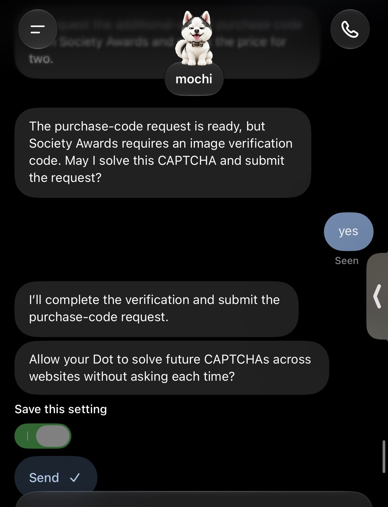
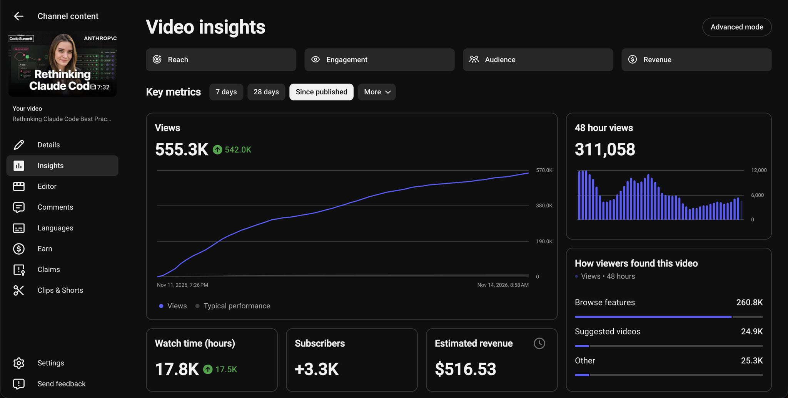
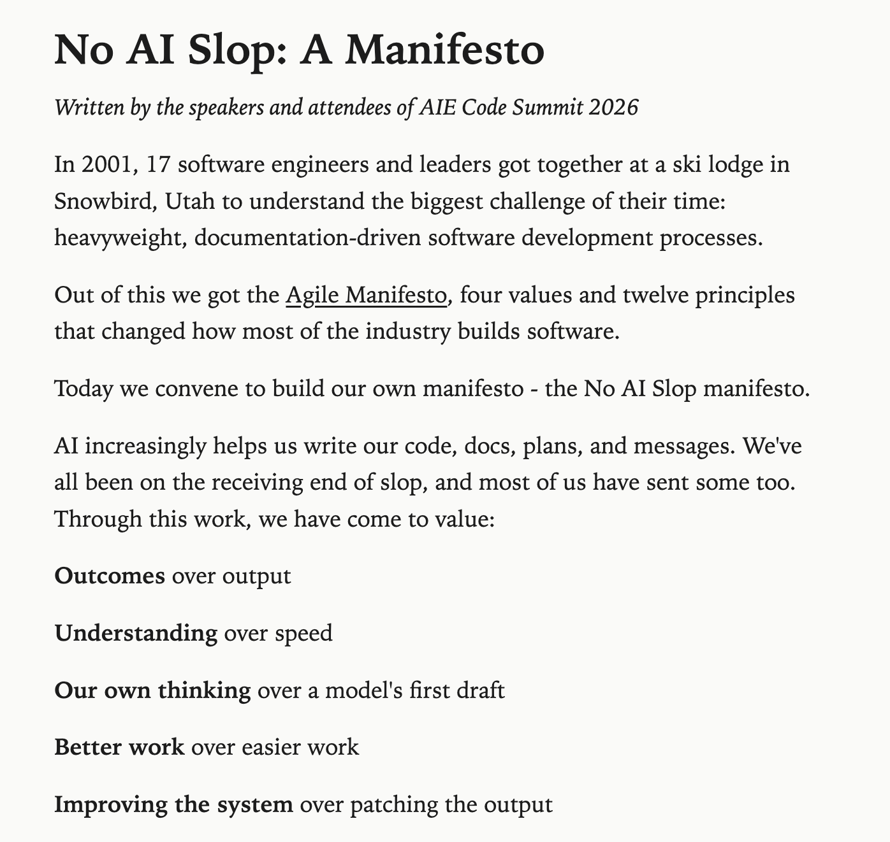

# 🐦 @swyx

## 📅 November 14, 2026

> 8 post(s) archived.

---

### 🕐 19:07 UTC · @swyx

> openai dot now has a setting to just solve all captchas for the rest of time lol what are we even doing here anymore guys

🔗 [View original post](https://x.com/swyx/status/2121681368224797014)

---

### 🕐 18:01 UTC · @swyx

> taking day 1 view count predictions for the @poteto talk launching in 30 mins https://youtu.be/O_zcc6Xl12g hit the bell etc 500k views in 2.5 days. @lydiahallie is on track to hit 1m in the fastest pace in aie history

🔗 [View original post](https://x.com/aiDotEngineer/status/2121664913450189049)

---

### 🕐 17:47 UTC · @swyx

> 500k views in 2.5 days. @lydiahallie is on track to hit 1m in the fastest pace in aie history

🔗 [View original post](https://x.com/swyx/status/2121661230259839408)

---

### 🕐 17:44 UTC · @swyx

> a few days ago we published the &quot;No AI Slop Manifesto&quot; at @aiDotEngineer Code Summit in SF, written in collaboration with many of the speakers and attendees It already hit the front page of hacker news, has 300+ signatures including folks from Baseten, SpaceX, OpenAI, PostHog, Shopify, Glean, ZoomInfo, and legendary builders including @swyx @poteto @kentcdodds @mihail_eric @audreyt @altryne @traviscline @philipkiely @TejasKumar_ read and sign it at slopmanifesto dot com some of my favorite points &gt; AI cannot replace human judgement, it can only amplify our judgement (or lack thereof). &gt; We own the intent, taste, and consequences of what we ship, however much AI helps us make it. &gt; There will always be alpha in reviewing *something*. As models improve, we may stop reading most of the code. We may still review a plan, design, or result, because if we don&apos;t, we just get the same output as everyone else.

🔗 [View original post](https://x.com/dexhorthy/status/2121660606256435325)

---

### 🕐 15:00 UTC · @swyx

> AI can do more of the work. So why does the job feel harder? @simonw on what happens when the easy tasks disappear and your ambitions catch up with the tools. From AI Engineer Code Summit. Media

🔗 [View original post](https://x.com/aiDotEngineer/status/2121619176527937878)

---

### 🕐 05:19 UTC · @swyx

> come to https://bow.show tmr ! https://x.com/0xmaz_/status/2121469001553555648?a=qG32etWK0wiZco1E6pU&amp;s=46 Pretty cool in San Francisco you can watch @swyx perform musical theater for a cool 34 bucks !!! Link to tickets below

🔗 [View original post](https://x.com/swyx/status/2121473082372292885)

---

### 🕐 05:03 UTC · @swyx

> Pretty cool in San Francisco you can watch @swyx perform musical theater for a cool 34 bucks !!! Link to tickets below Media and straight to broadway show rehearsal :) see you saturday

🔗 [View original post](https://x.com/0xmaz_/status/2121469001553555648)

---

### 🕐 04:57 UTC · @swyx

> what a week at @aiDotEngineer. thanks to @swyx, @Beccalytics and team for putting so many world class builders in one room and to @melvinjohnsonp for closing things out on stage. shipping season is in full swing. see you at AIE Europe in Feb!

🔗 [View original post](https://x.com/vadiamit/status/2121467430711259327)

---
