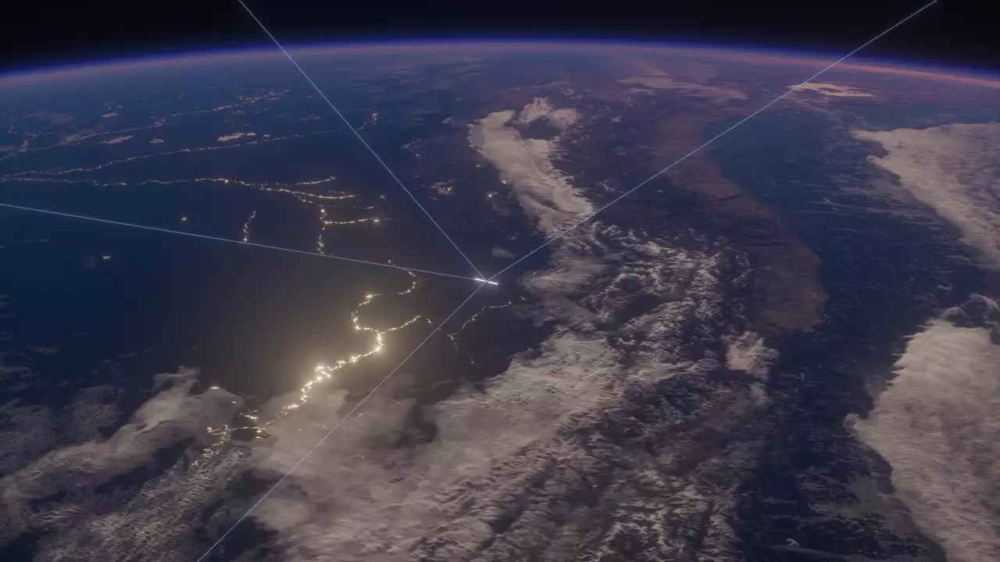
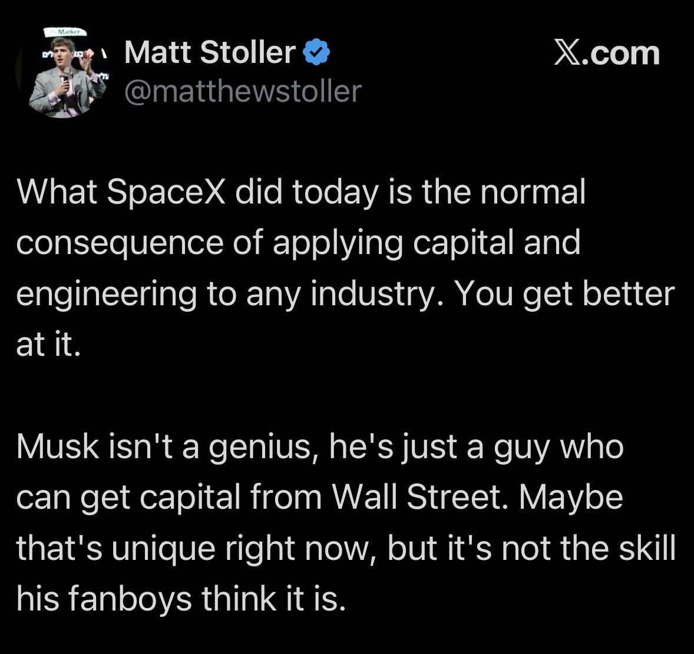
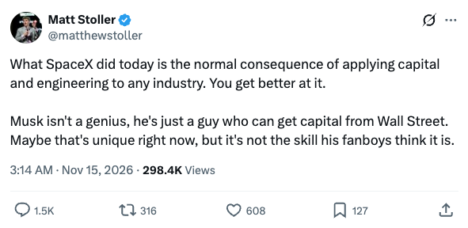
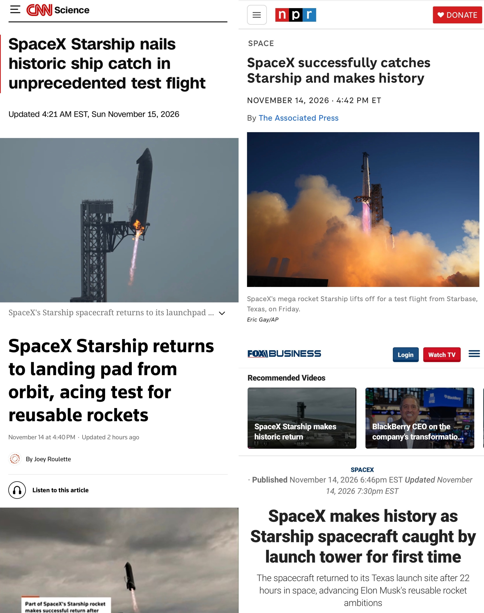
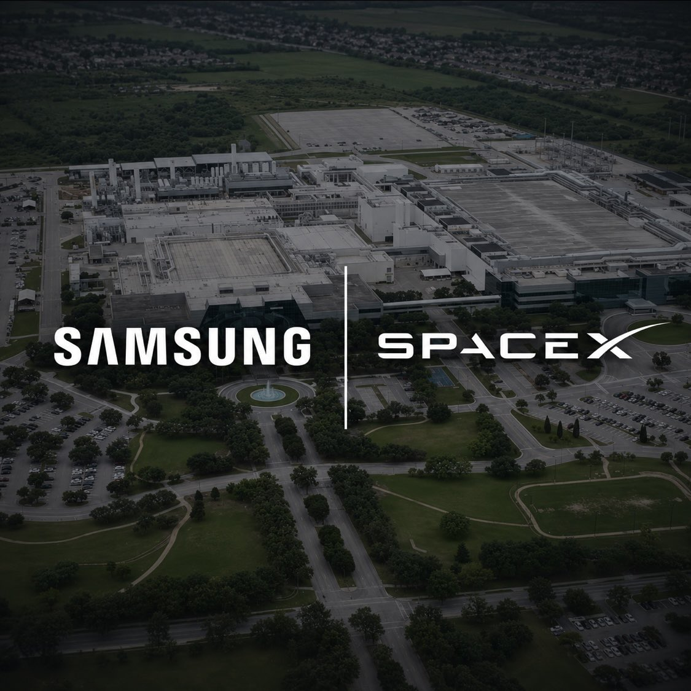
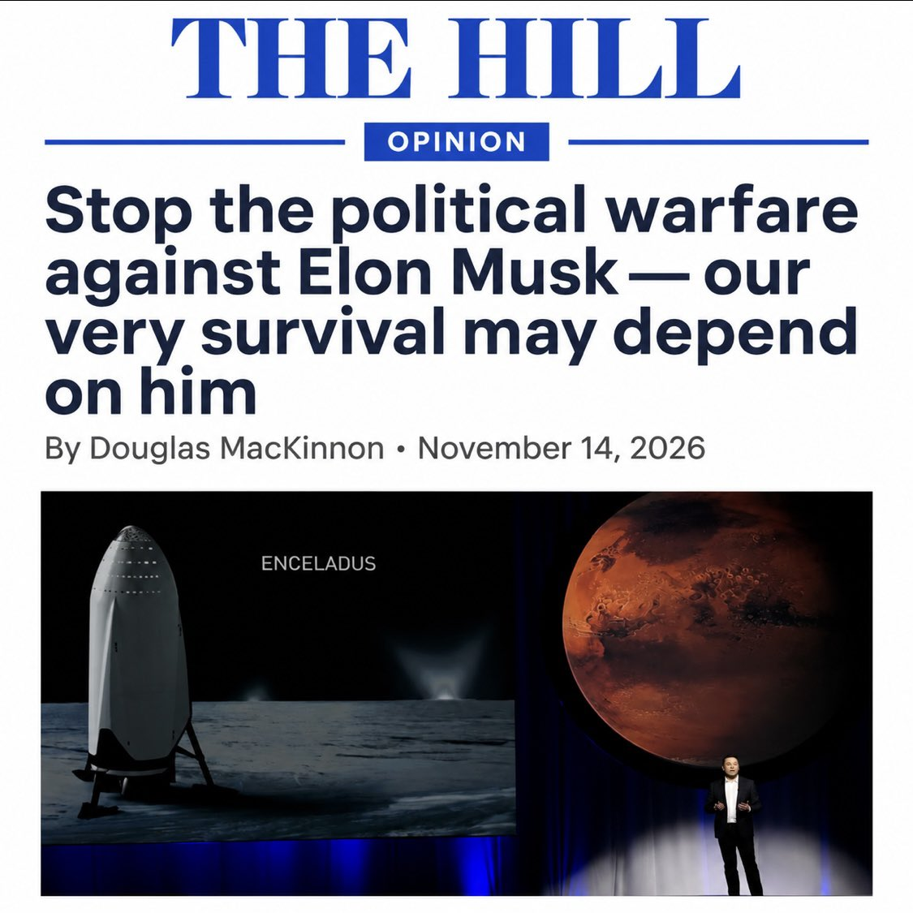
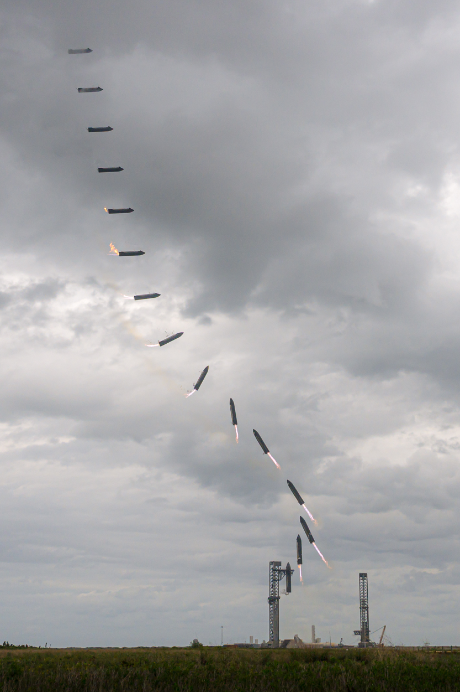
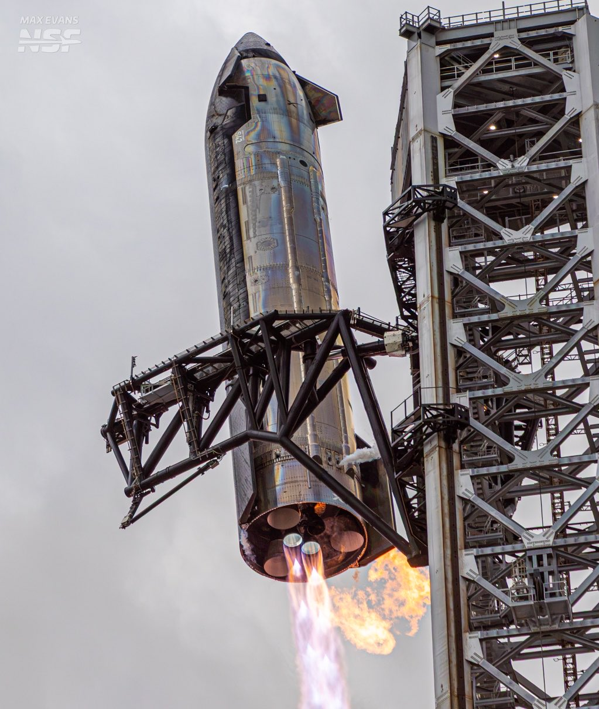
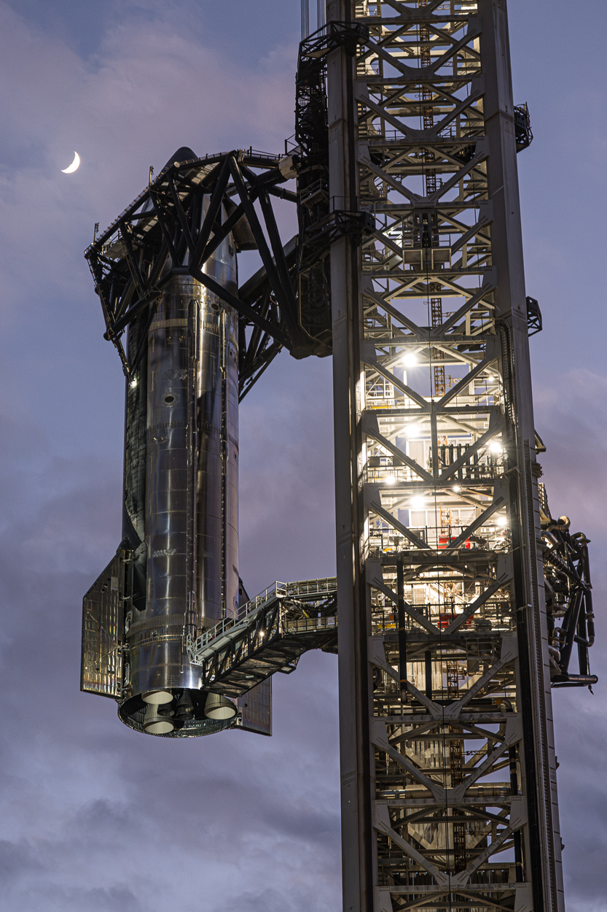

# 🐦 @elonmusk

## 📅 November 15, 2026

> 39 post(s) archived.

---

### 🕐 23:55 UTC · @elonmusk

> Samsung will invest $1.9 billion to expand its chip plant in Austin, Texas, to produce semiconductors for @SpaceX&apos;s Starlink satellites. The factory is expected to produce STM32V8 chips used in Starlink&apos;s laser communication systems, shifting production currently based in France to the U.S. The chips use an advanced 18nm FD-SOI process designed for high performance, low power consumption, and durability in harsh space environments. Production is targeted to begin by 2030, according to the Seoul Economic Daily.

🔗 [View original post](https://x.com/SawyerMerritt/status/2122116284628320705)

---

### 🕐 23:47 UTC · @elonmusk

> Let’s take this gentleman’s argument at face value that anyone can throw money at rockets and get something like Starship, Falcon or Dragon. Perhaps he can explain to everyone how SpaceX is able to catch giant starships from orbit with chopsticks and deliver 85% of all Earth payload to orbit with Falcon, while Blue Origin, which started before SpaceX and was funded by the immensely wealthy Jeff Bezos, is not yet able to launch reliably? Also, why is it that Boeing and Lockheed received several times what SpaceX did from the government for development of their rockets and spacecraft, but the Boeing capsule is still not operational and ULA delivers less than 5% of SpaceX payload to orbit? I am genuinely curious about these questions.

🔗 [View original post](https://x.com/elonmusk/status/2122114284779925897)

---

### 🕐 23:27 UTC · @elonmusk

> Starlink saves lives BREAKING: Greece’s government is using Starlink to support a railway safety system that warns of potential train collisions. Starlink sends live train data to the control center, including through mountainous areas without mobile coverage. • Monitoring equipment installed on 134…

🔗 [View original post](https://x.com/elonmusk/status/2122109219855806886)

---

### 🕐 23:17 UTC · @elonmusk

> No other 1:1 can top this. 😆 Elon Musk is currently inspecting heat shield tiles on Starship

🔗 [View original post](https://x.com/yunta_tsai/status/2122106864049717637)

---

### 🕐 23:09 UTC · @elonmusk

> Jeff Bezos applied capital and engineering to the same industry with Blue Origin, starting in 2000, 2 years before Elon founded SpaceX. He was wealthier for most of that time, with better access to Wall Street. The industry incumbents were around much longer than both, applying capital and engineering to the space industry. Elon’s results with SpaceX are far above normal. He raised most of his capital from Silicon Valley, not Wall Street. Criticizing Elon is not the skill his haters think it is.

🔗 [View original post](https://x.com/WR4NYGov/status/2122104610643222844)

---

### 🕐 22:55 UTC · @elonmusk

> BREAKING: Dominican Republic Government advances plans to expand Starlink connectivity and explores Grok for education. 🇩🇴 President Luis Abinader met with SpaceX executives and the Instituto Tecnológico de las Américas (ITLA) to discuss the initiatives: • More than 50,000 Starlink antennas are already installed across the country. • Starlink is already benefiting 1,608 students at ITLA’s Pedernales and Cotuí campuses. • Further expansion would bring internet to communities and schools where traditional services are limited or unavailable. • Grok Tutor is being considered for personalized learning support, helping students develop reasoning and critical thinking with teacher supervision. • Its potential integration would support RD Inteligente, a Government program aiming to train one million Dominicans in AI.

🔗 [View original post](https://x.com/cb_doge/status/2122101122072793431)

---

### 🕐 22:22 UTC · @elonmusk

> Starlink is a gamechanger Starlink is now pulling travelers away from competing airlines United Airlines CEO Scott Kirby: “We already see customers moving from other airlines today” The numbers: • Starlink is now available on more than 50% of United&apos;s daily flights • Over 700 aircraft equipped with Starl…

🔗 [View original post](https://x.com/elonmusk/status/2122092920434274773)

---

### 🕐 22:21 UTC · @elonmusk

> 🍌 4 scale S-tier Engineering S-tier Humor 🍌 Love this company.

🔗 [View original post](https://x.com/elonmusk/status/2122092646294581460)

---

### 🕐 22:20 UTC · @elonmusk

> Yeah, I was going over the whole Starship heat shield earlier today. Overall, it looks great. The engines look great too. Ship 42 could probably be reflown with a few weeks of refurbishment. However, many small fixes are needed to achieve immediate reusability (like an airplane), which requires zero expected refurbishment, apart from scheduled maintenance. Elon is up at the pad inspecting the ship. Road is closed and we&apos;re expecting a rollout soon!

🔗 [View original post](https://x.com/elonmusk/status/2122092374016806969)

---

### 🕐 21:55 UTC · @elonmusk

> Media

🔗 [View original post](https://x.com/johnkrausphotos/status/2122086227709202668)

---

### 🕐 20:46 UTC · @elonmusk

> Ship, in the future, will almost always be taken to mean spaceship For all but a vanishingly brief instant near the dawn of history, the word ‘ship’ will mean ‘spaceship.’ - Arthur C. Clarke

🔗 [View original post](https://x.com/elonmusk/status/2122068777189716003)

---

### 🕐 20:20 UTC · @elonmusk

> Elon Musk is currently inspecting heat shield tiles on Starship Media Media

🔗 [View original post](https://x.com/MinaGawargious/status/2122062161119994234)

---

### 🕐 19:35 UTC · @elonmusk

> Joe Rogan praises Tesla FSD, saying his car drives him home at the press of a button. “I leave the club. I press a button. It just drives me home. I don’t have to think at all. If Tesla licensed that, the whole electric car world would explode because it’s so good.” Media

🔗 [View original post](https://x.com/cb_doge/status/2122050855499366681)

---

### 🕐 19:05 UTC · @elonmusk

> Starlink BREAKING: Honduras’ government has installed 1,860 @Starlink antennas across 218 municipalities, prioritizing rural schools. 🇭🇳 Starlink is bringing internet from space to remote classrooms, helping more children access a world of knowledge.

🔗 [View original post](https://x.com/elonmusk/status/2122043427776819503)

---

### 🕐 18:58 UTC · @elonmusk

> Starlink BREAKING: Lufthansa just announced its first @Starlink-equipped A350-1000 will fly from Munich to Tokyo on December 3. Lufthansa Group plans to equip its entire fleet of around 850 aircraft with Starlink by 2029.

🔗 [View original post](https://x.com/elonmusk/status/2122041658426765334)

---

### 🕐 18:56 UTC · @elonmusk

> IMO Grok is currently, the best tool for understanding what’s happening in the world. Is Jensen being railroaded? https://grok.com/share/bGVnYWN5LWNvcHk_d59713f5-c4b0-4032-a59d-bd3e722ec3ff

🔗 [View original post](https://x.com/jamesdouma/status/2122041125171298662)

---

### 🕐 18:26 UTC · @elonmusk

> You work your ass off solving really hard problems day after day for decades, and this is what you get: anyone could have done it. As an investor, I can tell you the limiting factor isn&apos;t investment. It&apos;s founder ability.

🔗 [View original post](https://x.com/paulg/status/2122033524857589799)

---

### 🕐 15:53 UTC · @elonmusk

> Legacy media headlines after @SpaceX caught Starship: • CNN: &quot;SpaceX Starship nails historic ship catch in unprecedented test flight&quot; • Reuters: &quot;SpaceX Starship returns to landing pad from orbit, acing test for reusable rockets&quot; • Fox: &quot;SpaceX makes history as Starship spacecraft caught by launch tower for first time&quot; • CNBC: &quot;SpaceX catches upper stage of Starship rocket in historic first&quot; • NYT: &quot;SpaceX makes history with successful rocket catch in Texas&quot; • BBC: &quot;&apos;Can you believe it?&apos;: SpaceX catches part of its Starship rocket on return to Earth&quot; • NPR: &quot;SpaceX makes history with Starship catch&quot; • Sky News: &quot;SpaceX makes unprecedented &apos;catch&apos; of Starship&quot;

🔗 [View original post](https://x.com/SawyerMerritt/status/2121995093204701439)

---

### 🕐 15:00 UTC · @elonmusk

> BREAKING: Samsung reportedly plans to make chips for SpaceX’s Starlink satellites in Austin, Texas. Samsung is investing $1.9 billion to expand its Austin chip factory, with the planned operations targeted to begin by 2030, according to Seoul Economic Daily. The chip, called STM32V8, is already used in Starlink’s mini laser system. SpaceX’s Starlink engineering team has praised the chip’s performance. The chips are currently manufactured in France. The reported Texas plan would add American production capacity for a key component behind Starlink’s satellite communications.

🔗 [View original post](https://x.com/cb_doge/status/2121981656882122993)

---

### 🕐 13:37 UTC · @elonmusk

> This is spectacular— looks like science fiction, but it’s real! @elonmusk — I need to see this live one of these days! Mechazilla catches Starship! Congratulations to the entire SpaceX team on this incredible achievement!

🔗 [View original post](https://x.com/DavidSolomon/status/2121960724943823205)

---

### 🕐 12:07 UTC · @elonmusk

> BREAKING: Former White House and Pentagon official Douglas MacKinnon calls for an end to political attacks on Elon Musk, saying “our very survival may depend on him.” • Humanity’s future is vulnerable as long as we live on only one planet. War, an asteroid strike or another major disaster could threaten civilization. • Elon’s mission is to help humans live on other planets, giving future generations a better chance of surviving if disaster strikes Earth. • His work toward a permanent human presence in space could become one of his most important contributions to humanity. • People can disagree with his politics and still recognize the value of what he is trying to achieve. • MacKinnon argues that Elon deserves the time and freedom to focus on this mission. Elon is working toward a future where humanity can live beyond Earth and explore the stars. His determination to make that possible deserves recognition and support.

🔗 [View original post](https://x.com/cb_doge/status/2121938086292770850)

---

### 🕐 07:59 UTC · @elonmusk

> 5 years ago Elon posted this in 2021. Now a Starship has returned from orbit straight into giant robot chopsticks. What a time to be alive.

🔗 [View original post](https://x.com/elonmusk/status/2121875758704370144)

---

### 🕐 07:59 UTC · @elonmusk

> This gives a clear sense of the catch maneuver Ship 42 returns to Starbase, Texas for the first-ever Starship tower catch during Flight 15! I have dreamt of creating this image for years... and today it became real. Congrats, SpaceX team!

🔗 [View original post](https://x.com/elonmusk/status/2121875600906592260)

---

### 🕐 07:56 UTC · @elonmusk

> Great day One of the coolest things I&apos;ve ever seen!! Loved the thunderclap as the starship dropped out of the heavens, before the catch. True alien tech. Huge congrats @elonmusk and the @SpaceX team! the whole stack is now proven out. Ad Astra! 🚀

🔗 [View original post](https://x.com/elonmusk/status/2121875056817328621)

---

### 🕐 04:23 UTC · @elonmusk

> In my opinion... we have achieved AGI. Without a shadow of a doubt. The combination of Grok Bot + Opus/Fable + Argon is a do-anything digital stack. Whatever Fable/Opus suck at, Argon is an incredible filler. And vice-versa. Grok Bot orchestrates them all. Overpowered.

🔗 [View original post](https://x.com/farzyness/status/2121821420137423101)

---

### 🕐 04:06 UTC · @elonmusk

> Starship Flight 15 mission in one timelapse Launched from the tower → around Earth 14 times → caught by the tower Media

🔗 [View original post](https://x.com/XFreeze/status/2121817193579163893)

---

### 🕐 03:08 UTC · @elonmusk

> Will the future that you want Choose your path Western man.

🔗 [View original post](https://x.com/elonmusk/status/2121802527524164015)

---

### 🕐 01:54 UTC · @elonmusk

> MADE ON EARTH BY HUMANS Media Best remix / AI slop / music video / inspo / whatever o the StarShip landing gets $420.69 in XMONEY!

🔗 [View original post](https://x.com/anabology/status/2121783840695787904)

---

### 🕐 01:30 UTC · @elonmusk

> If you have kids, I highly recommend taking them to a launch. You can watch from the Margaritaville, the town beach or many other viewing locations open to the public. Sad to miss this one, great day for 🇺🇸

🔗 [View original post](https://x.com/GavinSBaker/status/2121777788797718785)

---

### 🕐 01:14 UTC · @elonmusk

> Everything has changed.

🔗 [View original post](https://x.com/AJamesMcCarthy/status/2121773877395181778)

---

### 🕐 01:12 UTC · @elonmusk

> Ship 42 returns to Starbase, Texas for the first-ever Starship tower catch during Flight 15! I have dreamt of creating this image for years... and today it became real. Congrats, SpaceX team!

🔗 [View original post](https://x.com/johnkrausphotos/status/2121773282919649324)

---

### 🕐 01:02 UTC · @elonmusk

> Try Grok @Bot holy f*ck... Elon Musk&apos;s team just made airport rebooking lines useless my flight got cancelled and 187 people were ahead of me at the desk. my Grok Bot rebooked me before the line moved 17 people Grok Bot makes phone calls now. it sits on hold, talks to the agent and says up fr…

🔗 [View original post](https://x.com/elonmusk/status/2121770874885845044)

---

### 🕐 00:58 UTC · @elonmusk

> Choose your path Western man.

🔗 [View original post](https://x.com/Geiger_Capital/status/2121769886770778182)

---

### 🕐 00:44 UTC · @elonmusk

> Dazzled. https://arstechnica.com/space/2026/11/with-starship-catch-spacex-still-shows-it-can-dazzle-the-world/

🔗 [View original post](https://x.com/SciGuySpace/status/2121766186492805263)

---

### 🕐 00:36 UTC · @elonmusk

> Thanks Congratulations to SpaceX for making history with an amazing feat of engineering!

🔗 [View original post](https://x.com/elonmusk/status/2121764319792677119)

---

### 🕐 00:35 UTC · @elonmusk

> I hugged ship 42 upon its return

🔗 [View original post](https://x.com/elonmusk/status/2121763977349013884)

---

### 🕐 00:25 UTC · @elonmusk

🔗 [View original post](https://x.com/johnkrausphotos/status/2121761584804503927)

---

### 🕐 00:17 UTC · @elonmusk

> The epic day has arrived, thanks to the incredibly talented team at SpaceX! This is actually a bigger deal for humanity than most people can imagine. I will always remember the looks on the engineers’ faces in the Starbase conference room in December 2020 when @elonmusk suggested, then insisted, that the Mechazilla launchpad arms could catch a returning…

🔗 [View original post](https://x.com/elonmusk/status/2121759522851115109)

---

### 🕐 00:15 UTC · @elonmusk

> Three booster catches and a ship SpaceX keeps making history. • Oct 13, 2024: First booster catch • Jan 16, 2025: Second booster catch • Mar 6, 2025: Third booster catch • Nov 14, 2026: First Starship catch

🔗 [View original post](https://x.com/elonmusk/status/2121759042582589821)

---
