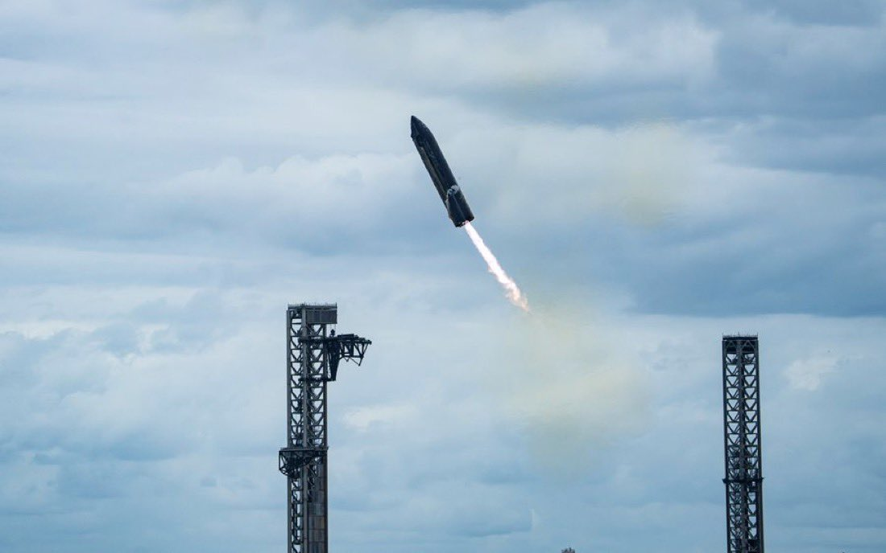
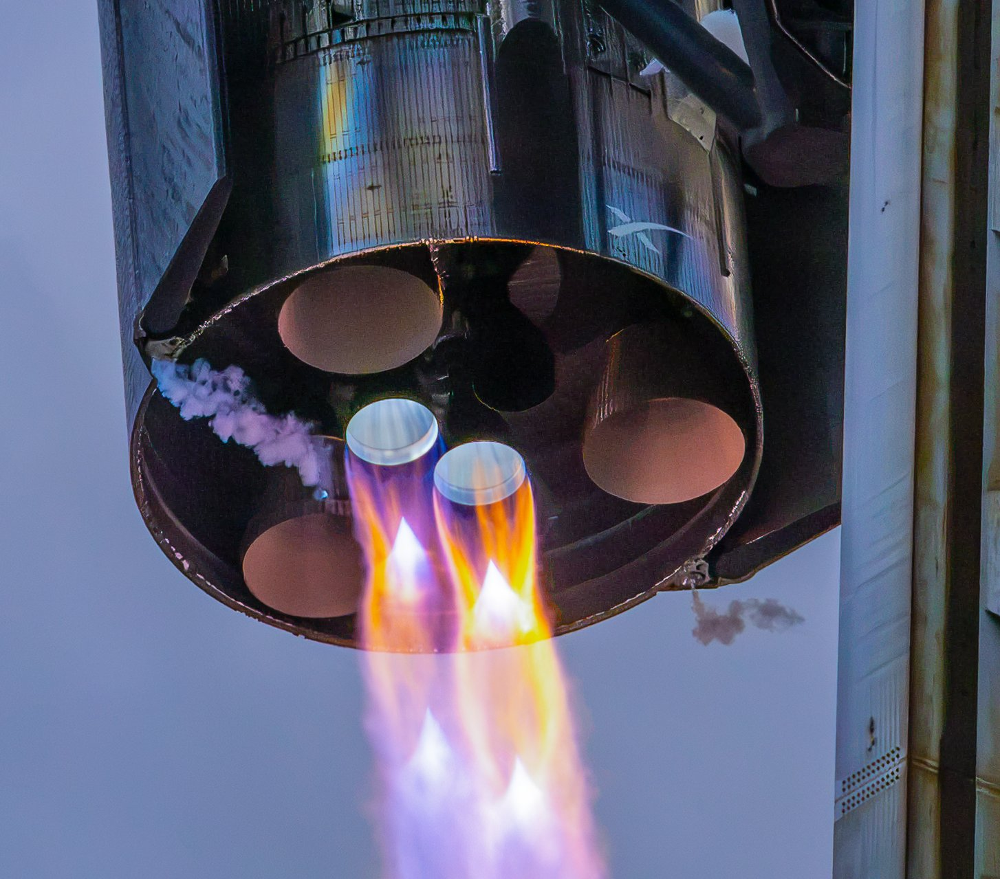
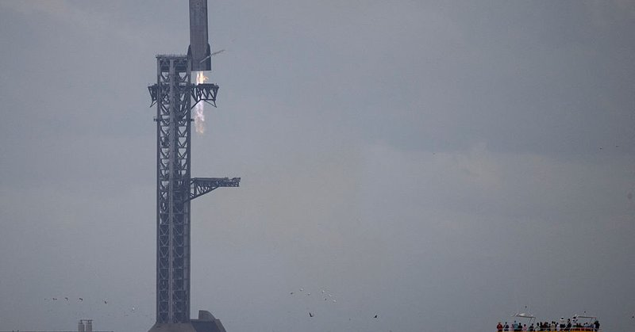

# 🐦 @elonmusk

## 📅 November 15, 2026

> 18 post(s) archived.

---

### 🕐 07:59 UTC · @elonmusk

> 5 years ago Elon posted this in 2021. Now a Starship has returned from orbit straight into giant robot chopsticks. What a time to be alive.

🔗 [View original post](https://x.com/elonmusk/status/2121875758704370144)

---

### 🕐 07:59 UTC · @elonmusk

> This gives a clear sense of the catch maneuver Ship 42 returns to Starbase, Texas for the first-ever Starship tower catch during Flight 15! I have dreamt of creating this image for years... and today it became real. Congrats, SpaceX team!

🔗 [View original post](https://x.com/elonmusk/status/2121875600906592260)

---

### 🕐 07:56 UTC · @elonmusk

> Great day One of the coolest things I&apos;ve ever seen!! Loved the thunderclap as the starship dropped out of the heavens, before the catch. True alien tech. Huge congrats @elonmusk and the @SpaceX team! the whole stack is now proven out. Ad Astra! 🚀

🔗 [View original post](https://x.com/elonmusk/status/2121875056817328621)

---

### 🕐 04:23 UTC · @elonmusk

> In my opinion... we have achieved AGI. Without a shadow of a doubt. The combination of Grok Bot + Opus/Fable + Argon is a do-anything digital stack. Whatever Fable/Opus suck at, Argon is an incredible filler. And vice-versa. Grok Bot orchestrates them all. Overpowered.

🔗 [View original post](https://x.com/farzyness/status/2121821420137423101)

---

### 🕐 04:06 UTC · @elonmusk

> Starship Flight 15 mission in one timelapse Launched from the tower → around Earth 14 times → caught by the tower Media

🔗 [View original post](https://x.com/XFreeze/status/2121817193579163893)

---

### 🕐 03:08 UTC · @elonmusk

> Will the future that you want Choose your path Western man.

🔗 [View original post](https://x.com/elonmusk/status/2121802527524164015)

---

### 🕐 01:54 UTC · @elonmusk

> MADE ON EARTH BY HUMANS Media Best remix / AI slop / music video / inspo / whatever o the StarShip landing gets $420.69 in XMONEY!

🔗 [View original post](https://x.com/anabology/status/2121783840695787904)

---

### 🕐 01:30 UTC · @elonmusk

> If you have kids, I highly recommend taking them to a launch. You can watch from the Margaritaville, the town beach or many other viewing locations open to the public. Sad to miss this one, great day for 🇺🇸

🔗 [View original post](https://x.com/GavinSBaker/status/2121777788797718785)

---

### 🕐 01:14 UTC · @elonmusk

> Everything has changed.

🔗 [View original post](https://x.com/AJamesMcCarthy/status/2121773877395181778)

---

### 🕐 01:12 UTC · @elonmusk

> Ship 42 returns to Starbase, Texas for the first-ever Starship tower catch during Flight 15! I have dreamt of creating this image for years... and today it became real. Congrats, SpaceX team!

🔗 [View original post](https://x.com/johnkrausphotos/status/2121773282919649324)

---

### 🕐 01:02 UTC · @elonmusk

> Try Grok @Bot holy f*ck... Elon Musk&apos;s team just made airport rebooking lines useless my flight got cancelled and 187 people were ahead of me at the desk. my Grok Bot rebooked me before the line moved 17 people Grok Bot makes phone calls now. it sits on hold, talks to the agent and says up fr…

🔗 [View original post](https://x.com/elonmusk/status/2121770874885845044)

---

### 🕐 00:58 UTC · @elonmusk

> Choose your path Western man.

🔗 [View original post](https://x.com/Geiger_Capital/status/2121769886770778182)

---

### 🕐 00:44 UTC · @elonmusk

> Dazzled. https://arstechnica.com/space/2026/11/with-starship-catch-spacex-still-shows-it-can-dazzle-the-world/

🔗 [View original post](https://x.com/SciGuySpace/status/2121766186492805263)

---

### 🕐 00:36 UTC · @elonmusk

> Thanks Congratulations to SpaceX for making history with an amazing feat of engineering!

🔗 [View original post](https://x.com/elonmusk/status/2121764319792677119)

---

### 🕐 00:35 UTC · @elonmusk

> I hugged ship 42 upon its return

🔗 [View original post](https://x.com/elonmusk/status/2121763977349013884)

---

### 🕐 00:25 UTC · @elonmusk

🔗 [View original post](https://x.com/johnkrausphotos/status/2121761584804503927)

---

### 🕐 00:17 UTC · @elonmusk

> The epic day has arrived, thanks to the incredibly talented team at SpaceX! This is actually a bigger deal for humanity than most people can imagine. I will always remember the looks on the engineers’ faces in the Starbase conference room in December 2020 when @elonmusk suggested, then insisted, that the Mechazilla launchpad arms could catch a returning…

🔗 [View original post](https://x.com/elonmusk/status/2121759522851115109)

---

### 🕐 00:15 UTC · @elonmusk

> Three booster catches and a ship SpaceX keeps making history. • Oct 13, 2024: First booster catch • Jan 16, 2025: Second booster catch • Mar 6, 2025: Third booster catch • Nov 14, 2026: First Starship catch

🔗 [View original post](https://x.com/elonmusk/status/2121759042582589821)

---
