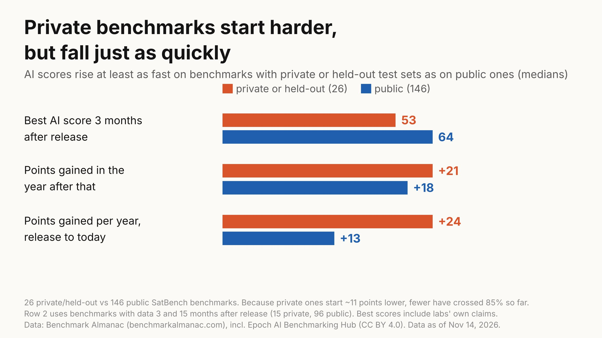

# 🐦 @emollick

## 📅 November 15, 2026

> 2 post(s) archived.

---

### 🕐 04:27 UTC · @emollick

> As a side note, a couple years ago, making this benchmark &amp; analysis would’ve taken a considerable amount of time in STATA, likely several days, and making it look this nice would have been quite a while as well. This was like 4 prompts to Fable 5.2 AI is getting better faster than our measurements are I threw together SatBench, which measures how quickly major AI benchmarks become saturated (effectively beaten). Of 173 benchmarks cited by the Labs since 2023, 63% are now saturated. Saturation is happening faster each year.

🔗 [View original post](https://x.com/emollick/status/2121822367575945454)

---

### 🕐 00:07 UTC · @emollick

> Private benchmarks start harder, but fall just as fast.

🔗 [View original post](https://x.com/emollick/status/2121756860072296848)

---
