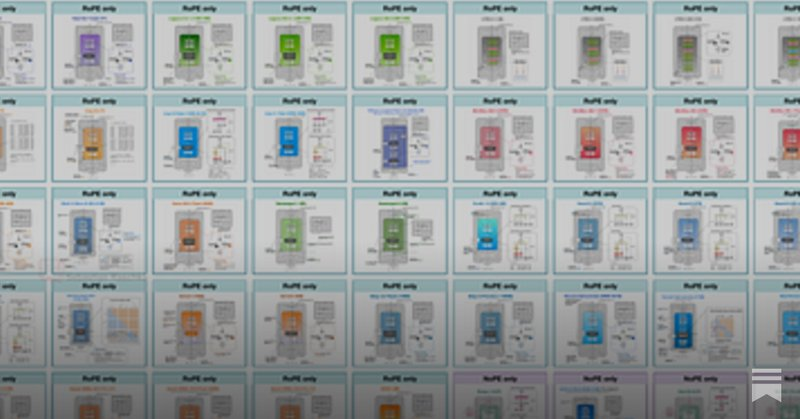
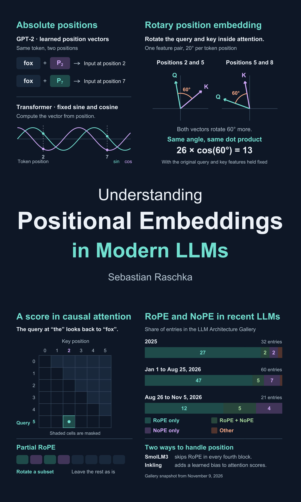

# 🐦 @rasbt

## 📅 November 15, 2026

> 2 post(s) archived.

---

### 🕐 13:29 UTC · @rasbt

> And here&apos;s the link to the full article: https://magazine.sebastianraschka.com/p/understanding-positional-embeddings

🔗 [View original post](https://x.com/rasbt/status/2121958669432631769)

---

### 🕐 13:29 UTC · @rasbt

> (Finally) wrote up &quot;Understanding Positional Embeddings in Modern LLMs.&quot; A RoPE from-scratch tutorial missing from my LLM building blocks collection + what recent architectures do (NoPE, partial RoPE, hybrids). Prob not the flashiest topic, but essential for understanding LLMs

🔗 [View original post](https://x.com/rasbt/status/2121958665989083253)

---
