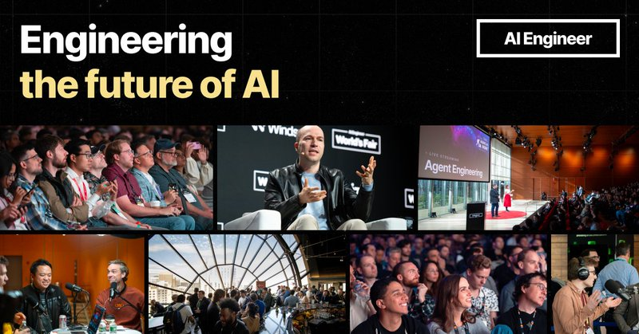
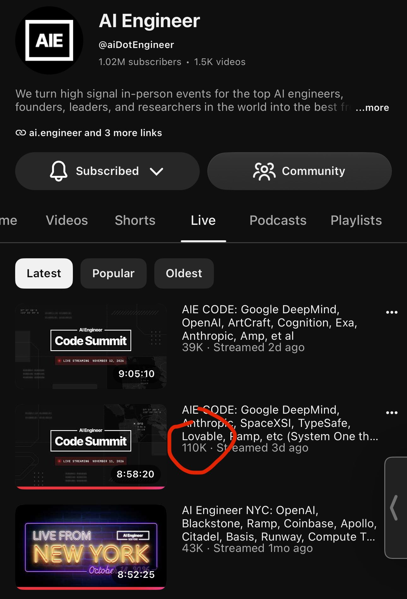
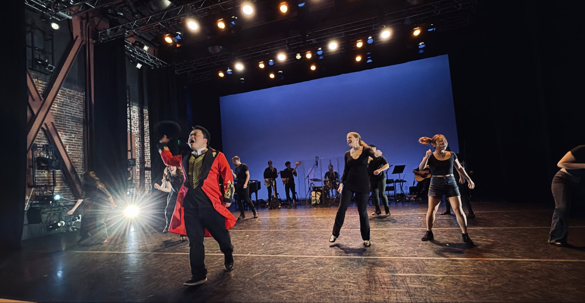

# 🐦 @swyx

## 📅 November 15, 2026

> 8 post(s) archived.

---

### 🕐 20:35 UTC · @swyx

> apparently it is pretty normal https://x.com/gergelyorosz/status/2121764764737290472?a=2eV01xOcTli4r-G_eN4&amp;s=46 The Economist is the one I only publication I told to NEVER use any material from me ever again. They redrew and renamed my Trimodal compensation diagram, did not link to my work… not even after I called them out Not much original journalism left there https://x.com/gergelyorosz…

🔗 [View original post](https://x.com/swyx/status/2122066060769952161)

---

### 🕐 18:21 UTC · @swyx

> clanker wrote up the talk https://ai.engineer/code/2026/talks/lydia-hallie

🔗 [View original post](https://x.com/swyx/status/2122032217430032548)

---

### 🕐 18:18 UTC · @swyx

> clanker wrote up a short recap of the talk https://ai.engineer/code/2026/talks/lauren-tan

🔗 [View original post](https://x.com/swyx/status/2122031563961684032)

---

### 🕐 15:00 UTC · @swyx

> 11,000 pull requests in one month. A revert rate around 0.5%. @poteto on the Grok Bot team&apos;s shipping pace at @SpaceXSI. More contributors, daily stable releases, and an app that got faster. From AI Engineer Code Summit. Media

🔗 [View original post](https://x.com/aiDotEngineer/status/2121981562824564960)

---

### 🕐 09:22 UTC · @swyx

> also the day 1 livestream has crossed 100k in the fastest time ever. covering coding agent practices and landscape continues to be the strongest format we do and by far my strongest product-market-fit focus thing I have ever done. taking day 1 view count predictions for the @poteto talk launching in 30 mins https://youtu.be/O_zcc6Xl12g hit the bell etc

🔗 [View original post](https://x.com/swyx/status/2121896675048587765)

---

### 🕐 07:15 UTC · @swyx

> Attended an amazing broadway musical tonight, don’t sleep on @swyx outside the AI world dude is incredibly talented and full of surprises

🔗 [View original post](https://x.com/TheAhmadOsman/status/2121864756088930412)

---

### 🕐 03:59 UTC · @swyx

> holy shit u guys like a lot of poteto my AIE talk is up! come hear how the grok @bot team ships so quickly without compromise on quality https://youtu.be/O_zcc6Xl12g

🔗 [View original post](https://x.com/swyx/status/2121815348370612414)

---

### 🕐 00:10 UTC · @swyx

> obviously correct, we are so suboptimal in AI UX rn it is crazy esp given existence of models too cheap to meter AI interfaces nowadays are still pretty much turn-based. In my PhD thesis, I thought about what interaction would look like if we could go beyond taking turns. One example is intra-turn interaction:

🔗 [View original post](https://x.com/swyx/status/2121757606801023085)

---
