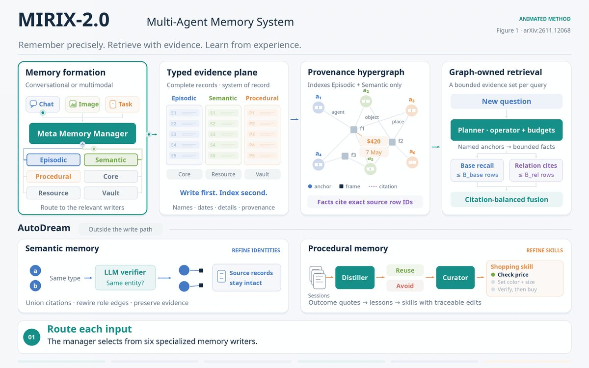
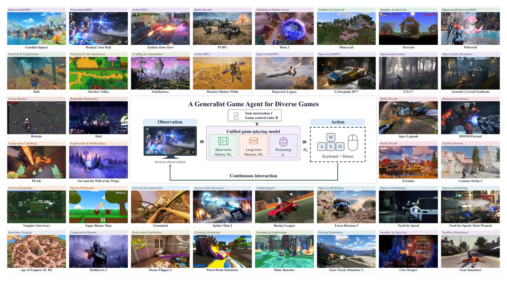

# 🐦 @_akhaliq

## 📅 November 16, 2026

> 9 post(s) archived.

---

### 🕐 21:37 UTC · @_akhaliq

> Restoring Diversity in Distilled Image and Video Generators by Probing Activations paper: https://huggingface.co/papers/2611.18550 Media

🔗 [View original post](https://x.com/_akhaliq/status/2122444024363852252)

---

### 🕐 20:07 UTC · @_akhaliq

> MIRIX-2.0 A practical multi-agent memory system for LLM agents that combines factual and procedural memory. Reaches 91.4% on LoCoMo and 72.6% on LongMemEval-S, leading the strongest baseline by 14.3 points.

🔗 [View original post](https://x.com/HuggingPapers/status/2122421433431105988)

---

### 🕐 20:02 UTC · @_akhaliq

> Nasiko - Open Runtime platform for managing AI agents. See every agent. Cut token spend by up to 50%. Route to the right model with the agent gateway. Govern tool access. Set permissions and budgets per agent, per team. One command. Same workflow. Open Runtime for agents starts now. First, every token. Next, every action! Start Free: https://buff.ly/k79CiWW #ai #tokenops #openruntime #agents Media

🔗 [View original post](https://x.com/nasikolabs/status/2122420182815592736)

---

### 🕐 18:18 UTC · @_akhaliq

> We&apos;re teaming up to accelerate open-source Al. OpenRouter is now integrated into Hugging Face directly. Same token, same endpoint, plus live model stats on the Hub and an inference widget we redesigned together. The best of open, in one place. https://huggingface.co/blog/openrouter

🔗 [View original post](https://x.com/huggingface/status/2122393775314264519)

---

### 🕐 16:14 UTC · @_akhaliq

> eDMD Endpoint Distribution Matching for Few-Step Diffusion Distillation paper: https://huggingface.co/papers/2611.17194

🔗 [View original post](https://x.com/_akhaliq/status/2122362729759662110)

---

### 🕐 15:01 UTC · @_akhaliq

> We raised a $125M Series A at a $1B valuation, 3 months out of stealth. @NEA led. @sequoia, @khoslaventures and @coatuemgmt doubled down. @CormaAI is training foundation models toward superintelligence for defensive cybersecurity. Because the greatest gift cyberattackers have ever received is smarter AI, and right now only one side is armed. Arm the defenders. Media

🔗 [View original post](https://x.com/AlonPluda/status/2122344413951111663)

---

### 🕐 12:15 UTC · @_akhaliq

> VibePrevisBench A benchmark that turns scripts, photos, or videos into executable 4D scenes in Blender, then checks both the scene (rule-based) and the proxy video (VLM-based).

🔗 [View original post](https://x.com/HuggingPapers/status/2122302646539227474)

---

### 🕐 08:27 UTC · @_akhaliq

> MMFlash Faster Speculative Decoding for Vision-Language Models paper: https://huggingface.co/papers/2611.18482 Media

🔗 [View original post](https://x.com/_akhaliq/status/2122245046263308321)

---

### 🕐 08:20 UTC · @_akhaliq

> Gamer: miHoYo&apos;s generalist game agent A vision-language-action foundation model for long-horizon real-time play. It acts like a human—screenshots in, keyboard and mouse out—and completes over 95% of challenges in Honkai: Star Rail.

🔗 [View original post](https://x.com/HuggingPapers/status/2122243466600047037)

---
