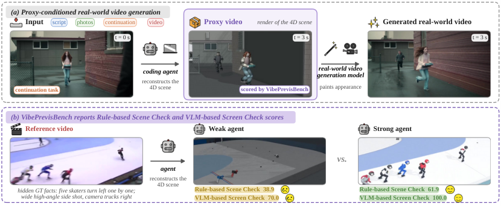

# 🐦 @_akhaliq

## 📅 November 16, 2026

> 5 post(s) archived.

---

### 🕐 16:14 UTC · @_akhaliq

> eDMD Endpoint Distribution Matching for Few-Step Diffusion Distillation paper: https://huggingface.co/papers/2611.17194

🔗 [View original post](https://x.com/_akhaliq/status/2122362729759662110)

---

### 🕐 15:01 UTC · @_akhaliq

> We raised a $125M Series A at a $1B valuation, 3 months out of stealth. @NEA led. @sequoia, @khoslaventures and @coatuemgmt doubled down. @CormaAI is training foundation models toward superintelligence for defensive cybersecurity. Because the greatest gift cyberattackers have ever received is smarter AI, and right now only one side is armed. Arm the defenders. Media

🔗 [View original post](https://x.com/AlonPluda/status/2122344413951111663)

---

### 🕐 12:15 UTC · @_akhaliq

> VibePrevisBench A benchmark that turns scripts, photos, or videos into executable 4D scenes in Blender, then checks both the scene (rule-based) and the proxy video (VLM-based).

🔗 [View original post](https://x.com/HuggingPapers/status/2122302646539227474)

---

### 🕐 08:27 UTC · @_akhaliq

> MMFlash Faster Speculative Decoding for Vision-Language Models paper: https://huggingface.co/papers/2611.18482 Media

🔗 [View original post](https://x.com/_akhaliq/status/2122245046263308321)

---

### 🕐 08:20 UTC · @_akhaliq

> Gamer: miHoYo&apos;s generalist game agent A vision-language-action foundation model for long-horizon real-time play. It acts like a human—screenshots in, keyboard and mouse out—and completes over 95% of challenges in Honkai: Star Rail.

🔗 [View original post](https://x.com/HuggingPapers/status/2122243466600047037)

---
