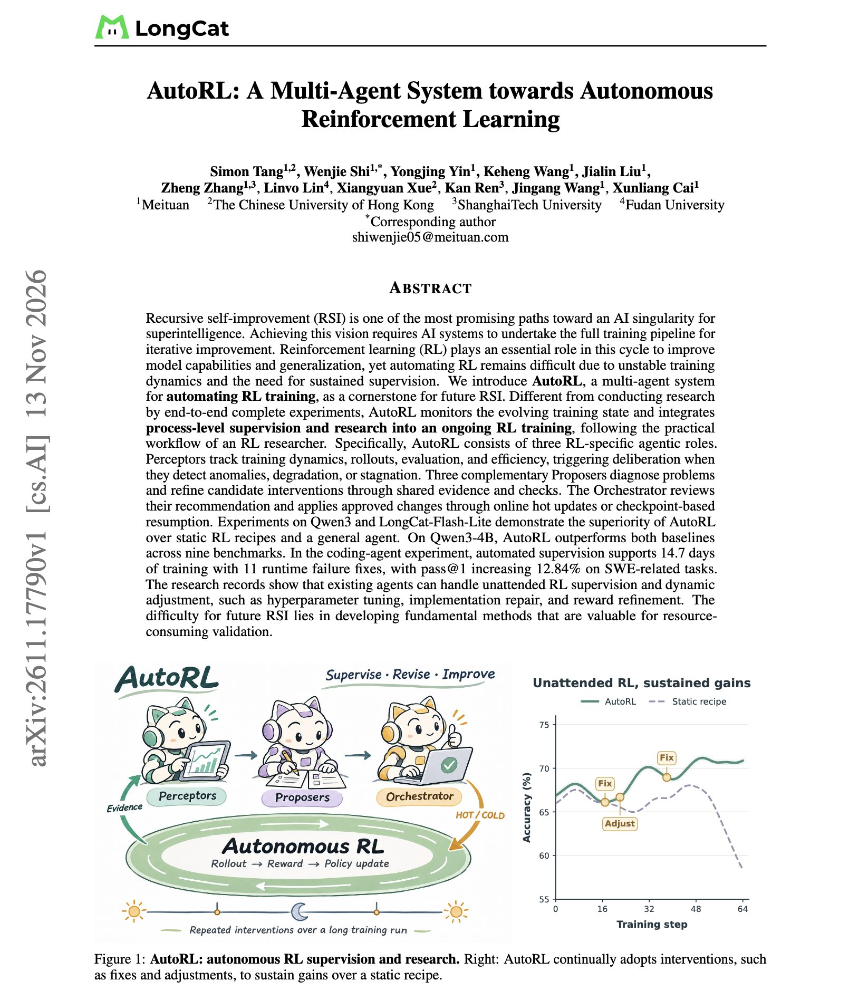
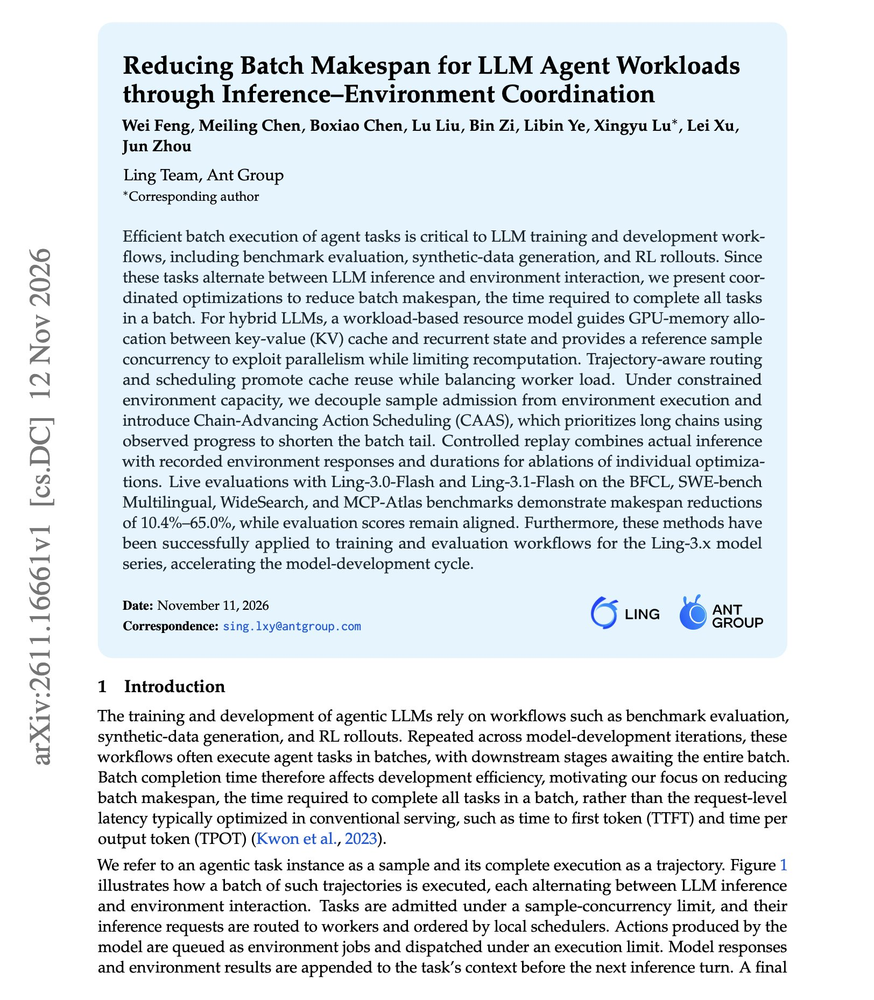

# 🐦 @dair_ai

## 📅 November 16, 2026

> 4 post(s) archived.

---

### 🕐 20:40 UTC · @dair_ai

> Self-improving AI is one of the most discussed ideas right now. This is one of the most exciting papers I&apos;ve read recently on the topic. (bookmark it) It proposes AutoRL, which lifts Qwen3 on AIME 2024 from 46.67% to 66.67% by letting agents supervise a live RL run instead of following a fixed recipe. AutoRL works like an RL researcher on call. Perceptor agents watch training curves, rollouts, and evaluations and flag problems. Three Proposer agents diagnose the issue and suggest changes. An Orchestrator approves them and applies them with a hot update or a restart from a checkpoint. On math, AIME 2025 and HMMT 2025 each improve by 11.67 points. On agentic coding with LongCat-Flash-Lite, pass@1 rises from 52.29% to 65.13% over a long unattended run with interruptions. Given a deliberately broken recipe, AutoRL found and fixed the problems. The authors say agents can already handle routine RL supervision. Validating each change still takes a lot of compute. https://arxiv.org/abs/2611.17790 Chat with Paper: https://academy.dair.ai/papers/autorl-a-multi-agent-system-towards-autonomous-reinforcement-learning-2611.17790

🔗 [View original post](https://x.com/omarsar0/status/2122429507756069008)

---

### 🕐 20:37 UTC · @dair_ai

> Great practical paper on speeding up agent evals and RL rollouts. For agent batches, they suggest running the longest trajectories first, because they determine when the whole batch finishes. Agent tasks alternate between model inference and environment steps, so GPUs and sandboxes wait on each other. The Ling team schedules both together. Trajectories stay on the workers that hold their KV cache, and when environment slots are limited, the longest chains get priority. On BFCL, SWE-bench Multilingual, WideSearch, and MCP-Atlas, batch completion time drops by 10.4% to 65.0% with the same evaluation scores. The methods now run in training and evaluation for the Ling-3.x models. Takeaway: If your eval runs end with a few long trajectories while the other workers sit idle, look at scheduling before buying more GPUs. https://arxiv.org/abs/2611.16661 Chat with Paper: https://academy.dair.ai/papers/reducing-batch-makespan-for-llm-agent-workloads-through-inference-environment-co-2611.16661

🔗 [View original post](https://x.com/dair_ai/status/2122428754127729037)

---

### 🕐 14:21 UTC · @dair_ai

> Just published my top eval papers of 2026. The list covers different aspects of evals to focus on: durability, quality, robustness, efficiency, etc. It also covers new topics like verifiers, agent-as-a-judge, jev-as-a-judge, audit self-improvement, and more. https://x.com/i/article/2122331222365839360

🔗 [View original post](https://x.com/omarsar0/status/2122334173780185384)

---

### 🕐 14:17 UTC · @dair_ai

> https://x.com/i/article/2122331222365839360

🔗 [View original post](https://x.com/omarsar0/status/2122333324895035868)

---
