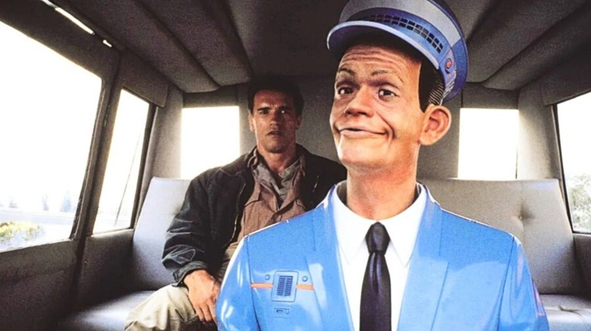

# 🐦 @elonmusk

## 📅 November 16, 2026

> 10 post(s) archived.

---

### 🕐 02:30 UTC · @elonmusk

> Robotaxi life is a hard life. Tesla team empathizes with this guy.

🔗 [View original post](https://x.com/elonmusk/status/2122155440788099394)

---

### 🕐 02:11 UTC · @elonmusk

> Morgan Stanley’s Adam Jonas on @SpaceX successfully catching Starship on flight 15: “In our view, Flight 15 is a historic inflection moment for the company and spaceflight as a whole. SpaceX has recovered three Starship + many hundreds of Falcon 9 boosters in its history, and now others have accomplished the same. However, no entity has ever even attempted to recover a rocket upper stage in history (not counting Space Shuttle) given the intense thermal and mechanical stress of orbital re-entry. With an upper stage now recovered intact, SpaceX can conduct a deep inspection of Ship 42 and use the findings to improve future vehicles in a way that was never previously possible. We believe it also helps clear the path to ramping full reuse of both booster and ship, the last major technical milestone before weekly or even daily Starship flights become realistic. With a ship catch, SpaceX has materially de-risked the longer-term TAMs across all 3 of its segments.”

🔗 [View original post](https://x.com/SawyerMerritt/status/2122150555078234620)

---

### 🕐 01:54 UTC · @elonmusk

> Say no to crack

🔗 [View original post](https://x.com/elonmusk/status/2122146355074232469)

---

### 🕐 01:50 UTC · @elonmusk

> I have a very wide distribution of training data Former NASA astronaut Garrett Reisman, who spent seven years working with Elon Musk at SpaceX, explains what makes @elonmusk such an extraordinary engineer: “I mean, I’ve met a lot of super, super smart people, but they’re usually super, super smart on one thing.” “And he’s able…

🔗 [View original post](https://x.com/elonmusk/status/2122145276681220436)

---

### 🕐 01:37 UTC · @elonmusk

> That’s how it happened Elon Musk reveals he recruited SpaceX’s first engineers by telling them &apos;we’re probably going to die&apos;, and ended up as chief engineer because no good one would join “So SpaceX, I started that in mid-2002 expecting to fail. Probably 90% chance of failing.” “And even when recruiti…

🔗 [View original post](https://x.com/elonmusk/status/2122141959917842487)

---

### 🕐 01:34 UTC · @elonmusk

> True Also why the same amount of money (~$15B) to build all of Starbase was used to build an overpass to nowhere for California’s high speed rail. Capital allocation efficiency is a thing.

🔗 [View original post](https://x.com/elonmusk/status/2122141116195877155)

---

### 🕐 01:33 UTC · @elonmusk

> Starship V4 will be ~70m long, which is roughly a 40% length increase and allows &gt;60% more propellant load. Engine count will be raised to 9, with 3 more Raptor-Vacuum engines added, and these will be higher thrust V4 engines. The scale of Starship:

🔗 [View original post](https://x.com/elonmusk/status/2122141019894383027)

---

### 🕐 01:23 UTC · @elonmusk

> This is the way Most CEO&apos;s would take a meeting to hear from employees who inspected the ship, but Elon gets up in a boom lift to personally inspect it alongside his team. Zero loss of information, everyone on the same page, and as a result Starship will be further improved upon.

🔗 [View original post](https://x.com/elonmusk/status/2122138555137110487)

---

### 🕐 01:21 UTC · @elonmusk

> Cool Legacy media headlines after @SpaceX caught Starship: • CNN: &quot;SpaceX Starship nails historic ship catch in unprecedented test flight&quot; • Reuters: &quot;SpaceX Starship returns to landing pad from orbit, acing test for reusable rockets&quot; • Fox: &quot;SpaceX makes history as Starship spacecra…

🔗 [View original post](https://x.com/elonmusk/status/2122138040176894180)

---

### 🕐 00:40 UTC · @elonmusk

> Starlink helps rural schools with education BREAKING: Every rural municipal school in Rondonópolis, Brazil, now has Starlink internet. 🇧🇷 Students and teachers can now access digital libraries, educational videos and online learning tools. SpaceX is bringing a world of knowledge to remote classrooms. ♥️

🔗 [View original post](https://x.com/elonmusk/status/2122127527040712704)

---
