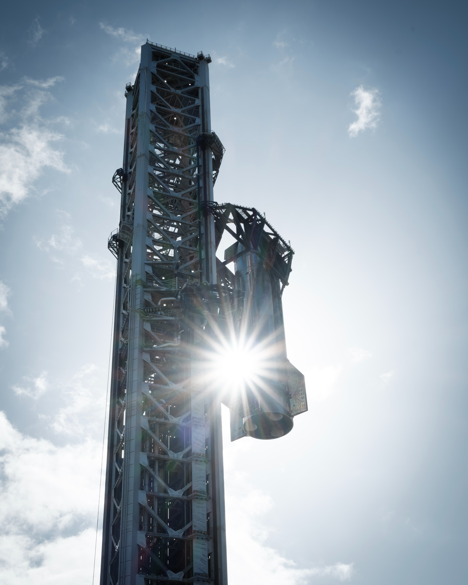
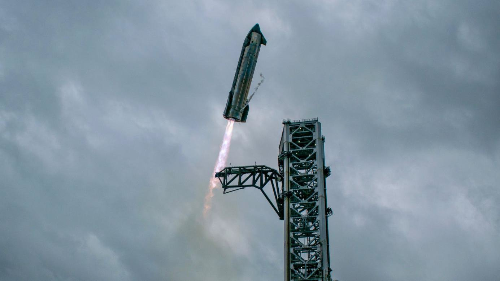
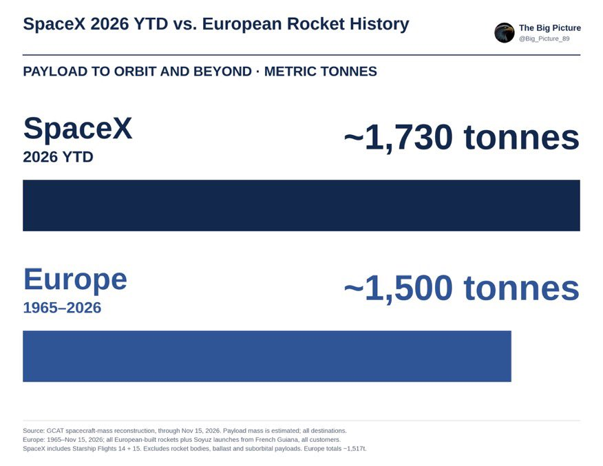
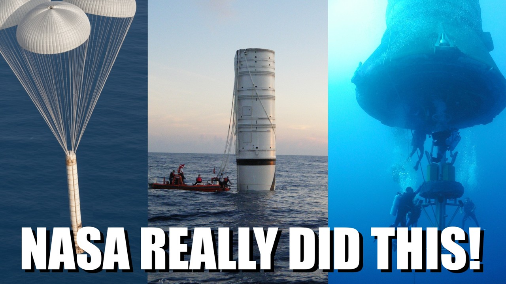
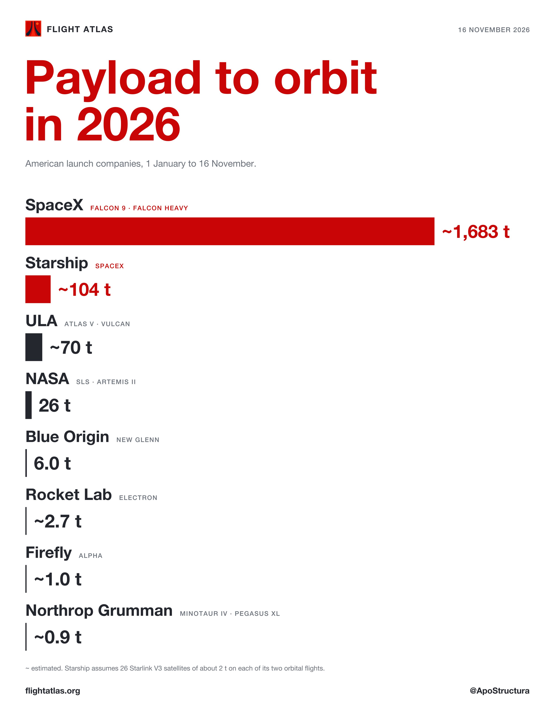
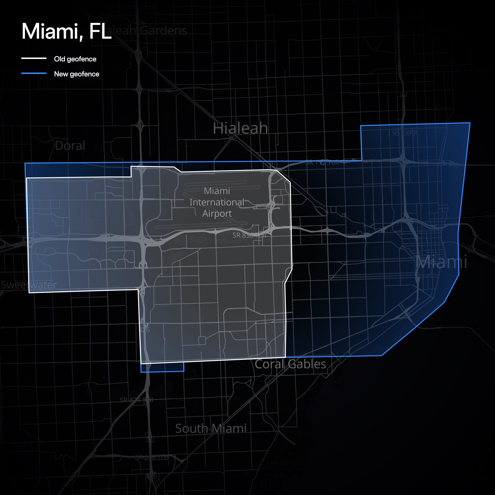
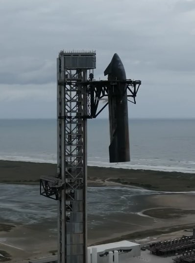
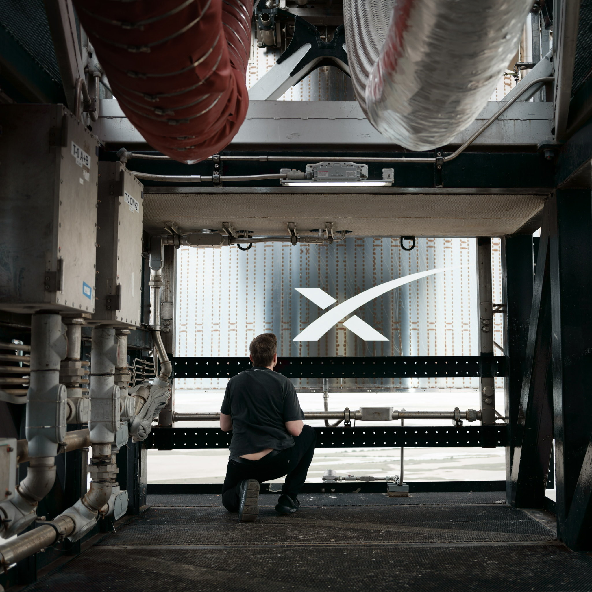

# 🐦 @elonmusk

## 📅 November 16, 2026

> 45 post(s) archived.

---

### 🕐 23:30 UTC · @elonmusk

> View of Starship landing from the tower Views from Mechazilla of the first ever Starship catch

🔗 [View original post](https://x.com/elonmusk/status/2122472344052531640)

---

### 🕐 23:28 UTC · @elonmusk

> Starlink Starlink has completely transformed connectivity across North Star&apos;s offshore fleet North Star&apos;s head of IT, Bruce Catto: “Starlink has changed everything for us” “It is the biggest difference in communications in the last 15 years” The UK-based maritime operator is using Starli…

🔗 [View original post](https://x.com/elonmusk/status/2122471820712660999)

---

### 🕐 21:49 UTC · @elonmusk

> Starship 42 back on Earth

🔗 [View original post](https://x.com/SpaceX/status/2122446937286971592)

---

### 🕐 21:47 UTC · @elonmusk

> As I was saying … Free Starlinks for FAA were offered to Sec Duffy, but he said they were not needed. As it turns out, they were. Correction: the ancient system that is rapidly declining in capability was made L3Harris. The new system that is not yet operational is from Verizon.

🔗 [View original post](https://x.com/elonmusk/status/2122446366354096479)

---

### 🕐 21:45 UTC · @elonmusk

> Catching a Starship with Mini 2 → https://starlink.com/mini-2 Media

🔗 [View original post](https://x.com/Starlink/status/2122446093648875712)

---

### 🕐 20:58 UTC · @elonmusk

> What was the significance of this weekend&apos;s SpaceX tower catch: &quot;Catching the second stage is substantially harder than catching the first stage because the Ship returns from orbit while the booster returns from a short suborbital hop. The booster separates minutes after liftoff, performs a brief boostback, and comes back from only a few hundred kilometers away at relatively low speed. Ship must reach orbital velocity, deploy payload, coast for many hours, execute a precise deorbit burn, survive full reentry heating, and only then perform its landing burn. As such, Ship must carry a functional heat shield, fly a long guided atmospheric trajectory from the other side of the planet, and execute a high-energy flip into the “chopsticks” while protecting its heat-shield side. Those combined demands of orbital energy, thermal protection, long-range guidance, and final precision are why a Ship catch is so incredibly difficult. No prior system, including the Space Shuttle, recovered a rocket-style orbital stage in this manner. The catch validates the path to full reusability which is the foundation of Starship’s cost and cadence targets. This is particularly important in driving the economics of orbital data centers.&quot; - DB

🔗 [View original post](https://x.com/zerohedge/status/2122434181904924817)

---

### 🕐 20:39 UTC · @elonmusk

> there&apos;s something immensely satisfying about the way 42 walks its way into the sticks, then sinking into the landing rails and swaying Media Views from Mechazilla of the first ever Starship catch

🔗 [View original post](https://x.com/_MaxQ_/status/2122429483391324638)

---

### 🕐 20:30 UTC · @elonmusk

> Views from Mechazilla of the first ever Starship catch Media Media

🔗 [View original post](https://x.com/SpaceX/status/2122427170328883425)

---

### 🕐 20:25 UTC · @elonmusk

> This year SpaceX has launched more mass to orbit Than the entire continent of Europe has in the entirety of human history Brutal mogging

🔗 [View original post](https://x.com/zebulgar/status/2122425945990840499)

---

### 🕐 20:05 UTC · @elonmusk

> .@NASAAdmin on @SpaceX&apos;s Starship catch: &quot;This really changes everything.&quot; Media

🔗 [View original post](https://x.com/RapidResponse47/status/2122420702686961667)

---

### 🕐 19:56 UTC · @elonmusk

> Deep in the Amazon rainforest, MrBeast was still connected to the whole world, all thanks to Starlink In his video, he used Starlink to talk with his teams in Antarctica and the Peruvian desert, thousands of miles away Three of the most remote places on Earth, linked together from space No cell towers, no cables, just a dish and the sky, powered by Starlink https://x.com/XFreeze/status/2096534987919196379/video/1 Media

🔗 [View original post](https://x.com/XFreeze/status/2122418561985749454)

---

### 🕐 19:46 UTC · @elonmusk

> Try Grok @Bot What&apos;s new in Grok Bot 1.0 🚀 00:45 Team Bot improvements 01:47 Bots join your meetings 03:26 Bots take initiative 04:10 Bots learn and improve 05:19 Bots are smarter and faster Lots of easter eggs in this one for y&apos;all!

🔗 [View original post](https://x.com/elonmusk/status/2122416056006324311)

---

### 🕐 19:11 UTC · @elonmusk

> Cool Starship is no longer the smallest ship compared to the Culture. Respectable achievement. 🙂

🔗 [View original post](https://x.com/elonmusk/status/2122407149401964722)

---

### 🕐 19:10 UTC · @elonmusk

> We’ve come a long way 100 years

🔗 [View original post](https://x.com/elonmusk/status/2122406902827245831)

---

### 🕐 18:22 UTC · @elonmusk

> For the people who are desperate to act like recovering Starship is some kind of nothingburger because the Space Shuttle was kinda reusable, watch my video about recovering and reusing the shuttle boosters, and compare that to landing back on the pad. https://youtu.be/a9VmcAsV8n0

🔗 [View original post](https://x.com/DJSnM/status/2122394910359990321)

---

### 🕐 17:49 UTC · @elonmusk

> Every driver needs their crew. Media

🔗 [View original post](https://x.com/bot/status/2122386524297974128)

---

### 🕐 17:27 UTC · @elonmusk

> Week two of moving the entire team to @bot: multiple team members burned their credits and asked to level up to the $100 plan — which I was excited to approve! Productivity is going up 10% a week for folks tokenmaxxing with GROK BOT. Honestly, I don&apos;t know if we will need to hire new people for our VC firm and media company at this pace — adding humans will probably be a fun luxury for business owners.

🔗 [View original post](https://x.com/Jason/status/2122381122474520707)

---

### 🕐 16:57 UTC · @elonmusk

> shoutout @elonmusk were livestreaming a MARATHON IN ANTARTICA Media

🔗 [View original post](https://x.com/nelkboys/status/2122373508064034895)

---

### 🕐 15:45 UTC · @elonmusk

> Starship 42 coming in for catch Media Media Media Media

🔗 [View original post](https://x.com/SpaceX/status/2122355344576037338)

---

### 🕐 15:20 UTC · @elonmusk

> Tesla is going big in Germany again, and this time it&apos;s all about the Cybercab Tesla will invest €3 billion to expand Giga Berlin-Brandenburg, starting with a new production building designed for up to 1 million Cybercabs The key details: • Construction planned to start in H1 2027 • Cybercab production targeted for 2029 • Permit application to be filed before the end of 2026 • Investment also covers ancillary buildings and a new wastewater treatment plant • Several hundred new hires for construction and production planning Grünheide already builds around 7,000 Model Ys a week, with a 7,500 target Adding Cybercab next to Model Y turns Tesla&apos;s only European factory into a key piece of its robotaxi future Tesla calls it the foundation for &quot;the world&apos;s most technologically advanced Tesla factory&quot; Once Giga Berlin built cars for drivers Soon it builds cars that drive themselves

🔗 [View original post](https://x.com/XFreeze/status/2122349057712750988)

---

### 🕐 14:43 UTC · @elonmusk

> We&apos;ve all read about Elon&apos;s working style being different. Hands-on, to say the least. Here&apos;s my anecdotal Elon moment: in 2014, we were raising capital and got introduced to John Doerr through our friend Jerry Murdock, and John wanted to meet me and Nami in Sicily, where they had a private event. During the evening, we jumped on a small bus together with Elon to join a dinner. At that time, Tesla had just opened their first showroom in Sweden, Täby. I told Elon that I booked a test ride with their new Model S but was wondering why they had a two-month waiting time to try the car. He was shocked/frustrated about the waiting time. He picked up his phone, made a call and sent some messages. The next week, Tesla Sweden called me and said, &quot;Hi, you signed up for the test drive. We just got many more demo cars delivered and you can come and try it today already.&quot; That&apos;s how you get shit done! Can&apos;t even imagine how he operates today, but I&apos;m sure it&apos;s still in the details and solving problems. That was inspiring, to say the least.

🔗 [View original post](https://x.com/AlanMamedi/status/2122339794113953836)

---

### 🕐 14:31 UTC · @elonmusk

> BREAKING: SpaceX is joining local law enforcement in Florida to help bring Christmas joy to children in need. Brevard County Sheriff Wayne Ivey announced that SpaceX will participate in the Reverse Christmas Parade on Monday, November 30. SpaceX helping the community. ♥️

🔗 [View original post](https://x.com/cb_doge/status/2122336858415989037)

---

### 🕐 09:44 UTC · @elonmusk

> If Starship were its own launch company, it would already be number 2 in the US by payload to orbit. (behind SpaceX Falcon 9).

🔗 [View original post](https://x.com/ApoStructura/status/2122264436069339575)

---

### 🕐 07:44 UTC · @elonmusk

> Now serving more of Miami 🌴

🔗 [View original post](https://x.com/robotaxi/status/2122234442328740005)

---

### 🕐 07:01 UTC · @elonmusk

> Important Grok&apos;s text watermarking is now off by default in the SpaceXSI API. Elon Musk confirmed it and went further. He says text watermarking with Grok is only on where the law requires it or a user asks for it. So if you build on Grok, your output won&apos;t carry a hidden watermark unless…

🔗 [View original post](https://x.com/elonmusk/status/2122223599079559603)

---

### 🕐 06:53 UTC · @elonmusk

> 💯 Ladies and gentlemen, introducing the greatest team on earth…. @SpaceX!!! Can’t get over the high of yesterday. Vibes are 10/10 right now!!!!!

🔗 [View original post](https://x.com/elonmusk/status/2122221516867895726)

---

### 🕐 06:48 UTC · @elonmusk

> The amount of energy we harness for civilization from the Sun will obviously ultimately round up to 100% of all energy. That math is obvious and trivial. Years ago, Elon Musk predicted: “Solar electricity will become by far the biggest source of power for civilization” Today, we&apos;re watching that vision become reality In 2015, solar generated just 256 TWh of electricity globally A decade later, annual solar generation has surpasse…

🔗 [View original post](https://x.com/elonmusk/status/2122220308799316072)

---

### 🕐 05:41 UTC · @elonmusk

> Yup In 2014, NASA awarded Boeing $4.2 BILLION to develop Starliner SpaceX received just $2.6 BILLION for Crew Dragon Now look at the results: • Boeing Starliner: Just one crewed flight and got two astronauts stuck on the ISS for over 9 months in space before SpaceX sent Dragon to re…

🔗 [View original post](https://x.com/elonmusk/status/2122203324460265943)

---

### 🕐 04:54 UTC · @elonmusk

> Yup SpaceX has launched more then every other company combined

🔗 [View original post](https://x.com/elonmusk/status/2122191623731745133)

---

### 🕐 04:34 UTC · @elonmusk

> 12 years ago About to testify before Senate against ULA (Lockheed and Boeing) monopoly contract for national security launches

🔗 [View original post](https://x.com/elonmusk/status/2122186399575396604)

---

### 🕐 04:03 UTC · @elonmusk

> @nbcsnl lol

🔗 [View original post](https://x.com/elonmusk/status/2122178701039137144)

---

### 🕐 03:45 UTC · @elonmusk

> The SpaceX engineers who caught the rocket don&apos;t write LinkedIn thought pieces about leadership.

🔗 [View original post](https://x.com/JohnLeFevre/status/2122174254787760534)

---

### 🕐 03:05 UTC · @elonmusk

> Grok @Bot can do almost anything Grok Bot made this Starship Flight 15 highlight reel for me. 🚀 It downloaded the 23-hour livestream, picked out the best moments, edited the clips together, added effects and music, all so quickly. You don’t need a video editor anymore. Just ask Grok Bot.

🔗 [View original post](https://x.com/elonmusk/status/2122164224382447808)

---

### 🕐 03:04 UTC · @elonmusk

> Just doin some plumbin

🔗 [View original post](https://x.com/elonmusk/status/2122163777454166505)

---

### 🕐 02:30 UTC · @elonmusk

> Robotaxi life is a hard life. Tesla team empathizes with this guy.

🔗 [View original post](https://x.com/elonmusk/status/2122155440788099394)

---

### 🕐 02:11 UTC · @elonmusk

> Morgan Stanley’s Adam Jonas on @SpaceX successfully catching Starship on flight 15: “In our view, Flight 15 is a historic inflection moment for the company and spaceflight as a whole. SpaceX has recovered three Starship + many hundreds of Falcon 9 boosters in its history, and now others have accomplished the same. However, no entity has ever even attempted to recover a rocket upper stage in history (not counting Space Shuttle) given the intense thermal and mechanical stress of orbital re-entry. With an upper stage now recovered intact, SpaceX can conduct a deep inspection of Ship 42 and use the findings to improve future vehicles in a way that was never previously possible. We believe it also helps clear the path to ramping full reuse of both booster and ship, the last major technical milestone before weekly or even daily Starship flights become realistic. With a ship catch, SpaceX has materially de-risked the longer-term TAMs across all 3 of its segments.”

🔗 [View original post](https://x.com/SawyerMerritt/status/2122150555078234620)

---

### 🕐 02:00 UTC · @elonmusk

> @elonmusk Great timeline 😂

🔗 [View original post](https://x.com/AntiWokeMemes/status/2122147680201949253)

---

### 🕐 01:54 UTC · @elonmusk

> Say no to crack

🔗 [View original post](https://x.com/elonmusk/status/2122146355074232469)

---

### 🕐 01:50 UTC · @elonmusk

> I have a very wide distribution of training data Former NASA astronaut Garrett Reisman, who spent seven years working with Elon Musk at SpaceX, explains what makes @elonmusk such an extraordinary engineer: “I mean, I’ve met a lot of super, super smart people, but they’re usually super, super smart on one thing.” “And he’s able…

🔗 [View original post](https://x.com/elonmusk/status/2122145276681220436)

---

### 🕐 01:37 UTC · @elonmusk

> That’s how it happened Elon Musk reveals he recruited SpaceX’s first engineers by telling them &apos;we’re probably going to die&apos;, and ended up as chief engineer because no good one would join “So SpaceX, I started that in mid-2002 expecting to fail. Probably 90% chance of failing.” “And even when recruiti…

🔗 [View original post](https://x.com/elonmusk/status/2122141959917842487)

---

### 🕐 01:34 UTC · @elonmusk

> True Also why the same amount of money (~$15B) to build all of Starbase was used to build an overpass to nowhere for California’s high speed rail. Capital allocation efficiency is a thing.

🔗 [View original post](https://x.com/elonmusk/status/2122141116195877155)

---

### 🕐 01:33 UTC · @elonmusk

> Starship V4 will be ~70m long, which is roughly a 40% length increase and allows &gt;60% more propellant load. Engine count will be raised to 9, with 3 more Raptor-Vacuum engines added, and these will be higher thrust V4 engines. The scale of Starship:

🔗 [View original post](https://x.com/elonmusk/status/2122141019894383027)

---

### 🕐 01:23 UTC · @elonmusk

> This is the way Most CEO&apos;s would take a meeting to hear from employees who inspected the ship, but Elon gets up in a boom lift to personally inspect it alongside his team. Zero loss of information, everyone on the same page, and as a result Starship will be further improved upon.

🔗 [View original post](https://x.com/elonmusk/status/2122138555137110487)

---

### 🕐 01:21 UTC · @elonmusk

> Cool Legacy media headlines after @SpaceX caught Starship: • CNN: &quot;SpaceX Starship nails historic ship catch in unprecedented test flight&quot; • Reuters: &quot;SpaceX Starship returns to landing pad from orbit, acing test for reusable rockets&quot; • Fox: &quot;SpaceX makes history as Starship spacecra…

🔗 [View original post](https://x.com/elonmusk/status/2122138040176894180)

---

### 🕐 00:40 UTC · @elonmusk

> Starlink helps rural schools with education BREAKING: Every rural municipal school in Rondonópolis, Brazil, now has Starlink internet. 🇧🇷 Students and teachers can now access digital libraries, educational videos and online learning tools. SpaceX is bringing a world of knowledge to remote classrooms. ♥️

🔗 [View original post](https://x.com/elonmusk/status/2122127527040712704)

---
