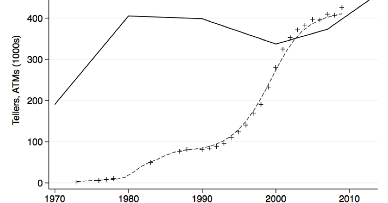

# 🐦 @emollick

## 📅 November 16, 2026

> 5 post(s) archived.

---

### 🕐 12:38 UTC · @emollick

> I think contrary to many of our expectations, we have not seen a Fable class open model more than 8 months after Fable/Mythos was first made public. Alibaba has launched Qwen4 Max, gaining 9 points over Qwen3.8 Max on the Artificial Analysis Intelligence Index and landing 3 points behind Kimi K3.1 Pro at ~11% lower Cost per Task Qwen4 Max, using xhigh reasoning effort, scores 43 on the Intelligence Index, 9 points ahead of Q…

🔗 [View original post](https://x.com/emollick/status/2122308260325720127)

---

### 🕐 11:42 UTC · @emollick

> The paper I got the elevator operator stat from. Which doesn’t mean many jobs haven’t changed dramatically as a result of technology, of course. https://cepr.org/voxeu/columns/how-computer-automation-affects-occupations-technology-jobs-and-skills

🔗 [View original post](https://x.com/emollick/status/2122294310121201763)

---

### 🕐 04:00 UTC · @emollick

> But it also means that no leader of a company, government, or any other institution has ever had to deal with a radically different socio-technical regime. The old approaches that worked through the ups-and-downs of the previous 75 years may not work for the years ahead.

🔗 [View original post](https://x.com/emollick/status/2122177932286423423)

---

### 🕐 03:58 UTC · @emollick

> The image comes from one of my first posts on OneUsefulThing right after the release of ChatGPT, based on the premonition that this time, things are going to be different. If we avoid disaster, worth remembering humans are very good at muddling through. https://www.oneusefulthing.org/p/becoming-strange-in-the-long-singularity

🔗 [View original post](https://x.com/emollick/status/2122177524813951473)

---

### 🕐 03:54 UTC · @emollick

> I think often about the fact that almost everyone working in the West has lived in a quite stable socio-technical period Only 1 job out of 270 in the 1950 census is now obsolete (elevator operator) 2026 is similar to 1957 in a way that 1969 was not from 1900. That may change.

🔗 [View original post](https://x.com/emollick/status/2122176524610884061)

---
