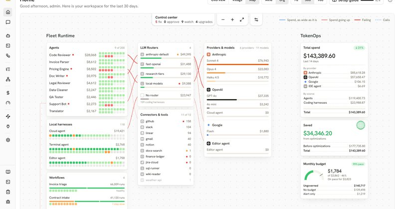
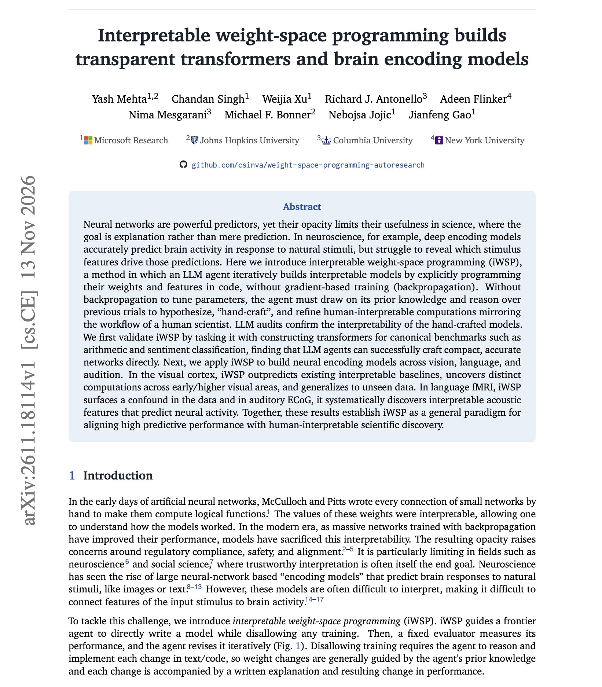

# 🐦 @omarsar0

## 📅 November 16, 2026

> 7 post(s) archived.

---

### 🕐 20:17 UTC · @omarsar0

> If you build and manage agents, the goal is to spend smarter on tokens. To solve this, Nasiko picks the right model for each agent, compresses context, and caches. They report 50% fewer tokens on standard SWE benchmarks. It sits under your existing agents and installs with one command. http://bit.ly/nasikolaunch Nasiko - Open Runtime platform for managing AI agents. See every agent. Cut token spend by up to 50%. Route to the right model with the agent gateway. Govern tool access. Set permissions and budgets per agent, per team. One command. Same workflow. Open Runtime for agents starts …

🔗 [View original post](https://x.com/omarsar0/status/2122423890735493334)

---

### 🕐 16:59 UTC · @omarsar0

> Recommend reading following up on the idea of weight-space programming. Bigger models (Opus 5.5) tend to do better and be more efficient. Super interesting work from Microsoft and colleagues. They take a closer look at the exciting research area of weight-space programming. They had Claude Opus 5.5 write transformer weights directly in code, with no gradient training. The smallest models that solved the algorithmi…

🔗 [View original post](https://x.com/omarsar0/status/2122374124601590078)

---

### 🕐 16:45 UTC · @omarsar0

> Super interesting work from Microsoft and colleagues. They take a closer look at the exciting research area of weight-space programming. They had Claude Opus 5.5 write transformer weights directly in code, with no gradient training. The smallest models that solved the algorithmic tasks had a median of 166 parameters. The method is called interpretable weight-space programming. An agent proposes a computation, writes it as explicit weights and features, tests it, and revises it for 30 to 50 rounds. A person can read the result line by line. All 26 runs on algorithmic tasks reached 100% accuracy on held-out data, often by writing a known algorithm into the weights. They find that the model matters. Sonnet 5.5 needed a median of 41,600 parameters, and Haiku 5.5 needed 100,000. Language tasks were harder. Those models stayed near 190,000 parameters and lost accuracy against learned baselines. They then used the same loop on brain data. In the visual cortex, it predicted responses better than existing interpretable models. In language fMRI, it found a confound in the dataset. https://arxiv.org/abs/2611.18114 Chat with Paper: https://academy.dair.ai/papers/interpretable-weight-space-programming-builds-transparent-transformers-and-brain-2611.18114

🔗 [View original post](https://x.com/dair_ai/status/2122370369097277634)

---

### 🕐 16:05 UTC · @omarsar0

> The CEO of Vercel called us out. We claimed http://Agent37.com was 25x cheaper, and he said we didn&apos;t consider active CPU time. So we fixed the math.. We gave 100 coding agents a sandbox each and had them vibe code an app. Here&apos;s the cost per hour at just 5% active CPU: Vercel: $9.75 (14x) E2B: $16.56 (24x) Daytona: $16.56 (24x) Agent37: $0.68 We&apos;re starting a race to the bottom... see you there. Find a cheaper sandbox and we&apos;ll refund the difference. Media @paarangatrai WAIT a total miscalculation of active cpu time¹ to produce fake cost comparisons and fake impressions!?!? ¹ https://vercel.com/docs/sandbox/pricing#active-cpu

🔗 [View original post](https://x.com/an_engineer_log/status/2122360362712395943)

---

### 🕐 15:54 UTC · @omarsar0

> Reach out if your company needs to build an eval. We are working in this space at @dair_ai.

🔗 [View original post](https://x.com/omarsar0/status/2122357655628911002)

---

### 🕐 15:41 UTC · @omarsar0

> Cyber defense might be one of the hardest problems for frontier AI. I think this needs specialized foundation AI models to address it properly. @CormaAI is training foundation models built for this. $125M Series A at a $1B valuation, three months out of stealth. Strong team to watch. We raised a $125M Series A at a $1B valuation, 3 months out of stealth. @NEA led. @sequoia, @khoslaventures and @coatuemgmt doubled down. @CormaAI is training foundation models toward superintelligence for defensive cybersecurity. Because the greatest gift cyberattackers have ev…

🔗 [View original post](https://x.com/omarsar0/status/2122354372273213772)

---

### 🕐 15:10 UTC · @omarsar0

> Let me know if you found this useful. I have a few more of these to share on different topics like memory, RSI, and harnesses.

🔗 [View original post](https://x.com/omarsar0/status/2122346472519696515)

---
