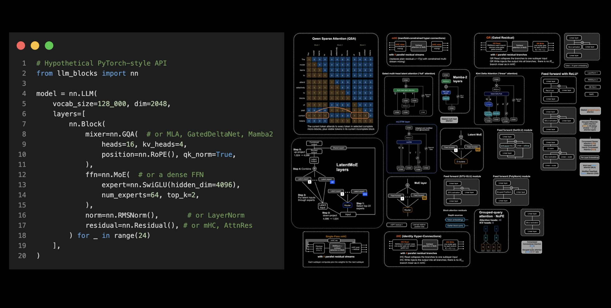

# 🐦 @rasbt

## 📅 November 16, 2026

> 1 post(s) archived.

---

### 🕐 14:28 UTC · @rasbt

> The open-source LLM ecosystem could really benefit from an LLM building-block API. We have so many LLM components across different models now. Whether you are using PyTorch or C++ and CUDA code directly, there is a major switching cost when you want to run experiments or ablation studies, say swapping GQA with MLA, dense FFNs with MoE, attention layers with Mamba2 or Gated DeltaNet, or standard residual connections with attention residuals. Currently, it’s very messy even with LLM-assisted coding. It could maybe be on top of PyTorch or CUDA directly, but it needs to be carefully engineered and maintained (versus quickly vibe-coded on a weekend) and efficient enough that people trust it to use in production (which is really a requirement to move beyond toy examples). Maybe some food for thought for a big, well-funded lab :) (There are some efforts that go into that direction, like torchtitan, torchtune, Megatron Core, OLMo-core, but they are not quite that level of abstraction, I&apos;d say. And, as always, there’s the chicken-and-egg problem: it needs to be popular to get widely adopted, and it needs to get widely adopted to become popular.)

🔗 [View original post](https://x.com/rasbt/status/2122336040899711282)

---
