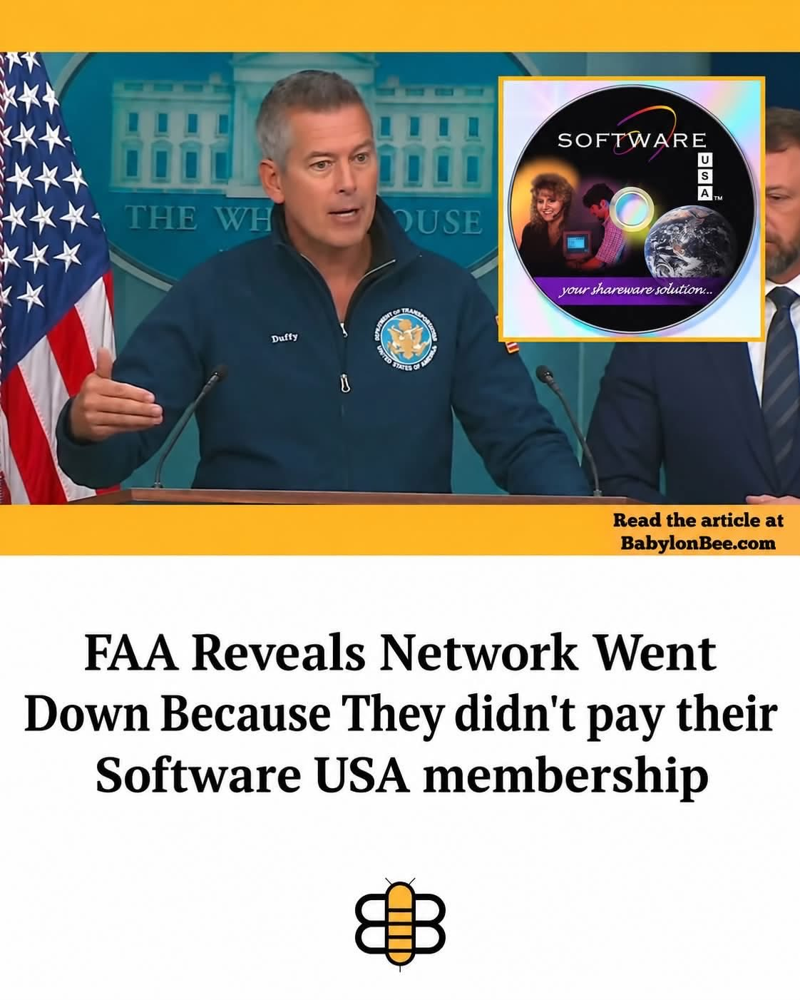

# 🐦 @tunguz

## 📅 November 16, 2026

> 4 post(s) archived.

---

### 🕐 10:34 UTC · @tunguz

> Too real. 🤌🏻🥂

🔗 [View original post](https://x.com/tunguz/status/2122277213051445703)

---

### 🕐 00:41 UTC · @tunguz

> That’s why we can’t get any more Astras. people have little understanding of how much the federal government is already involved in the ai industry. for example if there’s a new model you need to convince the feds that new model is safe before launching it or men with proverbial guns and export control bans show up

🔗 [View original post](https://x.com/tunguz/status/2122127993359171996)

---

### 🕐 00:35 UTC · @tunguz

> All right, I’ll try running it on my old MacBook Air. if you have a 16GB GPU or a 24GB mac, try qwen 3.8 27B before paying for another subscription. the compressed IQ3 file is ~12GB, and it scored the same as chatgpt on a 20-task test.

🔗 [View original post](https://x.com/tunguz/status/2122126343978524866)

---

### 🕐 00:21 UTC · @tunguz

> That explains it!

🔗 [View original post](https://x.com/tunguz/status/2122122817239969860)

---
