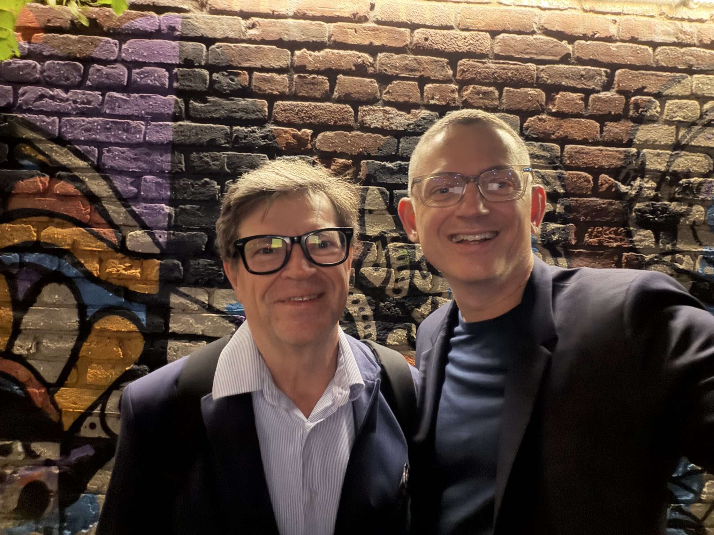
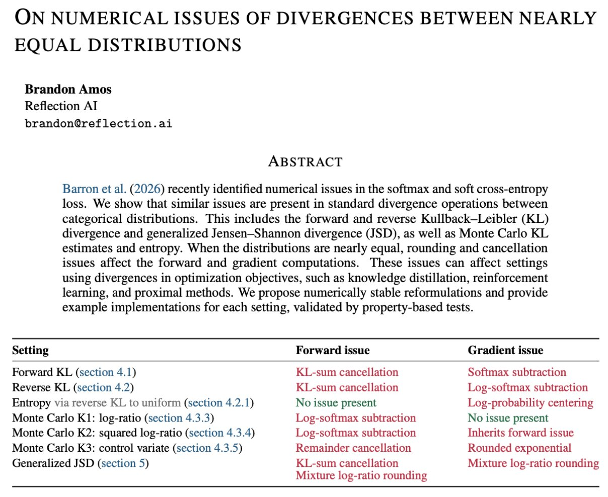

# 🐦 @ylecun

## 📅 November 16, 2026

> 3 post(s) archived.

---

### 🕐 18:55 UTC · @ylecun

> Our @224ventureshq community dinners are always energizing. Last week, @ylecun and I hosted a dinner in SoHo, New York, with a conversation ranging from AI applications to NVIDIA to world models. Looking forward to bringing this community together again in 2027!

🔗 [View original post](https://x.com/shaunbjohnson/status/2122403290965287162)

---

### 🕐 16:15 UTC · @ylecun

> ⚠️ Numerical issues can go on silently for decades like in the softmax/CE! Similar issues are present in other widely-used divergences like the KL and JSD I just posted this paper overviewing what they are and how to fix them: 📚 https://arxiv.org/abs/2611.18511 Hi all, I have a new result I&apos;m excited to share. It turns out that *all existing implementations* of softmax and cross-entropy (that&apos;s JAX, PyTorch, textbooks, etc) have a subtle bug --- two bugs, actually. A simple rewrite fixes both, and eliminates &quot;slingshots&quot; when grokking:

🔗 [View original post](https://x.com/brandondamos/status/2122362884642554242)

---

### 🕐 15:37 UTC · @ylecun

> Dario Amodei on open source models: “If the path continues, I think we could get to a very dangerous place.” “When you control a model and you&apos;re deploying it, you have the ability to monitor its usage.” “You can revoke a user&apos;s access. You can change what the model is willing to do.” “When a model is released in an uncontrolled manner, there&apos;s no ability to do that. It&apos;s entirely out of your hands.” “We should confront the advocates of this with that problem and challenge them to solve it.” He clearly doesn&apos;t believe Intelligence should be in the hand of the masses and Sam Altman also saying &quot;RAM&quot; shouldn&apos;t be accessible to everyone indefinitely agreed with him. Media Anthropic &amp; OpenAI wants to own intelligence. Open models want to free it

🔗 [View original post](https://x.com/vikktorrrre/status/2122353364306374986)

---
