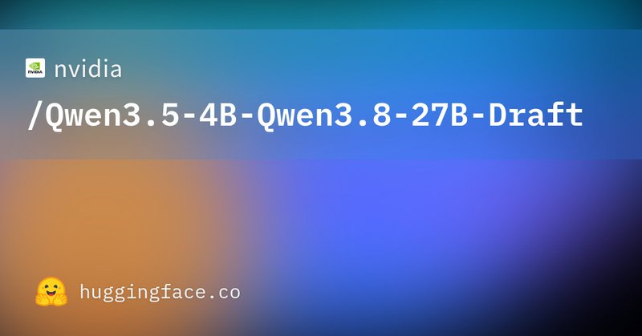
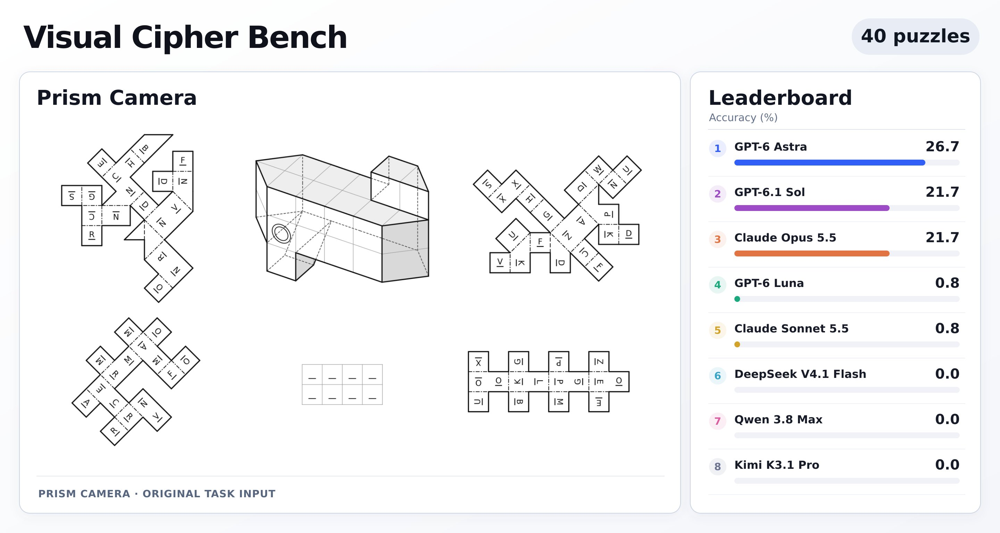
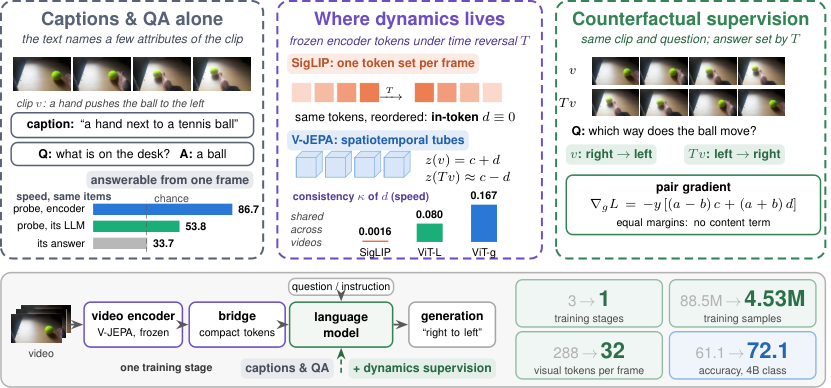

# 🐦 @_akhaliq

## 📅 November 17, 2026

> 11 post(s) archived.

---

### 🕐 22:49 UTC · @_akhaliq

> Apple just released FastFrames Video Generation at Interactive Latency FastFrames-L (14B): https://huggingface.co/apple/FastFrames-L FastFrames-S (1.3B): https://huggingface.co/apple/FastFrames-S Media

🔗 [View original post](https://x.com/_akhaliq/status/2122824565185503427)

---

### 🕐 22:08 UTC · @_akhaliq

> Energy-Based Reasoners Your Recurrent Reasoner Should Be an Energy-Based Model paper: https://huggingface.co/papers/2611.08977 Media

🔗 [View original post](https://x.com/_akhaliq/status/2122814097649742258)

---

### 🕐 21:32 UTC · @_akhaliq

> Ropedia Xperience 2 A Gold Standard for Scaling Physical AI Environments and Behaviors paper: https://huggingface.co/papers/2611.17060 Media

🔗 [View original post](https://x.com/_akhaliq/status/2122805100171460887)

---

### 🕐 20:09 UTC · @_akhaliq

> Introducing Qwen3.8-27B-pi-adapted 🤗 We adapted Qwen&apos;s model specifically for the pi coding agent using reinforcement learning and a LoRA adapter. The results, measured as pass@1: 🚀 SWE-bench Pro (Hard 51): 29.4% → 62.7% 💻 Terminal-Bench 2.1: 39.5% → 55.8% ⚡ 55–62% fewer tool calls per task This is the power of open models: you can adapt them to YOUR tools and YOUR use cases. Let’s build! 💛 Open weights: http://huggingface.co/harness-hub/Qwen3.8-27B-pi-adapted Methodology: https://huggingface.co/blog/harness-hub/harness-adapters

🔗 [View original post](https://x.com/ClementDelangue/status/2122784279604383914)

---

### 🕐 19:54 UTC · @_akhaliq

> We built Australia’s own AI model, and today it’s open to the world. Agentaus 1 (@AgentausTD): 220B parameters. 84.4% on MMLU-Pro. Ranked 43rd in the world. It runs on Australian servers. Nothing ever leaves Australia, and nothing you type is used to train AI. Delete a chat and it’s gone for good. Most of the world’s AI answers to somebody else. This one answers only to you. Free to start: http://agentaus.com.au Media

🔗 [View original post](https://x.com/MGately_au/status/2122780345947017287)

---

### 🕐 18:26 UTC · @_akhaliq

> Accelerate Bench Evaluating Agents for Application-Level Program Optimization paper: https://huggingface.co/papers/2611.20882

🔗 [View original post](https://x.com/_akhaliq/status/2122758250059977062)

---

### 🕐 18:01 UTC · @_akhaliq

> Genesis is entering its next phase. Today we&apos;ve raised a $500M Series A at $3.5B. We can imagine far more than we can build physically today. Almost everything we are creating is still paid for in human time, by human hands. We want to remove the physical limits on human ambition. We are building general-purpose robots with human level intelligence and capability. Ones that work reliably across entire workflows for years. There are countless versions of possible futures where billions of robots are deployed everywhere, and we aspire to bring the brightest one that carries our hopes into reality. Media

🔗 [View original post](https://x.com/zhou_xian_/status/2122752003197833357)

---

### 🕐 17:04 UTC · @_akhaliq

> NVIDIA just released a speculative decoding draft on Hugging Face It accelerates Qwen3.8-27B with 4B parameters, boosting token acceptance by 46% over the built-in head. https://huggingface.co/nvidia/Qwen3.5-4B-Qwen3.8-27B-Draft

🔗 [View original post](https://x.com/HuggingPapers/status/2122737583361057024)

---

### 🕐 16:00 UTC · @_akhaliq

> Looking for a reference manual for building a frontier LLM? We wrote one 👇 The K2 Horizon technical report is now on arXiv: 134 pages on how we built six models, from architecture to inference. It may be the most detailed LLM training reference you can read today. • Architecture: we bring two new attention designs, MoVA and softplus attention gating, to strengthen reasoning. With them, our 36B model nearly matches a 32B dense one on one-seventh of the active parameters. • Pre-training: we trained four models, from 3.7B to 36B, on the same 22T tokens. Their normalized loss curves collapse onto nearly the same line, so a recipe that works on a small model carries over when scaling up. • Data: 60+ pages on the part most reports skip. How we generated ~10T synthetic tokens, and why we chose the data mix on predicted scores at scale, which reversed the small-run ranking. • Post-training: we document our full production-scale run for the 375B flagship. • Inference: Uno gives an autoregressive model diffusion speed with one small adapter. Up to 2.2× faster decoding, lossless by construction, no draft model. This is the last piece of the openness puzzle. K2 Horizon already shipped with 380 checkpoints, 13 TB of pre-training data, 58 training runs and 17 code repositories. The report explains the decisions behind them. More details: http://arxiv.org/abs/2611.21003 Media

🔗 [View original post](https://x.com/IFM_AI/status/2122721434262786095)

---

### 🕐 14:30 UTC · @_akhaliq

> Coding agents can now grind through long-horizon tasks, as long as they get a written spec and a test suite. What happens if the spec is a drawing, and nothing tells if they&apos;re right? We gave 8 frontier models 40 visual puzzles. The best configuration solved 26.7%. Three models solved none. Introducing Visual Cipher Bench from Einsia AI, a benchmark for long-horizon visual reasoning. Agents get tools, then after 60 minutes, no written rules and no correctness feedback is given. 40 original puzzles · 67 drawings · 8 models · 29 configurations · 3,480 graded attempts 🌐Project: https://lab.einsia.ai/visual-cipher-bench/ 💻Github: https://github.com/Einsia/Visual-Cipher-Bench 📄Paper: https://arxiv.org/abs/2611.16861

🔗 [View original post](https://x.com/EinsiaAI/status/2122698779623407932)

---

### 🕐 04:09 UTC · @_akhaliq

> V-JEPA-LM: Video-Language Models That Read Dynamics New models (1B-8B) join frozen V-JEPA 2.1 to an LLM with counterfactual supervision, reading direction, speed, and order. They lead every size class on 11 video benchmarks – 4B averages 72.1, beating all open models. Open-sourced on Hugging Face.

🔗 [View original post](https://x.com/HuggingPapers/status/2122542566482579746)

---
