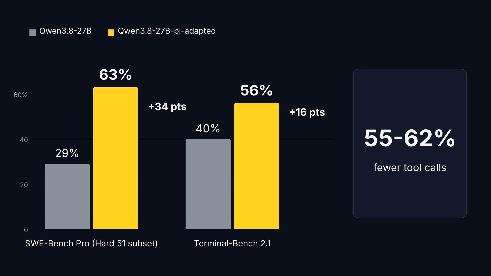
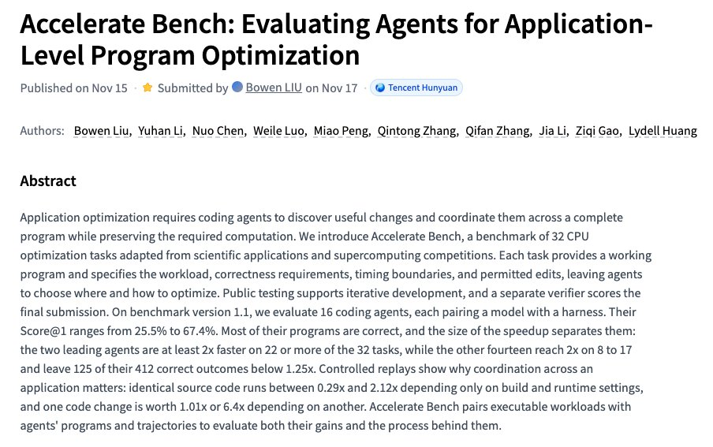

# 🐦 @_akhaliq

## 📅 November 17, 2026

> 7 post(s) archived.

---

### 🕐 20:09 UTC · @_akhaliq

> Introducing Qwen3.8-27B-pi-adapted 🤗 We adapted Qwen&apos;s model specifically for the pi coding agent using reinforcement learning and a LoRA adapter. The results, measured as pass@1: 🚀 SWE-bench Pro (Hard 51): 29.4% → 62.7% 💻 Terminal-Bench 2.1: 39.5% → 55.8% ⚡ 55–62% fewer tool calls per task This is the power of open models: you can adapt them to YOUR tools and YOUR use cases. Let’s build! 💛 Open weights: http://huggingface.co/harness-hub/Qwen3.8-27B-pi-adapted Methodology: https://huggingface.co/blog/harness-hub/harness-adapters

🔗 [View original post](https://x.com/ClementDelangue/status/2122784279604383914)

---

### 🕐 19:54 UTC · @_akhaliq

> We built Australia’s own AI model, and today it’s open to the world. Agentaus 1 (@AgentausTD): 220B parameters. 84.4% on MMLU-Pro. Ranked 43rd in the world. It runs on Australian servers. Nothing ever leaves Australia, and nothing you type is used to train AI. Delete a chat and it’s gone for good. Most of the world’s AI answers to somebody else. This one answers only to you. Free to start: http://agentaus.com.au Media

🔗 [View original post](https://x.com/MGately_au/status/2122780345947017287)

---

### 🕐 18:26 UTC · @_akhaliq

> Accelerate Bench Evaluating Agents for Application-Level Program Optimization paper: https://huggingface.co/papers/2611.20882

🔗 [View original post](https://x.com/_akhaliq/status/2122758250059977062)

---

### 🕐 18:01 UTC · @_akhaliq

> Genesis is entering its next phase. Today we&apos;ve raised a $500M Series A at $3.5B. We can imagine far more than we can build physically today. Almost everything we are creating is still paid for in human time, by human hands. We want to remove the physical limits on human ambition. We are building general-purpose robots with human level intelligence and capability. Ones that work reliably across entire workflows for years. There are countless versions of possible futures where billions of robots are deployed everywhere, and we aspire to bring the brightest one that carries our hopes into reality. Media

🔗 [View original post](https://x.com/zhou_xian_/status/2122752003197833357)

---

### 🕐 17:04 UTC · @_akhaliq

> NVIDIA just released a speculative decoding draft on Hugging Face It accelerates Qwen3.8-27B with 4B parameters, boosting token acceptance by 46% over the built-in head. https://huggingface.co/nvidia/Qwen3.5-4B-Qwen3.8-27B-Draft

🔗 [View original post](https://x.com/HuggingPapers/status/2122737583361057024)

---

### 🕐 14:30 UTC · @_akhaliq

> Coding agents can now grind through long-horizon tasks, as long as they get a written spec and a test suite. What happens if the spec is a drawing, and nothing tells if they&apos;re right? We gave 8 frontier models 40 visual puzzles. The best configuration solved 26.7%. Three models solved none. Introducing Visual Cipher Bench from Einsia AI, a benchmark for long-horizon visual reasoning. Agents get tools, then after 60 minutes, no written rules and no correctness feedback is given. 40 original puzzles · 67 drawings · 8 models · 29 configurations · 3,480 graded attempts 🌐Project: https://lab.einsia.ai/visual-cipher-bench/ 💻Github: https://github.com/Einsia/Visual-Cipher-Bench 📄Paper: https://arxiv.org/abs/2611.16861

🔗 [View original post](https://x.com/EinsiaAI/status/2122698779623407932)

---

### 🕐 04:09 UTC · @_akhaliq

> V-JEPA-LM: Video-Language Models That Read Dynamics New models (1B-8B) join frozen V-JEPA 2.1 to an LLM with counterfactual supervision, reading direction, speed, and order. They lead every size class on 11 video benchmarks – 4B averages 72.1, beating all open models. Open-sourced on Hugging Face.

🔗 [View original post](https://x.com/HuggingPapers/status/2122542566482579746)

---
