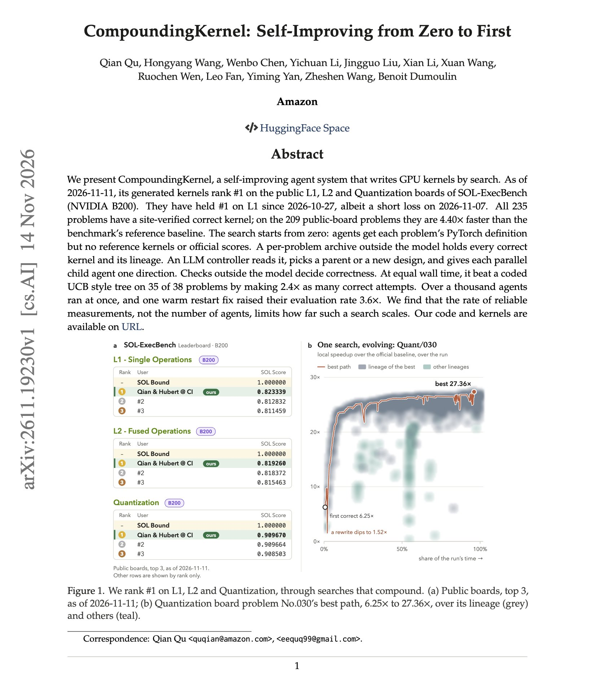
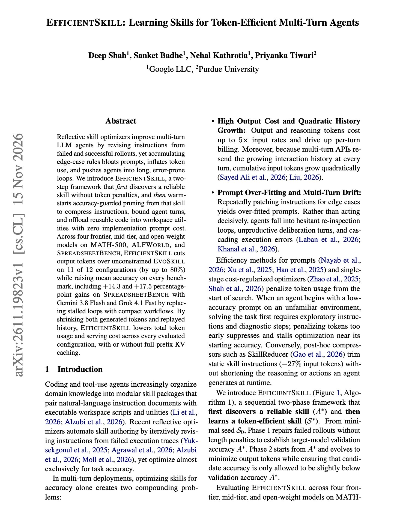
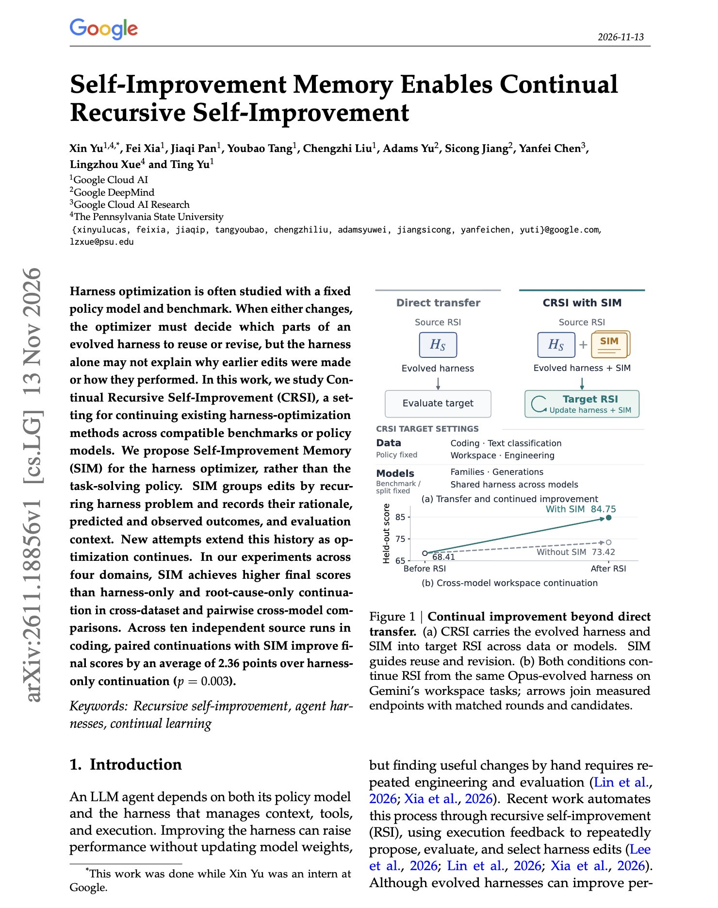

# 🐦 @dair_ai

## 📅 November 17, 2026

> 4 post(s) archived.

---

### 🕐 22:19 UTC · @dair_ai

> Highly recommended read. Self-improving memory is starting to look like an important component for continual-learning agents. So pay close attention to this research direction if you are studying recursive self-improvement. Just last week, I featured a few papers on the topic, and this week both Meta and Google published on it. (find more references towards the end) Meta lets a model design its own memory habits. Then they train those habits into the model weights. The goal is to allow the system to learn the memory design (what to memorize, how to memorize, and what to recall). This work is actually in the same vein as RIME, which I wrote some notes on last week: https://x.com/omarsar0/status/2121335666457944226 Meta first searches for better memory instructions (prompts the model to rewrite itself), then fine-tunes the model (SFT with LoRA) on runs that used the best ones. RIME, on the other hand, skips the search and uses RL to train one model to solve tasks and write memories, rewarding notes that help on later tasks. It also trains the model to explore so it collects useful information. Different ways to address the problem. More useful links below: Google Self-Improving Memory for Continual Learning - https://x.com/omarsar0/status/2122701047118635485 How to Train Memory Writing for Continual Learning - https://x.com/omarsar0/status/2121335666457944226 Can LLM Agents Organize Their Own Memory - https://x.com/omarsar0/status/2120888604402815485 Continual-ARC - https://x.com/omarsar0/status/2120638750740844672 Adaptive Memory Selection for LLM Agents - https://x.com/omarsar0/status/2118715786152001580 MemCredit - https://x.com/omarsar0/status/2121610612040220832 Introducing: Self-Improving Memory 🧠✨📈 We let the model discover its own memory skills, then train them into its weights: - Meta-optimizes memory from the model&apos;s own runs with large gains. - Distilling these gains works too. Blog post: 📝 https://facebookresearch.github.io/RA…

🔗 [View original post](https://x.com/omarsar0/status/2122817030277509231)

---

### 🕐 21:39 UTC · @dair_ai

> Banger paper from Amazon on self-improving agents. (bookmark it) CompoundingKernel writes GPU kernels from scratch with over a thousand agents: - 235 problems, every one with a verified correct kernel - First place on the public L1, L2 and Quantization boards of SOL-ExecBench on NVIDIA B200 - 4.40x faster than the reference baseline on the 209 public problems The agents start from each problem&apos;s PyTorch definition, with no reference kernels and no official scores. An archive outside the model keeps every correct kernel and its lineage. An LLM controller reads the archive, picks a parent, and gives each child agent one direction. Checks outside the model decide correctness. The controller beat a UCB-style tree search on 35 of 38 problems at equal wall time. It chose parents about as well, but made 2.4x as many correct attempts. One restart fix raised the fleet&apos;s evaluation rate 3.6x. If you scale an agent search, measure how many reliable evaluations per hour it runs before adding agents. https://arxiv.org/abs/2611.19230 Chat with Paper: https://academy.dair.ai/papers/compoundingkernel-self-improving-from-zero-to-first-2611.19230

🔗 [View original post](https://x.com/dair_ai/status/2122806742048448924)

---

### 🕐 14:50 UTC · @dair_ai

> Great practical paper from Google on building efficient agent skills. For cheaper agents, learn a skill for accuracy first, then prune it for length. This has also worked well in our own experiments. Skill optimizers usually add a new rule after every failure. The skill grows, the agent reads more tokens every turn, and long loops start to time out. EfficientSkill runs two phases. The first repairs failures with no length penalty until the skill reaches a target accuracy. The second prunes instructions and moves reusable code into workspace utilities, while accuracy has to stay close to that target. Pruning from the empty seed stalls, so the order matters. Across four models on MATH-500, ALFWorld, and SpreadsheetBench, output tokens fall on 11 of 12 configurations, up to 80% of the time. Accuracy also rises on every benchmark, including +14.3 points with Gemini 3.8 Flash and +17.5 points with Grok 4.1 Fast on SpreadsheetBench. Serving cost drops 25% to 67%. https://arxiv.org/abs/2611.19823 Chat with Paper: https://academy.dair.ai/papers/efficientskill-learning-skills-for-token-efficient-multi-turn-agents-2611.19823

🔗 [View original post](https://x.com/dair_ai/status/2122703815992602992)

---

### 🕐 14:39 UTC · @dair_ai

> Banger paper from Google on RSI. (bookmark it) They propose an approach for continual recursive self-improvement at the harness level. They also propose their own self-improving memory system for the harness optimizer. This clearly highlights the importance of traces and having a functional, adaptive, and structured persistent memory system in your harness. They show that a harness optimizer improves 9 of 10 continued runs when it remembers why it made each past edit. They discuss that a common problem shows up when you change the model or the benchmark. An Opus-evolved harness started at 68.41 on Gemini, below the 73.89 of the plain seed harness. Self-Improvement Memory groups past edits by the harness problem they addressed. For each edit, it stores the rationale, predicted outcome, observed outcome, and evaluation context. The proposer and the selector both read it before making new changes. Across four domains, including Terminal-Bench 2.1 to Terminal-Bench 4, SIM beats continuing from the harness alone in six cross-dataset and four Opus-to-Gemini settings. Across ten coding runs, it adds 2.36 points on average (p=0.003). If you evolve harnesses automatically, store the reasons and results of each edit next to the code. https://arxiv.org/abs/2611.18856 Chat with Paper: https://academy.dair.ai/papers/self-improvement-memory-enables-continual-recursive-self-improvement-2611.18856

🔗 [View original post](https://x.com/omarsar0/status/2122701047118635485)

---
