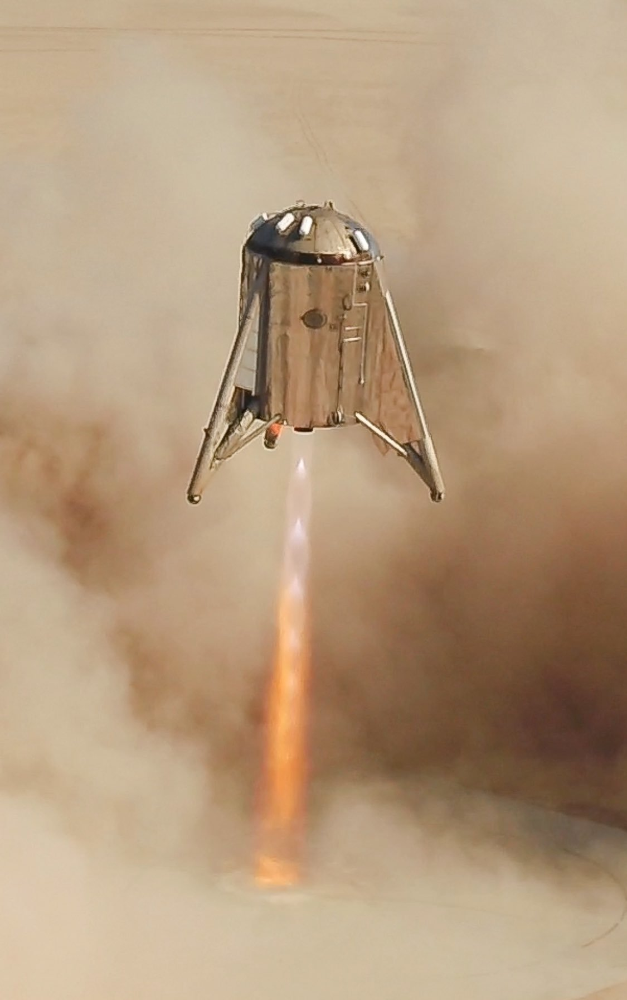

# 🐦 @elonmusk

## 📅 November 17, 2026

> 4 post(s) archived.

---

### 🕐 02:04 UTC · @elonmusk

> 😂 For many on the left, SpaceX exists in a bizzare quantum superposition of cognitive dissonance. SpaceX is simultaneously both a shameless valueless con job AND critical national infrastructure so essential that it must be nationalized.

🔗 [View original post](https://x.com/elonmusk/status/2122511154455134253)

---

### 🕐 01:04 UTC · @elonmusk

> 💯😂 @DJSnM Jus sayin…

🔗 [View original post](https://x.com/elonmusk/status/2122496146538946784)

---

### 🕐 00:43 UTC · @elonmusk

> NASA chief Jared Isaacman after SpaceX’s Starship catch: “This really changes everything.” “They’re doing all of this for a reason, not for this one and done demonstration you’re seeing now, but to build a world where you have lots of Starships that are flying routinely, almost on an hourly basis.” “You can experiment, build out a grand orbital economy, build lots of commercial space stations.” Media

🔗 [View original post](https://x.com/cb_doge/status/2122490851129774345)

---

### 🕐 00:25 UTC · @elonmusk

> only 2,670 **days** between these two photos We’ve come a long way

🔗 [View original post](https://x.com/ArthurMacwaters/status/2122486274040951096)

---
