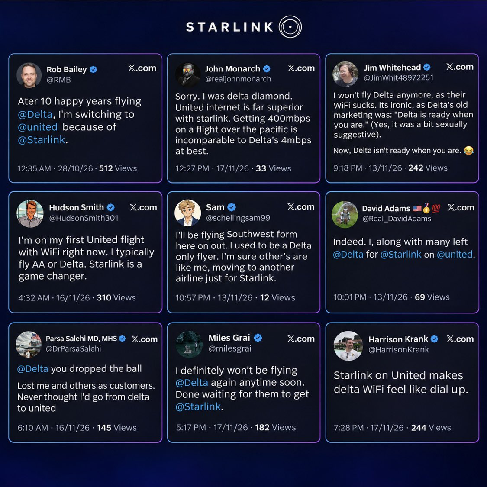
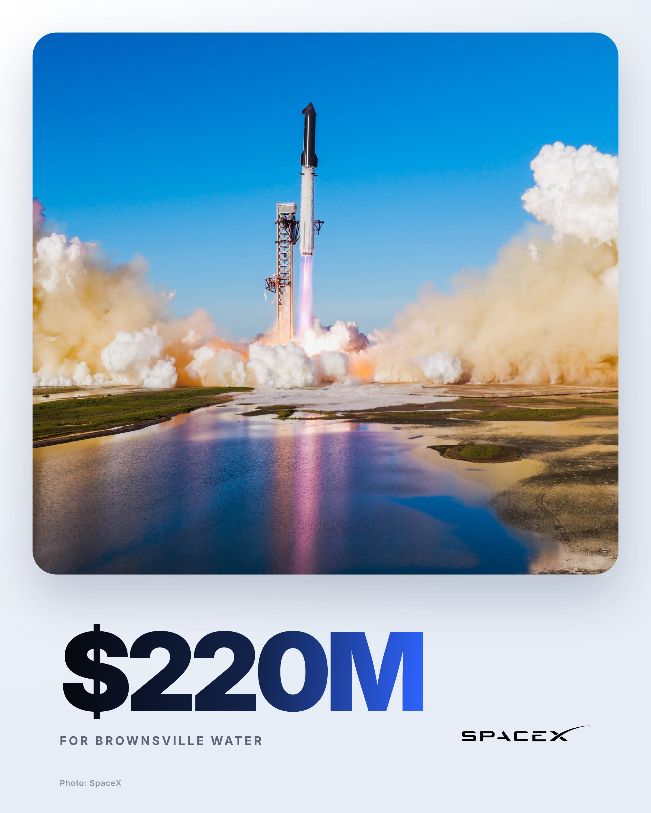
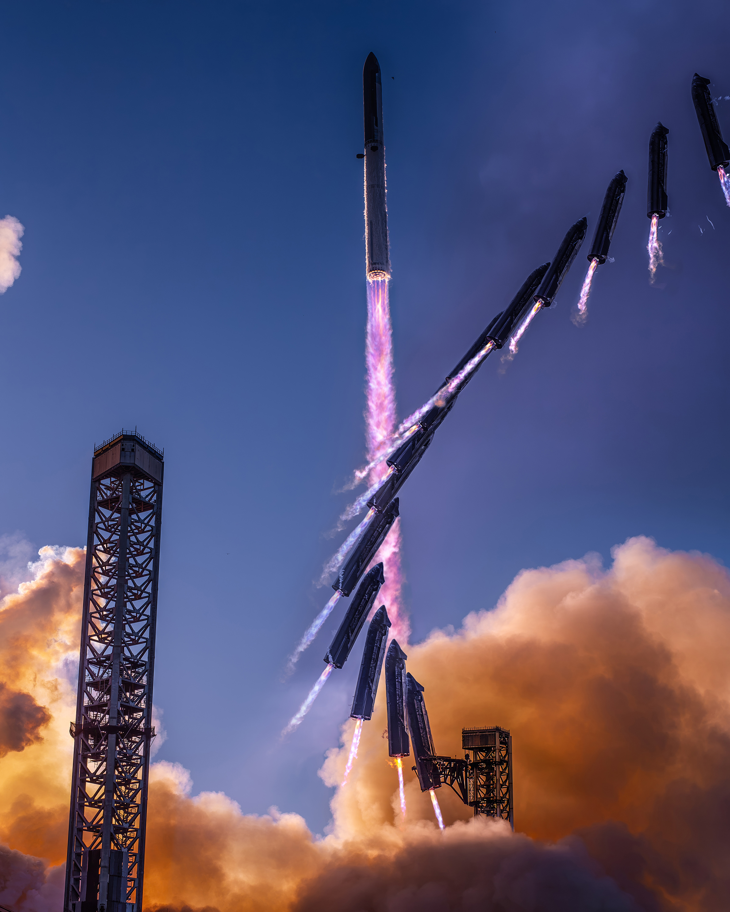
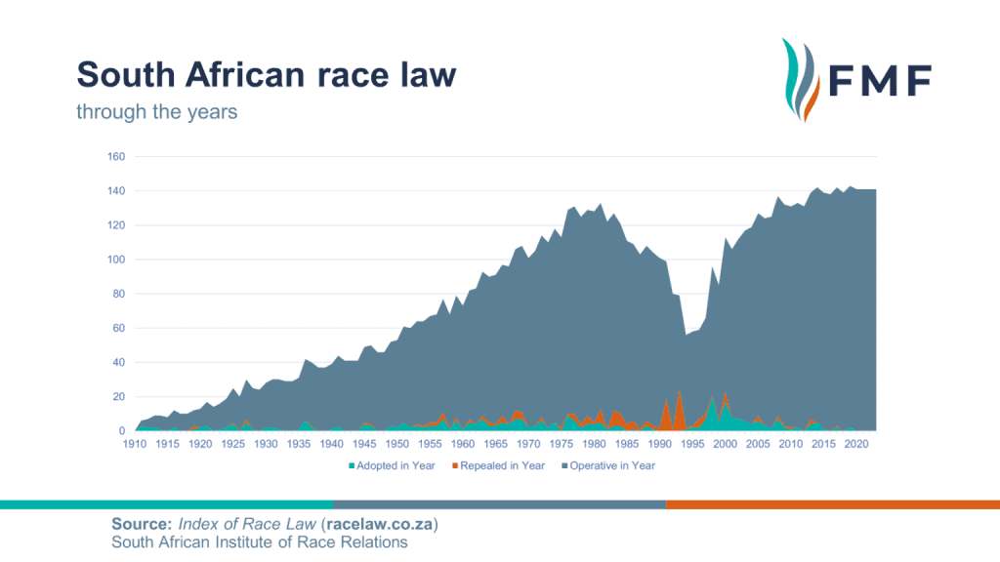
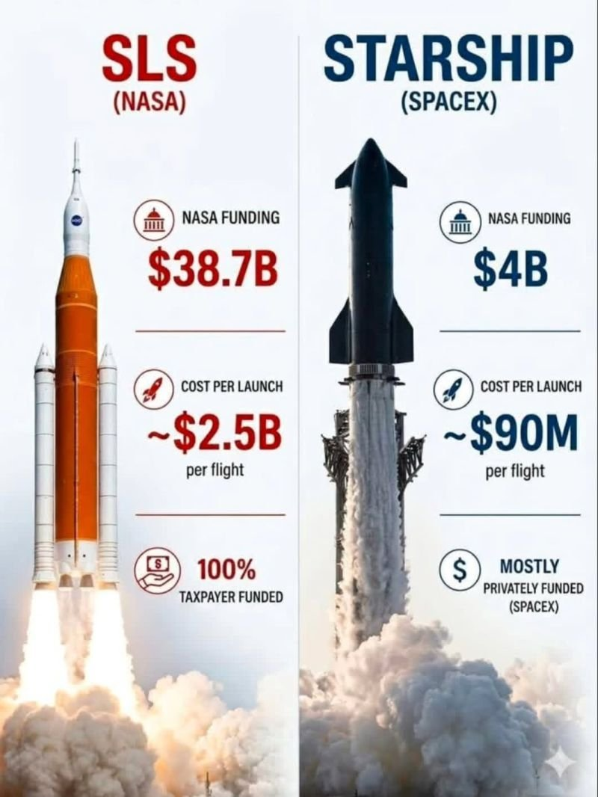

# 🐦 @elonmusk

## 📅 November 17, 2026

> 39 post(s) archived.

---

### 🕐 21:55 UTC · @elonmusk

> 🤦‍♂️ 🚨 JUST IN: Sec. Sean Duffy RESPONDS to Elon Musk saying he offered the Trump admin FREE Starlink for the FAA, but was turned down &quot;We thought that the best method is to have a network [that&apos;s] based on the ground.&quot; &quot;What he&apos;s doing with Starlink and the speed is remarkable — bu…

🔗 [View original post](https://x.com/elonmusk/status/2122810772967575759)

---

### 🕐 19:54 UTC · @elonmusk

> 🚨SpaceX CFO Bret Johnsen: “I hope everyone&apos;s trying Grok Bot, it is amazing. It’s probably the best agentic AI solution out there. If you look at Grok Bot and the updates that are coming on the Grok model as well, and the coding capability of Cursor, we have a very diversified software portfolio that&apos;s just going to get better and better.” Media

🔗 [View original post](https://x.com/cb_doge/status/2122780502277140508)

---

### 🕐 18:18 UTC · @elonmusk

> SpaceXSI has released a blog: Building an accounting team with Grok Bot

🔗 [View original post](https://x.com/techdevnotes/status/2122756172591812708)

---

### 🕐 17:53 UTC · @elonmusk

> Delta’s CEO said today, “We’ve been the leader in free, fast Wi-Fi,” and claimed customers don’t pick airlines based on Wi-Fi. The reality tells a completely different story. His own loyal customers are switching to airlines with Starlink 👇

🔗 [View original post](https://x.com/cb_doge/status/2122749962547270102)

---

### 🕐 17:44 UTC · @elonmusk

> Starlink saves lives Starlink helped save four sailors’ lives after a whale collision left their yacht sinking in the South Pacific. ♥️ A yacht suffered severe damage around 250 nautical miles north of Norfolk Island. As water poured in, the crew activated emergency beacons. Their Starlink connectio…

🔗 [View original post](https://x.com/elonmusk/status/2122747622662222010)

---

### 🕐 17:43 UTC · @elonmusk

> Transformers have barely changed since the 1890s: copper coils in a tank of oil. Batteries, solar and compute run on DC. The grid runs on AC. Bridging the two has meant inverters plus transformers. Powercore is a solid-state transformer, breaker and inverter in one box. Finally, one conversion and about half the losses. Hats off to the Tesla power electronics engineers! https://x.com/i/article/2122734886062813184

🔗 [View original post](https://x.com/MdeZegher/status/2122747456836587939)

---

### 🕐 16:46 UTC · @elonmusk

> Advanced solid state transformers at scale from Tesla Introducing Powercore Solid state medium voltage transformer, inverter and breaker – reliable, safe and secure 7.4 MW/9 MVA continuously at 34.5 kVac w/ grid-forming support for 10MVA of peak power Made in America. Operating 2027

🔗 [View original post](https://x.com/elonmusk/status/2122733232894468308)

---

### 🕐 16:42 UTC · @elonmusk

> Yes! This is sorely needed. Introducing Powercore Solid state medium voltage transformer, inverter and breaker – reliable, safe and secure 7.4 MW/9 MVA continuously at 34.5 kVac w/ grid-forming support for 10MVA of peak power Made in America. Operating 2027

🔗 [View original post](https://x.com/jamesdouma/status/2122732163942752316)

---

### 🕐 16:18 UTC · @elonmusk

> Over the past week, I’ve been overwhelmed by the love and support of friends, industry colleagues, and people I&apos;ve never met. Thank you to everyone who has shown kindness to my family and me. It means the world to me. I came to the United States 53 years ago, and becoming an American citizen is one of the greatest gifts and proudest moments of my life. NVIDIA has been my life’s work. Building it into the company it is today alongside my colleagues has been a privilege and an honor. Nowhere but in America could a company like NVIDIA be possible. I love our country, and I love NVIDIA. I did not live up to the standards expected of everyone at NVIDIA, and I have made serious mistakes in my personal life. I created problems for the Board that I deeply regret. I own my mistakes completely, and I am committed to cooperating with the Board’s independent investigation. Since my departure, I’ve seen an outpouring of calls from NVIDIA’s employees, investors, business partners, and customers for me to return as CEO. Many continue to reach out to me directly as the company navigates complex technology, market, competitive, and geopolitical dynamics. NVIDIA is a once-in-a-generation company. If the Board of Directors decides that my return is in the best interest of our shareholders, our employees, the company, and America, I would be honored to answer these calls and return as CEO. Thank you again to everyone who has shared their good wishes. I am profoundly humbled by your support. To my family: I love you, and I will spend the rest of my life being worthy of yours. Jensen

🔗 [View original post](https://x.com/JensenHuang/status/2122726005219737649)

---

### 🕐 16:11 UTC · @elonmusk

> Tesla has officially unveiled its first-ever transformer called Powercore, enabling fully off-grid data centers. • Solid state medium voltage transformer, inverter &amp; breaker • Peak efficiency: 98.86% • Power: 9 MVA 7.4 MW. Grid-forming support for 10MVA of peak power. • AC Voltage: 10 kV - 35 kV • DC Voltage: 800 Vdc - 2000 Vdc • 25-year warranty • Make Tesla Megablock even better • Powers 800 Vdc data centers • Accelerates 1500 to 2000 Vdc solar • Made in America • Operating 2027 Introducing Powercore Solid state medium voltage transformer, inverter and breaker – reliable, safe and secure 7.4 MW/9 MVA continuously at 34.5 kVac w/ grid-forming support for 10MVA of peak power Made in America. Operating 2027

🔗 [View original post](https://x.com/SawyerMerritt/status/2122724413036761244)

---

### 🕐 16:07 UTC · @elonmusk

> SpaceX just provided another $30 MILLION to help secure Brownsville&apos;s water future That brings the total to $70 MILLION already deposited toward its massive $220 MILLION commitment to water and wastewater infrastructure in South Texas Here&apos;s what the investment will support: • Expanding drinking water infrastructure across Brownsville and Cameron County • Recovering and treating wastewater for reuse as drinking water • Expanding groundwater treatment facilities and adding new wells • Adding approximately 18 MILLION gallons of water capacity per day • Reducing the region&apos;s dependence on the Rio Grande And this isn&apos;t just about supporting SpaceX&apos;s growing operations at Starbase These projects are designed to provide a more reliable, sustainable water supply for local communities for generations to come SpaceX isn&apos;t just building the future of spaceflight in South Texas It&apos;s also helping build the infrastructure that communities on Earth depend on

🔗 [View original post](https://x.com/XFreeze/status/2122723345225617654)

---

### 🕐 16:00 UTC · @elonmusk

> Tesla’s Annual Meeting is coming up on December 3 &amp; we need your vote Voting is quick &amp; easy – you can vote online, by mail, by QR code or by phone @Tesla_Optimus can show you how https://VoteTesla.com Media

🔗 [View original post](https://x.com/Tesla/status/2122721430596997348)

---

### 🕐 15:30 UTC · @elonmusk

> I combined 15 of my launch/catch photos to create this: A composite image telling the story of this historic event. I titled it &quot;Dreams of Martian Skies&quot;. Suddenly that dream feels a bit more real. Get the Print and read more info about how it was captured 👇

🔗 [View original post](https://x.com/AJamesMcCarthy/status/2122714087998292030)

---

### 🕐 14:25 UTC · @elonmusk

> Not &quot;pretty darn close&quot;. Starlink: ~100 Mbps down ~20 Mbps up, Latency ~30 ms ViaSat: ~`10 Mbps down ~2 Mbps up Latency &gt; 600 ms as the floor (can&apos;t get better). Order of magnitude difference. Delta Airlines CEO: &quot;We&apos;ve been out with a great product from Viasat, which we&apos;ve got two new satellites in the sky. It&apos;s not Starlink caliber but it&apos;s pretty darn close.&quot; It&apos;s not even remotely close to Starlink 😂😂

🔗 [View original post](https://x.com/pbeisel/status/2122697537693872373)

---

### 🕐 14:13 UTC · @elonmusk

> Gave the same task to Grok bot and OpenAI&apos;s Dot yesterday. Grok finished it in under 2 hours. Dot still has no clue what it&apos;s doing, it&apos;s completely frozen. If all that compute had gone into the subscription instead of Dot, the subscription would be worth a lot more.

🔗 [View original post](https://x.com/Da7_Tech/status/2122694607335235839)

---

### 🕐 11:59 UTC · @elonmusk

> BREAKING: Texas A&amp;M’s $205.5 million semiconductor project will help train America’s next generation of chipmakers for Terafab. 🇺🇸 University leaders say Terafab’s planned chip plant in Grimes County makes A&amp;M’s Semiconductor Institute even more relevant, with Terafab counting on the institute to help attract talent. • $205.5 million project: The institute’s new building in Bryan and supporting water infrastructure will serve chip research, development and workforce training. • Practical training for Terafab jobs: Director Steve Putna says students will train in an environment designed to help them move smoothly into Terafab’s workforce. • Access to engineering talent: Texas A&amp;M graduates more than 5,000 engineers annually, giving nearby chipmakers a major source of potential recruits. • Industry-style facilities: The institute will feature a cleanroom and six laboratories, giving students practical experience with semiconductor technology. • Construction is progressing: The building is about 20% complete. Substantial completion is expected by the end of 2027, with significant operations planned for mid-2028. • Infrastructure for long-term growth: Regents just approved $14.2 million for a new well and storage system supporting the RELLIS campus, including the institute. Media

🔗 [View original post](https://x.com/cb_doge/status/2122660866311197015)

---

### 🕐 11:16 UTC · @elonmusk

> BREAKING: South Korea’s Jin Air to introduce FREE Starlink Wi-Fi next month. Boeing 737-8 jets will be equipped first, bringing high-speed internet to more passengers. Korean Air and Asiana already have Starlink on 42 aircraft. Now it’s expanding to budget airlines.

🔗 [View original post](https://x.com/cb_doge/status/2122650084794048574)

---

### 🕐 08:01 UTC · @elonmusk

> Cyber-Inception This video was made entirely using @Cyborg21&apos;s neuralink implant

🔗 [View original post](https://x.com/elonmusk/status/2122600952096280785)

---

### 🕐 07:47 UTC · @elonmusk

> south africa is one of the few countries in the world that still explicitly discriminates based on race through its laws. since apartheid ended, it has passed 122 race-based laws explicitly discriminating against White South Africans. @semafor @jonkarl South Africa is now super racist against Whites and Asians

🔗 [View original post](https://x.com/IterIntellectus/status/2122597466034028975)

---

### 🕐 07:44 UTC · @elonmusk

> As a teenager, Elon Musk went through an existential crisis, reading religion and philosophy in search of the meaning of life Then he discovered Douglas Adams&apos; The Hitchhiker&apos;s Guide to the Galaxy “I ended up reading The Hitchhiker&apos;s Guide to the Galaxy, which is actually a book on philosophy, just sort of disguised as a silly humor book. But it&apos;s actually a philosophy book. And Adams makes the point that it&apos;s actually the question that is harder than the answer” A seemingly silly humor book helped a teenager searching for meaning realize something profound Finding the right question is often harder than finding the answer And that curiosity never left him Today, it&apos;s driving him to build rockets, explore the universe, and push humanity toward the stars

🔗 [View original post](https://x.com/XFreeze/status/2122596768051548482)

---

### 🕐 07:14 UTC · @elonmusk

> @XFreeze I found a pic of “the long game”

🔗 [View original post](https://x.com/elonmusk/status/2122589089702813944)

---

### 🕐 07:08 UTC · @elonmusk

> Was good to see @lrocket &amp; @HansKoenigsmann at the first ship catch &quot;@elonmusk really gets the best out of everybody, and that&apos;s why that company is so incredible.&quot; Tom Mueller

🔗 [View original post](https://x.com/elonmusk/status/2122587577274237129)

---

### 🕐 06:30 UTC · @elonmusk

> Find me when you wake up. Media Relentless reinforcement learning must feel like Edge of Tomorrow to superintelligence

🔗 [View original post](https://x.com/paranoidream/status/2122578000487256086)

---

### 🕐 06:26 UTC · @elonmusk

> Relentless reinforcement learning must feel like Edge of Tomorrow to superintelligence

🔗 [View original post](https://x.com/elonmusk/status/2122577169863885235)

---

### 🕐 06:23 UTC · @elonmusk

> Starship 42 Media

🔗 [View original post](https://x.com/elonmusk/status/2122576221846253837)

---

### 🕐 06:06 UTC · @elonmusk

> How can Grok @Bot be more helpful? 👋 Looking to get some feedback from folks automating most of their work with Bot, in exchange for some credits. If this is you, please reply to this thread with how you use Bot and DM me your email!

🔗 [View original post](https://x.com/elonmusk/status/2122572107116642664)

---

### 🕐 05:33 UTC · @elonmusk

> Jensen was demanding of his executives, yet consistently kind and supportive to individual contributors like me. Too many companies coddle their executives and shield them from accountability when things go wrong. Jensen did the opposite. I didn’t mind that my boss was demanding. All my previous bosses held me to the highest standards. Without them, I would not be where I am today.

🔗 [View original post](https://x.com/yunta_tsai/status/2122563749668167851)

---

### 🕐 05:21 UTC · @elonmusk

> Grok @Bot Grok Bot just got off a 90 minute phone call with AT&amp;T handling a complex issue for me. Unfortunately, that’s the time limit for Grok Bot calls. However. AT&amp;T called me back and the agent was STUNNED that she had been talking to a bot for 90minutes. She’d had other bots call bef…

🔗 [View original post](https://x.com/elonmusk/status/2122560774073901341)

---

### 🕐 04:25 UTC · @elonmusk

> I remember Announcing the new solana:2j5SaS7xy776qCBpyPQbZjyQSAtKiFgrwjfErthnW2ZM @XMoney contest winners! At #1, winning $420.69 - &quot;You&apos;re Too Young to Remember&quot; by @DTM_lab

🔗 [View original post](https://x.com/elonmusk/status/2122546702112735233)

---

### 🕐 03:16 UTC · @elonmusk

> LEO BOZELL: “Everyone would agree that Starlink is a great idea for South Africa. Starlink is a great idea in every single nation on earth because of what it’s been able to do. … The government said, we want 30% of that company here, which of course is preposterous. And Elon Musk is never going to do that. … They said, no, we want 30% of your company. So he said, go pound sand. I’ll go in every other country on planet earth.” Media

🔗 [View original post](https://x.com/cb_doge/status/2122529345902350362)

---

### 🕐 02:14 UTC · @elonmusk

> 最近硅谷两大佬因为马斯克吵翻了，结果老马亲自下场，一句话把全网看乐了。 先是著名反垄断评论家 Matt 泼冷水：SpaceX 算什么奇迹？马斯克根本不是天才，无非是会找华尔街搞钱，用钞票和工程师硬堆出来的。 这话连平时谁都不服的硅谷传奇程序员 DHH 都看不下去了，直接回怼：太酸了！哪怕你不喜欢马斯克，也得承认他“把吹过的牛变成现实”的能力举世无双。从特斯拉、脑机接口到 SpaceX，世上有一百万个会搞钱的投资人，但只有一个马斯克。 随后马斯克本尊下场，只回了一句灵魂反问：“行，那你给我解释一下蓝色起源、波音和 ULA？” 这一刀，直接捅在了“唯金钱论”的肺管子上。 如果光靠砸钱就能上天，那现在的太空霸主绝不可能是 SpaceX： 1、 比谁更有钱？ 贝索斯的蓝色起源比 SpaceX 早成立两年，背后站着前世界首富，从来不缺钱，结果到现在还在努力追赶。 2、 比谁补贴多？ NASA 当年搞载人航天，同一个任务，给波音砸了 42 亿美元，给 SpaceX 只给了 26 亿。结果 SpaceX 从 2020 年就开始像公交车一样送宇航员上天，波音的飞船却连宇航员都接不回来，最后还得靠 SpaceX 去救场。 3、 比华尔街输血？ SpaceX 起步根本没有华尔街一分钱，全是马斯克卖掉 PayPal 后自己掏的 1 亿美元家底。猎鹰 1 号连炸三次后差点破产，第四次才绝处逢生。 DHH 说得太对了：钱能买来顶级工程师，但买不来“不怕炸火箭”的魄力。 看看星舰第 15 次试飞（Flight 15）就懂了：同一个任务里，助推器在海里丢了，但飞船却从轨道返航、被发射塔的“机械筷子”稳稳夹住。 放在传统航天巨头那里，“丢了助推器”这半句话，就够他们停飞开两年的事故批斗会了；但在 SpaceX，这只是通往成功的又一组实验数据。 @elonmusk 说实话，到底哪个更难造：是一枚能上天的火箭，还是一家“允许工程师靠炸火箭来试错”的公司？ Let’s take this gentleman’s argument at face value that anyone can throw money at rockets and get something like Starship, Falcon or Dragon. Perhaps he can explain to everyone how SpaceX is able to catch giant starships from orbit with chopsticks and deliver 85% of all Earth pay…

🔗 [View original post](https://x.com/ZhouTalks/status/2122513599998677298)

---

### 🕐 02:09 UTC · @elonmusk

> Grok Bot read my wife&apos;s medical records, researched the latest cancer treatments and trials, found the top specialist at Stanford and drafted the emails. Hours later, Stanford called us to start intake. @elonmusk, Grok is giving families like mine a path forward. 🙏

🔗 [View original post](https://x.com/teslaownersSV/status/2122512355062161744)

---

### 🕐 02:04 UTC · @elonmusk

> 😂 For many on the left, SpaceX exists in a bizzare quantum superposition of cognitive dissonance. SpaceX is simultaneously both a shameless valueless con job AND critical national infrastructure so essential that it must be nationalized.

🔗 [View original post](https://x.com/elonmusk/status/2122511154455134253)

---

### 🕐 01:53 UTC · @elonmusk

> BREAKING: The Government of Burundi is rolling out 435 Starlink kits to connect rural schools and health centers. 🇧🇮 The deployment is part of the Government of Burundi’s World Bank-funded Soleil-Nyakiriza project, serving rural communities. Media

🔗 [View original post](https://x.com/cb_doge/status/2122508406879895871)

---

### 🕐 01:13 UTC · @elonmusk

> Socialism vs Capitalism

🔗 [View original post](https://x.com/MAGAGEM1/status/2122498243699655165)

---

### 🕐 01:04 UTC · @elonmusk

> 💯😂 @DJSnM Jus sayin…

🔗 [View original post](https://x.com/elonmusk/status/2122496146538946784)

---

### 🕐 01:00 UTC · @elonmusk

> As you can see from the chart, grifting podcasters, malicious YouTube algorithm, and illegal memes have caused young men to glam onto unacceptable reactionary ideologies. They’ve gone completely insane, while women have stayed the same. I have a new article out today in the New York Times on a topic that is really close to my heart. Both in my work and also socially, I speak often to young conservative women. I started hearing about the &quot;Repeal the 19th&quot; discussion on college campuses a few years ago. I also he…

🔗 [View original post](https://x.com/spqr_sulla/status/2122495096209678677)

---

### 🕐 00:43 UTC · @elonmusk

> NASA chief Jared Isaacman after SpaceX’s Starship catch: “This really changes everything.” “They’re doing all of this for a reason, not for this one and done demonstration you’re seeing now, but to build a world where you have lots of Starships that are flying routinely, almost on an hourly basis.” “You can experiment, build out a grand orbital economy, build lots of commercial space stations.” Media

🔗 [View original post](https://x.com/cb_doge/status/2122490851129774345)

---

### 🕐 00:25 UTC · @elonmusk

> only 2,670 **days** between these two photos We’ve come a long way

🔗 [View original post](https://x.com/ArthurMacwaters/status/2122486274040951096)

---
