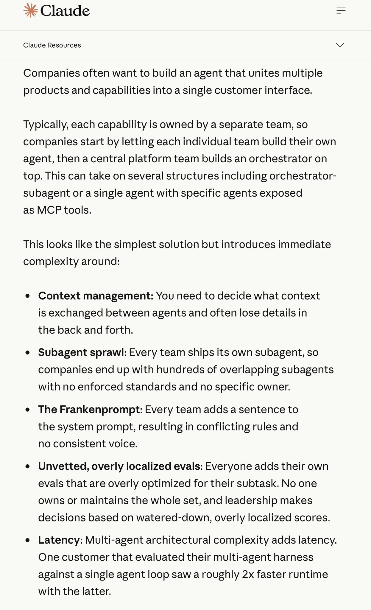

# 🐦 @emollick

## 📅 November 17, 2026

> 11 post(s) archived.

---

### 🕐 14:37 UTC · @emollick

> AI is a general purpose technology has good and bad impacts, the general model should be improving the good and building on it, while mitigating the bad. Seeing AI as all one thing is a barrier. @emollick Honestly most players I see aren&apos;t mad about devs using AI to help write code, they&apos;re mad about AI art and low effort shovelware. Lumping it all into one fight makes it way harder to push for the good uses.

🔗 [View original post](https://x.com/emollick/status/2122700639645933793)

---

### 🕐 14:33 UTC · @emollick

> Games have always been a very difficult industry with a high cost to its workers in terms of crunch &amp; instability. I would love to see more positive visions about how you rebuild an industry stronger using AI, rather than defending the status quo as good and AI is going away.

🔗 [View original post](https://x.com/emollick/status/2122699739389132891)

---

### 🕐 14:30 UTC · @emollick

> The discussion of AI in gaming is pernicious now. The idea that games are going to be the only field where humans write code unassisted is obviously wrong. But the push for that means missing a chance to guide AI usage toward approaches that empower workers &amp; help gaming thrive.

🔗 [View original post](https://x.com/emollick/status/2122698867883827584)

---

### 🕐 13:46 UTC · @emollick

> We keep relearning some sort of lesson. If only there was a word to describe how bitter it is to learn.

🔗 [View original post](https://x.com/emollick/status/2122687948181114887)

---

### 🕐 12:41 UTC · @emollick

> Ha the bot responses here missing the point.

🔗 [View original post](https://x.com/emollick/status/2122671527258955888)

---

### 🕐 12:33 UTC · @emollick

> What they mean when they say the expected value is continued 2% growth. I think about this chart at least a few times a week

🔗 [View original post](https://x.com/emollick/status/2122669466777481472)

---

### 🕐 12:15 UTC · @emollick

> This by Anthropic seems both right &amp; a condemnation of many “agentic solutions” &amp; harnesses being built at companies. Rather than a sprawl of specialized subagents built by different teams, you often get better &amp; cheaper results using one agent to do it all https://claude.com/resources/articles/building-agents-when-to-fold-subagents-into-your-main-agent-loop

🔗 [View original post](https://x.com/emollick/status/2122664990624641421)

---

### 🕐 02:38 UTC · @emollick

> It is a very funny time where the markets are basically assuming the future will look like the past even as many CEOs &amp; AI observers &amp; government officials keep yelling that the future is coming and it will change everything. Efficient markets versus radical discontinuities? Half my TL thinks AI is going to destroy the world, the other half thinks it can’t even help Google hit its like 8% growth targets

🔗 [View original post](https://x.com/emollick/status/2122519737318150181)

---

### 🕐 01:18 UTC · @emollick

> I will say that the Mythos security freakout, much derided at the time, and the focus on first deploying cyber models with limited access from the Labs seems to have been an effective step in mitigating some of the downside cyber risk that would have otherwise happened from AI.

🔗 [View original post](https://x.com/emollick/status/2122499485079060559)

---

### 🕐 01:15 UTC · @emollick

> I say this as I see every outage of the last five days get picked up by people who did not pay attention to cybersecurity before, usually with the implication that &quot;this is the big one,&quot; which, in turn, leads people on both X and real life to panic and spread further rumors.

🔗 [View original post](https://x.com/emollick/status/2122498761805255097)

---

### 🕐 00:59 UTC · @emollick

> A lot of folks don&apos;t realize how much of our computer infrastructure is an improvised system prone to cascading failures. You didn&apos;t need offensive AI cyberattacks to have big outages like Microsoft/FAA. Of course, now we DO have to deal with offensive AI (but also defensive AIs)

🔗 [View original post](https://x.com/emollick/status/2122494694953492810)

---
