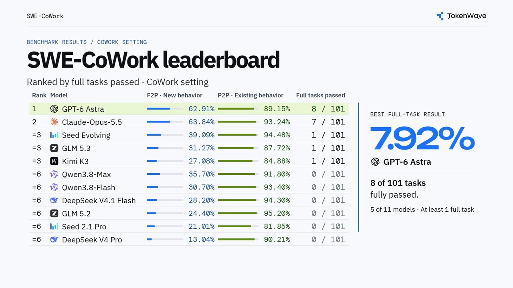

# 🐦 @omarsar0

## 📅 November 17, 2026

> 1 post(s) archived.

---

### 🕐 16:02 UTC · @omarsar0

> Handoff capabilities are something I am looking at closely with agents. They are still hard to code for agents. SWE-CoWork measures this by putting an agent in a simulated team with tickets, docs, and teammates it can ask. It then has to deliver a patch that passes hidden tests across 101 real repos. The best model fully finished 8 of 101 tasks. For Claude Opus 5.5, more than half of the failed checks came after the agent already had the requirement. Great work from @TokenWaveai. Can a coding agent take over a teammate’s work in progress? Introducing SWE-CoWork, a benchmark for coding agents working as digital employees on long-horizon software engineering tasks. Each assignment starts with a short handoff in a simulated workplace modeled on real-world e…

🔗 [View original post](https://x.com/omarsar0/status/2122721966574408112)

---
