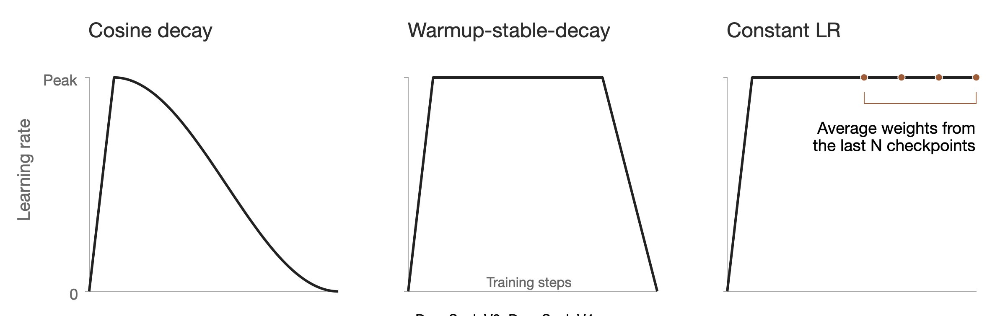

# 🐦 @rasbt

## 📅 November 17, 2026

> 1 post(s) archived.

---

### 🕐 16:00 UTC · @rasbt

> Could be the start of a trend in new pre-training recipes: no LR decay phase anymore. (Also seen in Kolibri.) Instead: constant LR + averaging the last N checkpoints (or a running weight average). I guess that makes it easier in practice because you don&apos;t have to commit to a total training length upfront. A little meta analysis based on those who share training details: - Classic cosine: Llama 3, OLMo 2, OLMo 3, GLM-4.5, GLM-5, Kimi K3, Phi-4 - WSD (&quot;Warmup-Stable-Decay&quot;): DeepSeek V3, DeepSeek V4, DeepSeek V4.1-Flash, Kimi K2, Kimi Linear, Nemotron 3 Nano, Nemotron 3 Super, SmolLM3, MiniMax M2 - No decay (constant LR plus checkpoint averaging): Kolibri-1, DatologyAI&apos;s models Trick #3: Merge, merge, merge. In pretraining, we skipped LR decay for a running weight average. Then we merged pre-context-extension models into post-extension checkpoints (see fig. for ablation study gains). Merging was also an expedient stand-in for MOPD in our RLVR recipe.

🔗 [View original post](https://x.com/rasbt/status/2122721652433715481)

---
