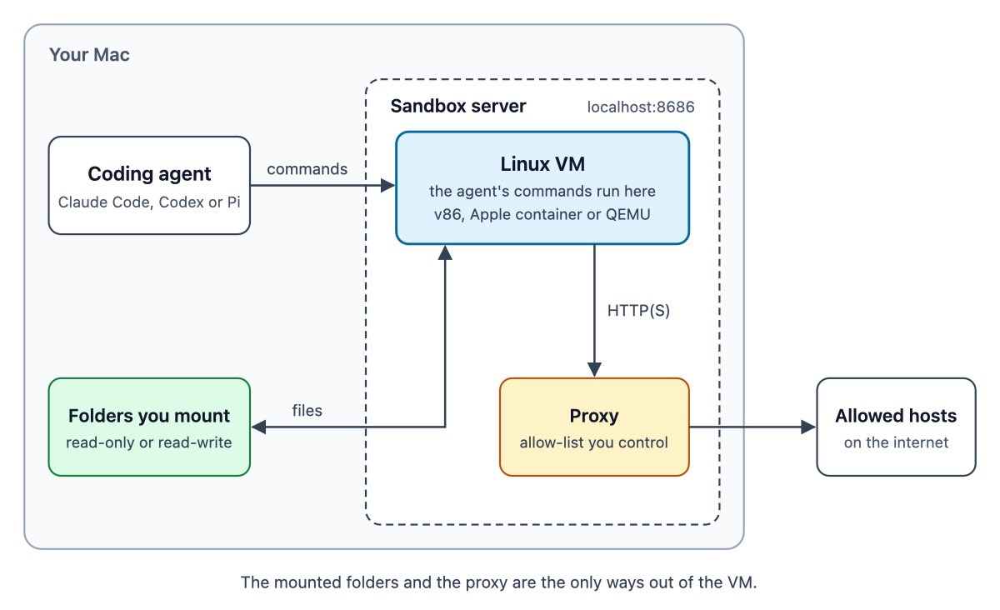

# 🐦 @simonw

## 📅 November 17, 2026

> 4 post(s) archived.

---

### 🕐 17:37 UTC · @simonw

> I shipped a new version of Datasette Lite recently - my build of the Datasette Python web app that runs entirely in the browser with WebAssembly and Pyodide - here&apos;s what&apos;s new and how it all works https://simonwillison.net/2026/Nov/17/datasette-lite/

🔗 [View original post](https://x.com/simonw/status/2122746008736276734)

---

### 🕐 01:21 UTC · @simonw

> Each of the three sandbox servers includes an optional HTTP/HTTPS allow-list proxy, so you can control exactly which hosts your agent&apos;s code can communicate with - plus a credential replacement mechanism to make authenticated API calls without sharing a secret with the agent

🔗 [View original post](https://x.com/simonw/status/2122500317187330279)

---

### 🕐 01:21 UTC · @simonw

> I worked on this project with Prime Radiant, the AI research lab behind Superpowers - here&apos;s our index repository for these external sandbox prototypes https://github.com/prime-radiant-inc/external-sandbox

🔗 [View original post](https://x.com/simonw/status/2122500313886396840)

---

### 🕐 01:21 UTC · @simonw

> I&apos;ve been exploring new ways to sandbox code written by coding agents - here&apos;s a description of the external sandbox pattern, where agents run on your Mac but execute code in a WebAssembly or QEMU or Apple Container sandbox - with demos for Claude Code, Codex and Pi https://blog.primeradiant.com/external-sandboxes-for-coding-agents/

🔗 [View original post](https://x.com/simonw/status/2122500307557265651)

---
