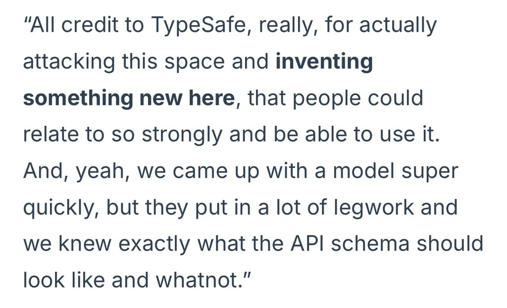
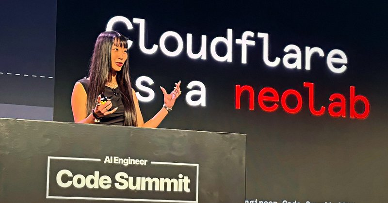
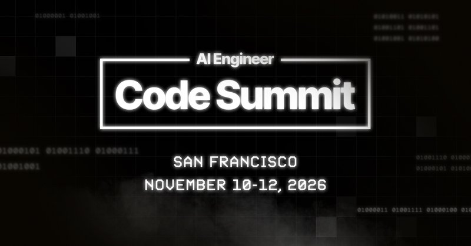
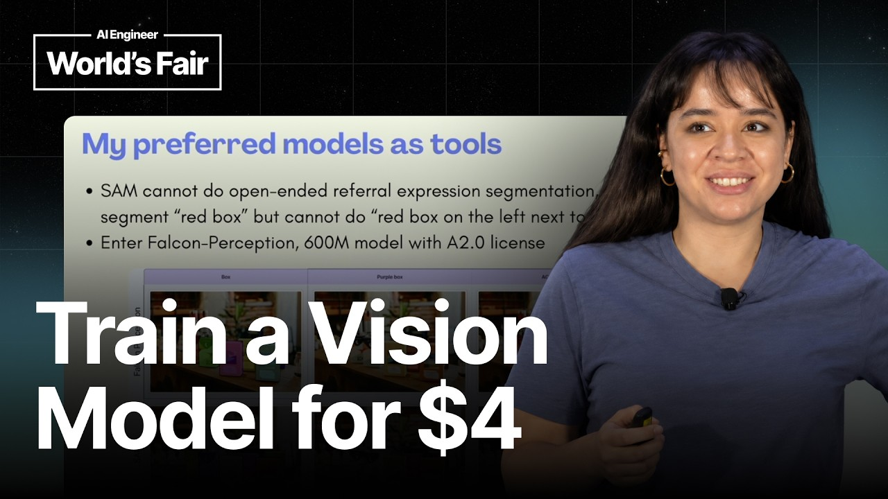

# 🐦 @swyx

## 📅 November 17, 2026

> 8 post(s) archived.

---

### 🕐 22:24 UTC · @swyx

> technical details: &gt; inter-session context is surfaced by default. Teams now create dedicated bots for different projects; while these different devins can talk to each other when necessary, they each have their own individual memory bank and goals. Each bot now has its own, long lived identity. The transition from &quot;Devin is a swarm of ephemeral agents&quot; to &quot;Devin is a collection of bots, each with their own persistent identity and memory&quot; is changing how people use and prompt Devin. https://x.com/stevenkplus1/status/2122761055588012112 Bots are super cool and if you haven&apos;t used them yet, you absolutely must try them. Create a bot to manage a goal or a project that you&apos;ll work on across multiple sessions and days. Some technical tidbits about the architecture and design: Devin used to have a major UX problem: …

🔗 [View original post](https://x.com/swyx/status/2122818291144229075)

---

### 🕐 17:39 UTC · @swyx

> devin bots are multi-agent teams done right: - always on, proactive (but tuned for ROI) - own outcomes not tasks (but can collab w others) - manages teams of subagents (and reviews itself) - available everywhere (call text slack whatever hello @interaction) - consistent reporting thru interactive artifacts aka devinapps not long chats (HTML is all you need™ @trq212) this is the preview that @walden_yan gave at AIE. i&apos;ve been trialing them for a week and i&apos;ve been able to hand over my AEO, QA, cross-platform app porting, personal admin automation, and video editing work (also simultaneously moving from local agent worktree hell to cloud because ofc this is all cloud based thank god) hyped concepts this replaces: - /goal - &quot;ultracode&quot; / &quot;ultra mode&quot; - &quot;loop engineering&quot; - &quot;agent to agent&quot; - &quot;agent swarms&quot; - AI employees (see below) my main aha moment is that you don&apos;t want &quot;AI Employees&quot;, we do not have agi yet and you will just fail if you overpromise/overexpect. what you want is the &quot;just&quot; the next level of abstraction above single tasks, and the overwhelming consensus I&apos;ve had talking to everyone at the frontier of agents (yes incl cog competitors) is agent managers that own outcomes. incidentally, as an employer of humans it&apos;s also how i distinguish between someone who &quot;has agency&quot; (owns a problem area, finds issues and researches/brings solutions not problems) and who doesn&apos;t (only does precisely what i asked, not proactive, doesn&apos;t come up with suggestions i didn&apos;t think about). guess which one i value more lol. if youre a startup, reminder that Devin for Startups offers 65k in credits. apply via clanker Meet Devin Bots. From writing firmware to merging thousands of PRs a week, a Devin Bot leads a team of agents to get the job done.

🔗 [View original post](https://x.com/swyx/status/2122746401482592549)

---

### 🕐 15:51 UTC · @swyx

> i kept getting questions on how we released clef so quickly after jev, but i strongly believe that we’re mostly reaping the benefits of asymmetric effort: new ideas are difficult to invent and easy to copy. @typesafeai has done an incredible job in pioneering this concept of system one models. i also strongly believe that it is not a zero-sum game! it’s almost a duty for all of us to solve difficult hardware constraints through software, and system one models allow us to offload some of the work we’d regularly send to LLMs towards smaller, faster, and less compute-intensive models. we’re also still challenging ourselves to invent in this space as well, with the launch of clairic and more. i’m excited for the future of cloudflare as a neolab and hope you are too. thank you to @ricmac for sitting down with me on this story! I&apos;ve been following @Cloudflare since it began 17 yrs ago. Its latest move into creating System One models is fascinating, and when I sat down with @michellechen at @aiDotEngineer Code, I discovered there are more models to come — incl reasoning models! https://latent.space/p/cl…

🔗 [View original post](https://x.com/michellechen/status/2122719372309672295)

---

### 🕐 15:36 UTC · @swyx

> I&apos;ve been following @Cloudflare since it began 17 yrs ago. Its latest move into creating System One models is fascinating, and when I sat down with @michellechen at @aiDotEngineer Code, I discovered there are more models to come — incl reasoning models! https://latent.space/p/cloudflare/

🔗 [View original post](https://x.com/ricmac/status/2122715468695785649)

---

### 🕐 15:00 UTC · @swyx

> Prefer reading to watching? 50 talks from AI Engineer Code Summit, now in writing: illustrated essays, full transcripts and links to watch. Pick a topic. Find the idea you want to try. https://ai.engineer/code/2026#talks

🔗 [View original post](https://x.com/aiDotEngineer/status/2122706337641763147)

---

### 🕐 14:35 UTC · @swyx

> it&apos;s a skill issue to use frontier LLMs to detect objects or do vision instead, if you use LLMs as vision interns you can train a detector for $6 that runs at little cost. but your agent is a bad vision intern, it only knows old models that are proprietary and makes rookie mistakes so I built something for it, I basically distilled myself for you to use🤝 I put my favorite models from keypoint detection to OCR as a tool for your agent to call and I also made an e2e object detection trainer (from labelling to VLM as a judge to training and eval) if you&apos;re interested in it and the results, my talk at @aiDotEngineer WF is finally out, you can watch it here https://www.youtube.com/watch?v=dKcTBQzR7jI many thanks @swyx on the next post you can find the github repository, I also shipped decision model support and updated VLMs (LFM3, Qwen3.6/8)

🔗 [View original post](https://x.com/mervenoyann/status/2122700240922833075)

---

### 🕐 05:44 UTC · @swyx

> together deleted megkernels https://x.com/dylan__lim/status/2122463072489271342?a=_41bTPYK2im8-dYQD4A&amp;s=46 For the past two years, members of our team have been investigating what a next-generation system for inference optimization should look like. In the following blog, we revisit the assumptions behind today&apos;s compilers, share the experiments that challenged our thinking, and expl…

🔗 [View original post](https://x.com/swyx/status/2122566522094915765)

---

### 🕐 02:08 UTC · @swyx

> women are destroying the men, wtf is happening rn

🔗 [View original post](https://x.com/swyx/status/2122512082835067151)

---
