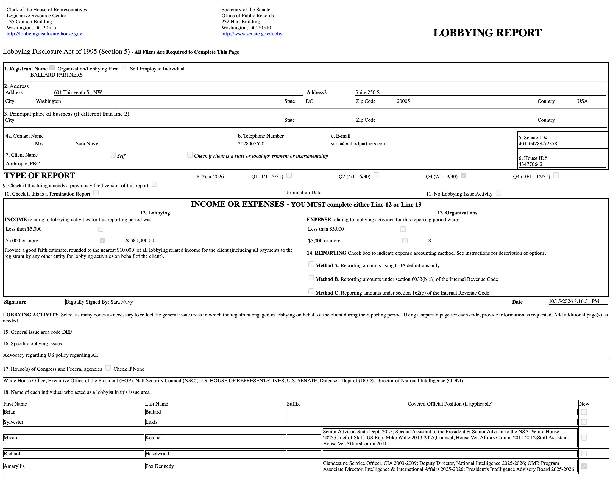

# 🐦 @ylecun

## 📅 November 17, 2026

> 2 post(s) archived.

---

### 🕐 02:44 UTC · @ylecun

> New connection between Anthropic lobby and US intelligence agencies. Amaryllis Fox Kennedy was Trump&apos;s Deputy DNI for Policy and Capabilities until May 2026. That&apos;s the same window U.S. intel was intercepting communications about Jensen Huang&apos;s affair with Alice Huang, and the same month Rubio briefed Trump on it. She currently sits on the President&apos;s Intelligence Advisory Board, while she also lobbies for Anthropic. Members of that advisory board hold top secret clearances and can see classified intel across every U.S. spy agency. https://federalregister.gov/executive-order/13462 In July, Fox Kennedy joined the lobbying firm Ballard Partners. Its Q3 filing lists her lobbying the DNI&apos;s office, the NSC, the Pentagon and the White House for Anthropic, which has paid Ballard $890K this year. https://lda.gov/filings/public/filing/62079cf1-23ea-4988-918e-c690b0f61217/print/ Now Politico reports that Fox Kennedy joined Anthropic&apos;s own national security advisory council, a hire announced by Anthropic&apos;s Chief Global Affairs Officer, Tino Cuéllar (remember Cuéllar; he&apos;ll come back) https://www.politico.com/newsletters/politico-influence/2026/11/06/the-oversight-dossier-that-has-k-street-buzzing-01154787

🔗 [View original post](https://x.com/KimChiSpicey/status/2122521163905798181)

---

### 🕐 01:51 UTC · @ylecun

> Can anyone lead the effort of creating such a list? Anyone with bandwidth? @natolambert @alexpolozov @mmitchell_ai @CGraziul @TaliaRinger @davetroy At the very least, we should organize a list of pro-open LLM businesses and academics and start reaching out. Additionally, I’m considering writing my representatives. I live in the Bay Area, though not in Silicon Valley.

🔗 [View original post](https://x.com/TaliaRinger/status/2122507846822887880)

---
