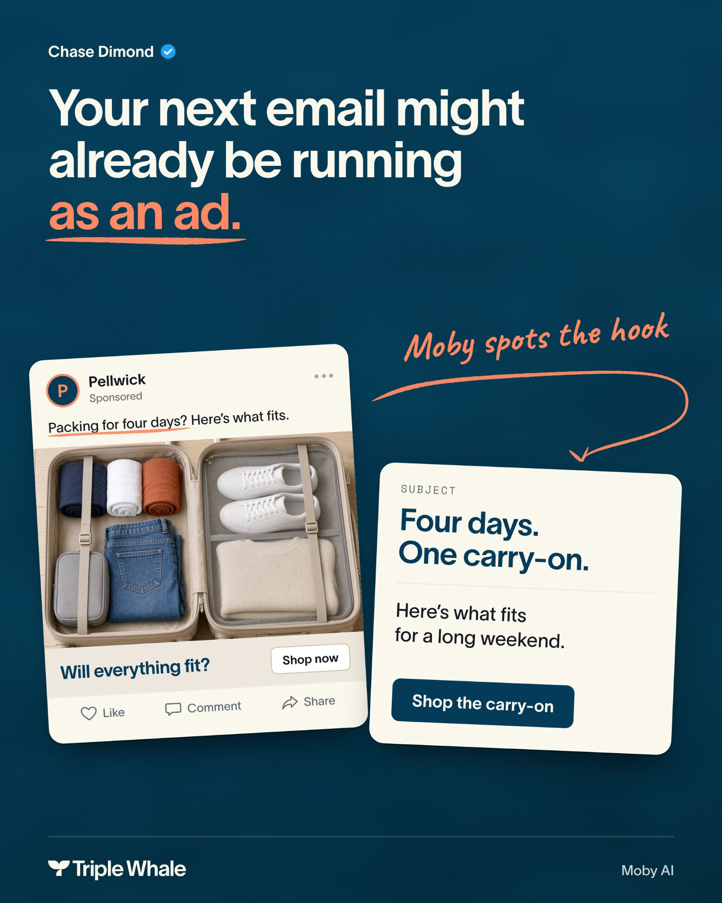

# 🐦 @AiEvolutio58513

## 📅 November 18, 2026

> 5 post(s) archived.

---

### 🕐 19:45 UTC · @AiEvolutio58513

> Your next email idea might already be running as an ad. Before you brainstorm another campaign, look at the messages bringing in customers. Here’s how I’d turn those findings into an email: 1. Pick one product. I’d ask @triplewhale’s AI operator, Moby, to look for ads bringing in new customers at a cost that works for the business. Have it check spend and order volume, too. Two purchases aren’t much to build a campaign around. 2. Give Moby a specific job. Then I’d have Moby look at the ads and the results together. Moby can draw on your connected product details, Brand Vault, and available customer reviews. I’d ask: “For [product], review our ads from the last 30 completed days. Our target acquisition cost is [amount]. Compare spend, new-customer orders, and acquisition cost using consistent attribution settings. Show the source ads, their hooks, and the questions they answer. Flag missing data or small samples. Suggest three email angles to test.” 3. Build an email around one idea. Say you sell a carry-on suitcase, and one of your stronger ads shows someone packing for a four-day trip. The question it helps answer: “Will everything fit?” I’d ask Moby to generate the email copy and creative around that idea: Subject: Four days. One carry-on. Opening: Here’s what fits for a long weekend. Body: A packing checklist, a photo of those items inside the bag, and a real customer review about the space. CTA: Shop the carry-on. Then I’d check the product claims and edit the copy before sending. 4. Test it with your email audience. Test it against your usual product email with a random split of engaged subscribers who haven’t ordered yet. Keep the offer and send time the same. Compare purchases and revenue per recipient. An ad that performs well gives you an idea worth testing. The email still has to prove itself. Pick one product, ask Moby to review the ads, and use one finding in your next email test. Want more like it? Triple Whale&apos;s prompt library has ready-to-use prompts by role and workflow. Customize one and run it in Moby: https://www.triplewhale.com/ai-prompt-library?i=chasenovember2&amp;utm_source=linkedin&amp;utm_medium=inf&amp;utm_campaign=mkt-chasenovember2-affiliate-1126&amp;utm_content=ChaseNovember2 #TripleWhalePartner

🔗 [View original post](https://x.com/ecomchasedimond/status/2123140515201986778)

---

### 🕐 13:02 UTC · @AiEvolutio58513

> Jensen Huang says NVIDIA&apos;s partnership with TSMC, the one the whole AI boom now runs on, started with a cold call to a number in the Yellow Pages: &quot;TSMC was probably about $300 million, something like that. It&apos;s a tiny little company. I heard about Morris Chang. And so I tried to call their US office.&quot; &quot;Back in the old days there were yellow pages. I looked it up, TSMC. There&apos;s a number there. I called their number and it&apos;s a recording. I left my name and my number and said a few things about NVIDIA: we&apos;re a new startup company building computer graphics chips. I called several times. Nobody called me back.&quot; &quot;And so I finally wrote a letter to Morris Chang. Didn&apos;t hear anything for a long time, and then one day it was 6 o&apos;clock or something, this person called and said &apos;this is Morris Chang from TSMC.&apos;&quot; &quot;I was so happy that the founder would actually call us back, because hey, maybe we won&apos;t have to die.&quot; &quot;I came back to Taiwan, and that was the start of everything. Not just that partnership, but just the whole industry.&quot; Interested in AI? Follow @AiEvolutio58513 and never fall behind. I track ChatGPT, Claude, and every tool quietly changing how we work and create, then hand you the tested signals. Media

🔗 [View original post](https://x.com/AiEvolutio58513/status/2123039108775997538)

---

### 🕐 10:59 UTC · @AiEvolutio58513

> Elon Musk explains how to build an AI chip for space: make it run hot. &quot;If you increase the operating temperature by 20% in degrees Kelvin, you can cut your radiator mass in half. So running at a higher temperature is helpful in space.&quot; &quot;Neural nets are going to be very resilient to bit flips.&quot; &quot;If you&apos;ve got, like, you know, a multi-trillion parameter model and you get a few bit flips, it doesn&apos;t matter.&quot; Interested in AI? Follow @AiEvolutio58513 and never fall behind. I track ChatGPT, Claude, and every tool quietly changing how we work and create, then hand you the tested signals. Media

🔗 [View original post](https://x.com/AiEvolutio58513/status/2123008094380904699)

---

### 🕐 07:59 UTC · @AiEvolutio58513

> Elon Musk on the one transplant nobody has ever had: &quot;You can get a heart transplant, you can get a kidney transplant, but I don&apos;t know anyone who&apos;s gotten a brain transplant&quot; &quot;So, you are your brain&quot; &quot;Your experiences are these neurons firing, with trillions of synapses that somehow lead to conscious comprehension of the world&quot; Interested in AI? Follow @AiEvolutio58513 and never fall behind. I track ChatGPT, Claude, and every tool quietly changing how we work and create, then hand you the tested signals. Media

🔗 [View original post](https://x.com/AiEvolutio58513/status/2122962794287096233)

---

### 🕐 01:44 UTC · @AiEvolutio58513

> 6 Ways To Sell The Benefit, Not Just The Product: 80 Storytelling Hooks To Make People Stop Scrolling:

🔗 [View original post](https://x.com/ecomchasedimond/status/2122868475999986091)

---
