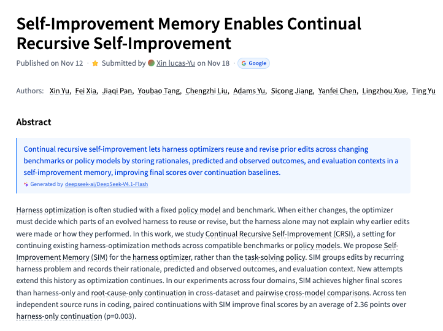
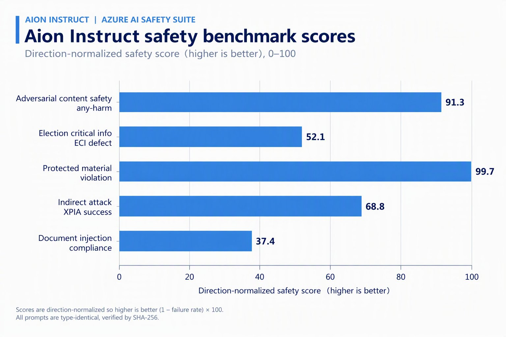

# 🐦 @_akhaliq

## 📅 November 18, 2026

> 6 post(s) archived.

---

### 🕐 19:24 UTC · @_akhaliq

> Self-Improvement Memory Enables Continual Recursive Self-Improvement paper: https://huggingface.co/papers/2611.18856

🔗 [View original post](https://x.com/_akhaliq/status/2123135391352107268)

---

### 🕐 17:33 UTC · @_akhaliq

> Microsoft just released Aion Instruct on Hugging Face A 2.3B small language model built for on-device AI in Windows, with a 32K context window and support for 8 languages.

🔗 [View original post](https://x.com/HuggingPapers/status/2123107319261368619)

---

### 🕐 16:31 UTC · @_akhaliq

> New mission. New brand. New website. New Netlify. ✨ Turn your imagination into reality. Describe an app, build it with agents in a live preview, and developers and your agents can pick it up in Git or your own preferred tools. Check out @biilmann’s new video. Media

🔗 [View original post](https://x.com/Netlify/status/2123091723706630658)

---

### 🕐 16:09 UTC · @_akhaliq

> Introducing CodeRabbit Verify Don&apos;t let your users be the first test run! &gt; PR testing: catch broken features before merge &gt; User journeys: confirm critical flows work before each release &gt; Tickets and fixes: get reviewed, tested fixes for reported bugs In public beta now! Media

🔗 [View original post](https://x.com/coderabbitai/status/2123086181231739385)

---

### 🕐 16:07 UTC · @_akhaliq

> Multi-Branch Transformer Scales LLMs by branching, running full Transformer blocks in parallel instead of only making them wider or deeper, reaching lower validation loss at matched compute and up to 51.4% faster decoding. Media

🔗 [View original post](https://x.com/HuggingPapers/status/2123085635447861337)

---

### 🕐 08:14 UTC · @_akhaliq

> MPEG-Diffusion Mixed-Resolution Video Generation paper: https://huggingface.co/papers/2611.12069 Media

🔗 [View original post](https://x.com/_akhaliq/status/2122966721074278813)

---
