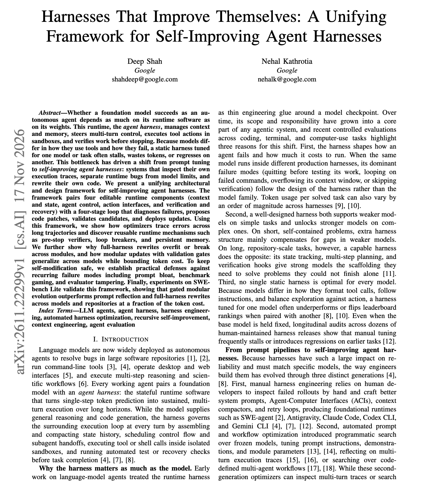

# 🐦 @dair_ai

## 📅 November 18, 2026

> 2 post(s) archived.

---

### 🕐 15:34 UTC · @dair_ai

> Another very interesting paper from Google on self-improving agent harnesses. (bookmark it) They let an optimizer rewrite the harness around a frozen Gemini 3.8 Flash on SWE-bench Lite and compared three approaches. - A prompt rule file lowered held-out accuracy from 5.0% to 2.5%. - A full rewrite of the harness reached 42.5% at 451.6k tokens per task. - Gated edits to one module at a time reached 40.0% at 46.7k tokens per task. The gated version splits the harness into four parts (context, control, tools, and verification). Each round it patches one part, checks the patch on held-out tasks under a token cap, and deploys it only if it passes. The gated harness also transferred to Gemini 4 Argon with no new search, solving 37.5% against 30.0% for the full rewrite. The test set is small (40 held-out issues), so treat the numbers as directional. The paper also lists failure modes to guard against when a harness edits itself, including prompt bloat, benchmark gaming, and evaluator tampering. https://arxiv.org/abs/2611.22299 Chat with Paper: https://academy.dair.ai/papers/harnesses-that-improve-themselves-a-unifying-framework-for-self-improving-agent-2611.22299

🔗 [View original post](https://x.com/omarsar0/status/2123077276350976396)

---

### 🕐 14:09 UTC · @dair_ai

> For a &quot;software factory&quot; to scale, you need a set of strong primitives. I feel like this auto-approving feature is an interesting primitive worth learning about. https://x.com/i/article/2123051296894717952

🔗 [View original post](https://x.com/omarsar0/status/2123056013582713318)

---
