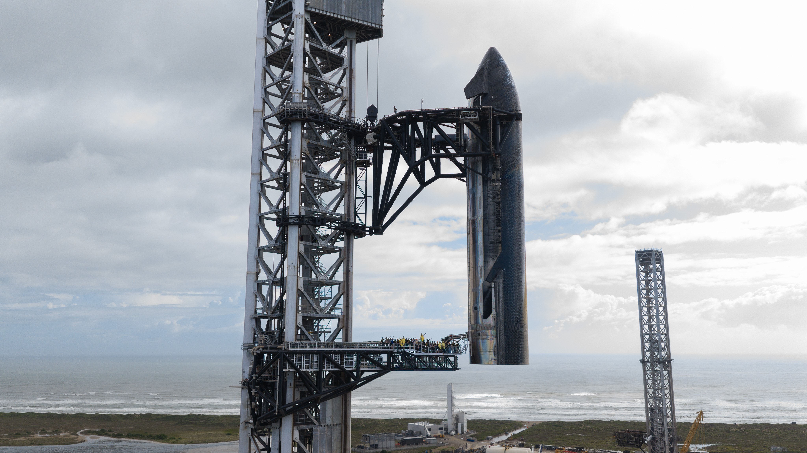
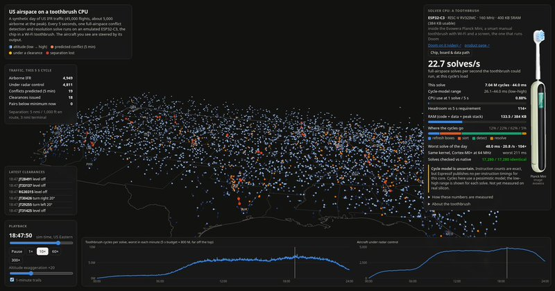
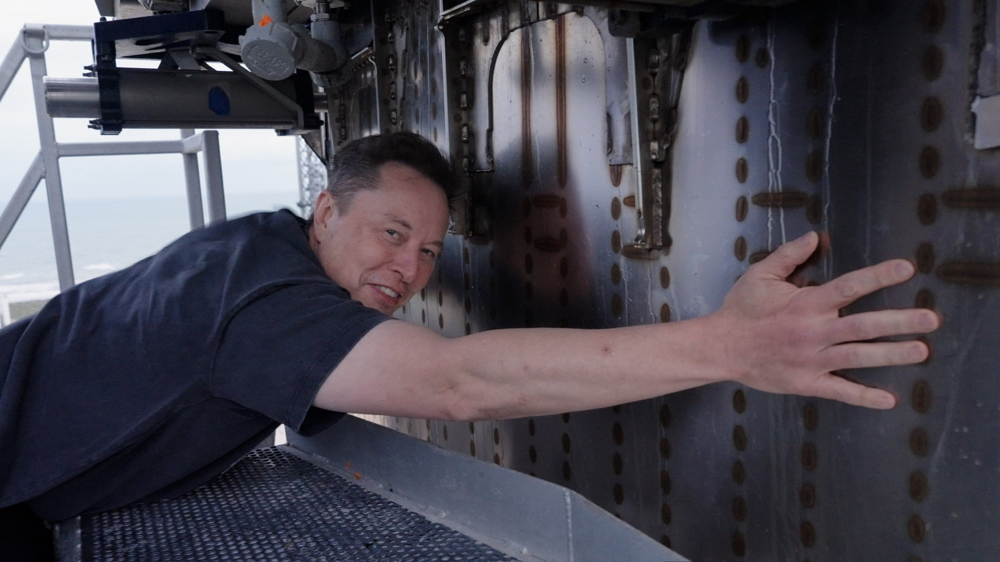

# 🐦 @elonmusk

## 📅 November 18, 2026

> 27 post(s) archived.

---

### 🕐 21:17 UTC · @elonmusk

> Starlink saves lives Starlink is being deployed to help families cut off by flooding in rural Cuiabá, Brazil Mato Grosso’s government is sending Starlink antennas to the Aguaçu district, where severe flooding left families isolated and without power Emergency teams are already on the ground, while a…

🔗 [View original post](https://x.com/elonmusk/status/2123163808592265639)

---

### 🕐 21:10 UTC · @elonmusk

> Treat Grok @Bot like a really smart employee I think a lot of people aren&apos;t using Grok Bot to its full potential, because knowing how to automate things is actually quite a difficult skill to learn. I wrote this post to break down how I approach automating anything with Grok Bot! https://x.com/i/article/2122921713864171520

🔗 [View original post](https://x.com/elonmusk/status/2123161902683746640)

---

### 🕐 21:00 UTC · @elonmusk

> We put a lot of thought into public safety Why Starship Zigzagged Home Instead of Flying Straight

🔗 [View original post](https://x.com/elonmusk/status/2123159371119280372)

---

### 🕐 20:04 UTC · @elonmusk

> Couldn’t recommend it more. Take your kids to a Starship launch. It’s a full-body experience. something you feel as much as you see, and one of the most awe-inspiring feats of human ingenuity you’ll ever witness. Plus, you’ll never see more grown men crying. Seriously &amp; that’s a wonderful thing. Impossible not to be deeply moved by what this incredible team has accomplished. True, Starship launches are incredibly exciting

🔗 [View original post](https://x.com/gjurvetson/status/2123145363544772871)

---

### 🕐 19:13 UTC · @elonmusk

> Starlink Mobile is now available in Mongolia with @mobicomofficial! For the first time, phones in areas without cell signal will automatically connect to our satellites, enabling customers to share updates via messaging apps and SMS 🛰️📱 mobispace — Connecting beyond limits... Mobicom Corporation, in partnership with Starlink Mobile, has officially launched mobispace. @Starlink Mobispace is a new service that uses Starlink’s satellite technology to help users stay connected on their phones in areas where traditi…

🔗 [View original post](https://x.com/Starlink/status/2123132631596556767)

---

### 🕐 16:56 UTC · @elonmusk

> The Starbase tower team on location with the first caught Starship🍌

🔗 [View original post](https://x.com/SpaceX/status/2123097995679867195)

---

### 🕐 12:11 UTC · @elonmusk

> Why Starship Zigzagged Home Instead of Flying Straight Media

🔗 [View original post](https://x.com/farzyness/status/2123026399787184615)

---

### 🕐 11:48 UTC · @elonmusk

> True Elon Musk and Grimes found each other because they both independently made the same obscure joke about an AI thought experiment called Roko&apos;s Basilisk. Neither of them knew the other had made it. When they discovered the coincidence, Elon DM&apos;d her. Their first real conversation …

🔗 [View original post](https://x.com/elonmusk/status/2123020499680981231)

---

### 🕐 11:38 UTC · @elonmusk

> Is the Thucydides Trap ever avoidable? I wish it were, but, inevitably, the most interesting outcome is the most likely.

🔗 [View original post](https://x.com/elonmusk/status/2123017891167785201)

---

### 🕐 11:05 UTC · @elonmusk

> Prufrock is perfectly named Elon Musk just shared the literary inspiration behind The Boring Company&apos;s massive tunnel-boring machines Each machine is named after a classic work of literature: • Godot - Waiting for Godot by Samuel Beckett • Line-Storm - A Line-Storm Song by Robert Frost • Prufrock - The Lov…

🔗 [View original post](https://x.com/elonmusk/status/2123009640925663305)

---

### 🕐 10:55 UTC · @elonmusk

> It only gets better from here Deception needs a motive, and a motive needs a soul

🔗 [View original post](https://x.com/elonmusk/status/2123007193918398527)

---

### 🕐 10:08 UTC · @elonmusk

> Prufrock The Boring Company is rapidly scaling up its Music City Loop project in Nashville Prufrock-MB3 has officially arrived, becoming the THIRD tunnel-boring machine for the network And Prufrock-MB4 is expected to arrive within the next 8 weeks TBC is now hiring across: • Engineering …

🔗 [View original post](https://x.com/elonmusk/status/2122995454560587952)

---

### 🕐 09:36 UTC · @elonmusk

> The machines of @boringcompany were named after: Waiting for Godot A Line-storm Song The Love Song of J. Alfred Prufrock

🔗 [View original post](https://x.com/elonmusk/status/2122987306923733063)

---

### 🕐 07:15 UTC · @elonmusk

> 5 years ago a SpaceX worker gave Elon a hug and told him &quot;We gonna make it&quot; And made it, we did! Starship came home &amp; Elon gave it a hug. Life comes full circle Media 🤗

🔗 [View original post](https://x.com/OPteemyst/status/2122951806548340804)

---

### 🕐 06:16 UTC · @elonmusk

> Hearing the @united CEO Scott Kirby on @CheekyPint telling @collision that the primary constraint on commercial aviation in the US is ATC slots drives me crazy. There are at most about 5000 flights occurring at any one time over the entire US. There are about 30 usable flight levels in alpha airspace, and you can deconflict 100x more flights than this with a single toothbrush CPU (http://FAA.caseyhandmer.com). In terms of physical space, there&apos;s enough room to fly every man woman and child in the US simultaneously. Look up. Does the sky seem crowded? There were plans to automate ATC using the first Iridium constellation more than 30 years ago. At some point we have to have a serious conversation about rent takings by obsolete incumbents that are blocking entire percentage points of economic growth. I wrote this 18 months ago

🔗 [View original post](https://x.com/CJHandmer/status/2122937091218981083)

---

### 🕐 06:13 UTC · @elonmusk

> 🤗

🔗 [View original post](https://x.com/elonmusk/status/2122936119448764559)

---

### 🕐 05:29 UTC · @elonmusk

> It was the smartest of times It was the dumbest of times

🔗 [View original post](https://x.com/elonmusk/status/2122925042400895056)

---

### 🕐 05:26 UTC · @elonmusk

> I wrote this 18 months ago To be clear here, the Verizon communication system to air traffic control is breaking down very rapidly. The FAA assessment is single digit months to catastrophic failure, putting air traveler safety at serious risk. The Starlink terminals are being sent at NO COST to the taxpay…

🔗 [View original post](https://x.com/elonmusk/status/2122924448861008163)

---

### 🕐 05:25 UTC · @elonmusk

> Four Years Ago Today, Elon Musk posted a poll asking 𝕏 if Donald Trump, who was banned by Twitter 1.0 as a sitting President, should be reinstated to the platform.

🔗 [View original post](https://x.com/alx/status/2122924222984958211)

---

### 🕐 04:48 UTC · @elonmusk

> I’m sorry but how can you watch this and not be obsessed Media

🔗 [View original post](https://x.com/HalcyonHypnotic/status/2122914742100517144)

---

### 🕐 04:15 UTC · @elonmusk

> SpaceX Investors MUST Watch This Supercut from CFO&apos;s Epic Chat Today With @GavinSBaker Media

🔗 [View original post](https://x.com/stevenmarkryan/status/2122906392969232791)

---

### 🕐 03:52 UTC · @elonmusk

> 😂 Elon Musk will return to China and continue creating new memes😂

🔗 [View original post](https://x.com/elonmusk/status/2122900620495704530)

---

### 🕐 03:42 UTC · @elonmusk

> Nice shot Watch sound bend light as Super Heavy Booster B22 reenters the atmosphere. This is maybe one of my all-time favorite shots I’ve ever seen of a rocket 👀 incredible tracking shot from @considercosmos from our Flight 15 Super Cut!!!

🔗 [View original post](https://x.com/elonmusk/status/2122898321044127878)

---

### 🕐 03:15 UTC · @elonmusk

> Grok @Bot can do your accounting Five Bots now have full-time roles on our accounting team. We onboard, train, and manage them just like human teammates. Here&apos;s how we built them to handle the order-to-cash process, from provisioning customer accounts to collecting payments. https://x.ai/news/grok-bot-accountin…

🔗 [View original post](https://x.com/elonmusk/status/2122891480729829482)

---

### 🕐 01:59 UTC · @elonmusk

> Grok @Bot can save you millions in corporate expenses! It will research every expenditure, evaluate its necessity and find better deals on the Internet or by calling suppliers on the phone directly. BREAKING: SpaceXSI cuts invoicing time from 24 hours to minutes with Grok Bot. Five specialized Grok Bots are now handling entire accounting jobs at SpaceXSI, with people stepping in for decisions and approvals: • Customer accounts: Checks signed contracts, sets up customer acce…

🔗 [View original post](https://x.com/elonmusk/status/2122872199623414175)

---

### 🕐 01:55 UTC · @elonmusk

> True, Starship launches are incredibly exciting 🚨 GAVIN BAKER: If you have children, if you have grandchildren, take them to see a Starship launch. It will change their life. It has a real impact on little kids. I&apos;d say probably half of adults cry at a launch. You just cannot believe that humans could do something like this.…

🔗 [View original post](https://x.com/elonmusk/status/2122871410561593384)

---

### 🕐 01:36 UTC · @elonmusk

> Super intelligence will hack your limbic system imho, in the next 2 years 50%+ of what we watch will come from AI influencers Welcome @claudia_popstar by @anabology: the first AI influencer on https://unfair.so! Made with @heyglif

🔗 [View original post](https://x.com/elonmusk/status/2122866559425384674)

---
