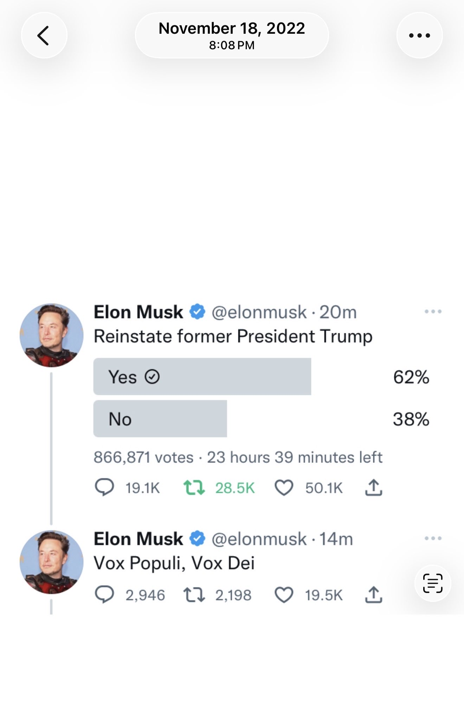

# 🐦 @elonmusk

## 📅 November 18, 2026

> 10 post(s) archived.

---

### 🕐 05:29 UTC · @elonmusk

> It was the smartest of times It was the dumbest of times

🔗 [View original post](https://x.com/elonmusk/status/2122925042400895056)

---

### 🕐 05:26 UTC · @elonmusk

> I wrote this 18 months ago To be clear here, the Verizon communication system to air traffic control is breaking down very rapidly. The FAA assessment is single digit months to catastrophic failure, putting air traveler safety at serious risk. The Starlink terminals are being sent at NO COST to the taxpay…

🔗 [View original post](https://x.com/elonmusk/status/2122924448861008163)

---

### 🕐 05:25 UTC · @elonmusk

> Four Years Ago Today, Elon Musk posted a poll asking 𝕏 if Donald Trump, who was banned by Twitter 1.0 as a sitting President, should be reinstated to the platform.

🔗 [View original post](https://x.com/alx/status/2122924222984958211)

---

### 🕐 04:15 UTC · @elonmusk

> SpaceX Investors MUST Watch This Supercut from CFO&apos;s Epic Chat Today With @GavinSBaker Media

🔗 [View original post](https://x.com/stevenmarkryan/status/2122906392969232791)

---

### 🕐 03:52 UTC · @elonmusk

> 😂 Elon Musk will return to China and continue creating new memes😂

🔗 [View original post](https://x.com/elonmusk/status/2122900620495704530)

---

### 🕐 03:42 UTC · @elonmusk

> Nice shot Watch sound bend light as Super Heavy Booster B22 reenters the atmosphere. This is maybe one of my all-time favorite shots I’ve ever seen of a rocket 👀 incredible tracking shot from @considercosmos from our Flight 15 Super Cut!!!

🔗 [View original post](https://x.com/elonmusk/status/2122898321044127878)

---

### 🕐 03:15 UTC · @elonmusk

> Grok @Bot can do your accounting Five Bots now have full-time roles on our accounting team. We onboard, train, and manage them just like human teammates. Here&apos;s how we built them to handle the order-to-cash process, from provisioning customer accounts to collecting payments. https://x.ai/news/grok-bot-accountin…

🔗 [View original post](https://x.com/elonmusk/status/2122891480729829482)

---

### 🕐 01:59 UTC · @elonmusk

> Grok @Bot can save you millions in corporate expenses! It will research every expenditure, evaluate its necessity and find better deals on the Internet or by calling suppliers on the phone directly. BREAKING: SpaceXSI cuts invoicing time from 24 hours to minutes with Grok Bot. Five specialized Grok Bots are now handling entire accounting jobs at SpaceXSI, with people stepping in for decisions and approvals: • Customer accounts: Checks signed contracts, sets up customer acce…

🔗 [View original post](https://x.com/elonmusk/status/2122872199623414175)

---

### 🕐 01:55 UTC · @elonmusk

> True, Starship launches are incredibly exciting 🚨 GAVIN BAKER: If you have children, if you have grandchildren, take them to see a Starship launch. It will change their life. It has a real impact on little kids. I&apos;d say probably half of adults cry at a launch. You just cannot believe that humans could do something like this.…

🔗 [View original post](https://x.com/elonmusk/status/2122871410561593384)

---

### 🕐 01:36 UTC · @elonmusk

> Super intelligence will hack your limbic system imho, in the next 2 years 50%+ of what we watch will come from AI influencers Welcome @claudia_popstar by @anabology: the first AI influencer on https://unfair.so! Made with @heyglif

🔗 [View original post](https://x.com/elonmusk/status/2122866559425384674)

---
