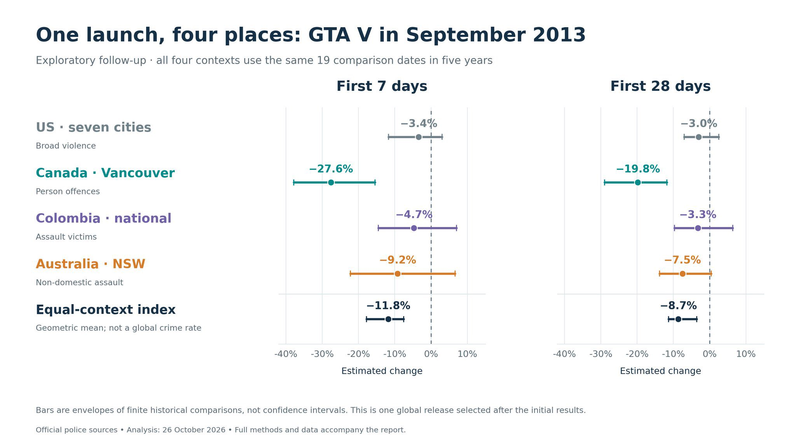
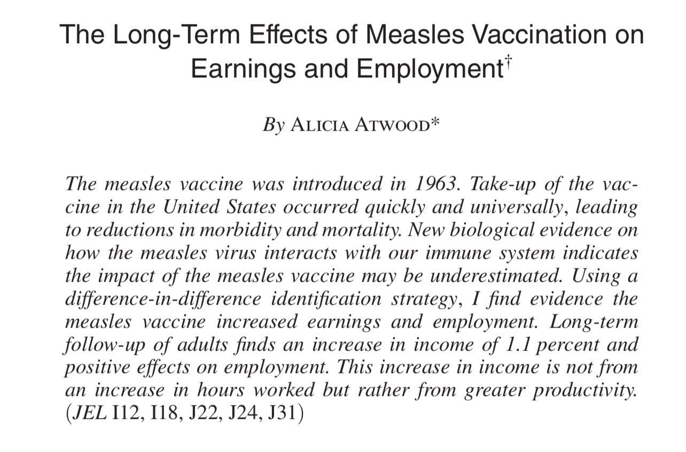
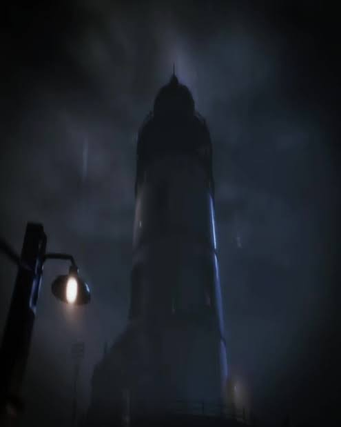

# 🐦 @emollick

## 📅 November 18, 2026

> 13 post(s) archived.

---

### 🕐 17:05 UTC · @emollick

> Misalignment! My god.

🔗 [View original post](https://x.com/emollick/status/2123100302278791310)

---

### 🕐 16:54 UTC · @emollick

> Tomorrow is likely going to be a safer day than today, thanks to the crime-fighting power of Rockstar. Previous research found that violent video games, and specifically GTA games, reduce crime, as people stay home playing them. GPT-6 Pro updated the data and found it holds.

🔗 [View original post](https://x.com/emollick/status/2123097628506485174)

---

### 🕐 16:43 UTC · @emollick

> All of this focus on individual releases also misses the broader point with much bigger implications for all of us: rapid, continuing acceleration of model development is very obviously happening and is the thing to actually pay attention to.

🔗 [View original post](https://x.com/emollick/status/2123094851801776178)

---

### 🕐 16:40 UTC · @emollick

> I am sure there are many use cases where 6.2 will be the best model. It can also be good to have models that differ from each other in strengths and weaknesses. And in some short period of time there will be another version of Astra, and the existing models will be tweaked.

🔗 [View original post](https://x.com/emollick/status/2123094110034919551)

---

### 🕐 16:36 UTC · @emollick

> I’d note that OpenAI has always been great about not influencing early testers &amp; has encouraged candid feedback. The mixed initial 6.2 reactions from testers didn’t blindside them. Some model point releases are just weirder, I wouldn’t overindex on it as a sign of the future.

🔗 [View original post](https://x.com/emollick/status/2123092922312925530)

---

### 🕐 09:20 UTC · @emollick

> Google, OpenAI &amp; Anthropic are at the stage where, unless you frequently switch between them or actively test them, you are probably very happy with the series of releases in the past two months. Even the model releases that are not as strong represent large capability gains

🔗 [View original post](https://x.com/emollick/status/2122983239883317335)

---

### 🕐 03:58 UTC · @emollick

> Most people don’t realize how much sickness we all lived with before modern medicine. The measles vaccination alone is responsible for half a percent of all US income this year, $80 billion. That is just from the reduced disease burden, it doesn’t include reduced medical costs @SamPassey3 In the 1930s, 10% of Americans had syphilis, which carries a high risk of miscarriage. Penicillin reduced that and other diseases https://worksinprogress.co/issue/understanding-the-baby-boom/

🔗 [View original post](https://x.com/emollick/status/2122902226868076552)

---

### 🕐 02:53 UTC · @emollick

> All the switches work too!

🔗 [View original post](https://x.com/emollick/status/2122885965765386461)

---

### 🕐 02:42 UTC · @emollick

> All of that aside, the fact that an AI can make a dynamically lit explorable 3D scene set in a realistic space elevator with realistic physics where every single object was coded by &quot;hand&quot; remains crazy. If you have a decent computer, it is worth trying the web version: https://upwell-tetherline.netlify.app/unity/ Or download the full Windows install from itch. io: https://emollick.itch.io/upwell I’ve been using GPT-6.2 Astra prior to launch &amp; I found it very uneven &amp; weird. On one hand, it was harder to steer &amp; work with than other models. On the other, when given an ambitious project (make a space elevator ride from scratch with Blender &amp; Unity) it could deliver well

🔗 [View original post](https://x.com/emollick/status/2122883198367502818)

---

### 🕐 02:15 UTC · @emollick

> They all have the aesthetics of Ken Levine.

🔗 [View original post](https://x.com/emollick/status/2122876209654874246)

---

### 🕐 02:03 UTC · @emollick

> Anyhow, I do not think information will stop the conspiracy theories. (And yes, when Mythos-class unguardrailed models are available, that will also lead to a lot of issues)

🔗 [View original post](https://x.com/emollick/status/2122873191832158593)

---

### 🕐 01:52 UTC · @emollick

> I know a lot of people are discovering this about GPT-6.2, but the GPT models have always been obsessed with bells and drowned clock towers. Always. Forget goblins, things that GPT-5.5 really likes in its fiction: lighthouses, the ocean, maps, bells, clock towers with bells that ring impossible times, Mira Vale, resonances and echoes (Claude and Gemini love them too), secret third things (not night/day, not high/low)...

🔗 [View original post](https://x.com/emollick/status/2122870629317681439)

---

### 🕐 01:49 UTC · @emollick

> A rush of patches to address security concerns is exactly the most plausible answer for recent outages, as well as the official reason. CIOs I talked to have been exhausted trying to keep up with security patch demands &amp; balacing that with normal operations. NEWS: Wall Street execs and NSA have told Congress that outages were caused by patching vulnerabilities identified by AI models, sources say AI did not cause outages but found so many issues that the rush to fix them before an attack overwhelmed systems https://www.washingtonsun…

🔗 [View original post](https://x.com/emollick/status/2122869773683831129)

---
