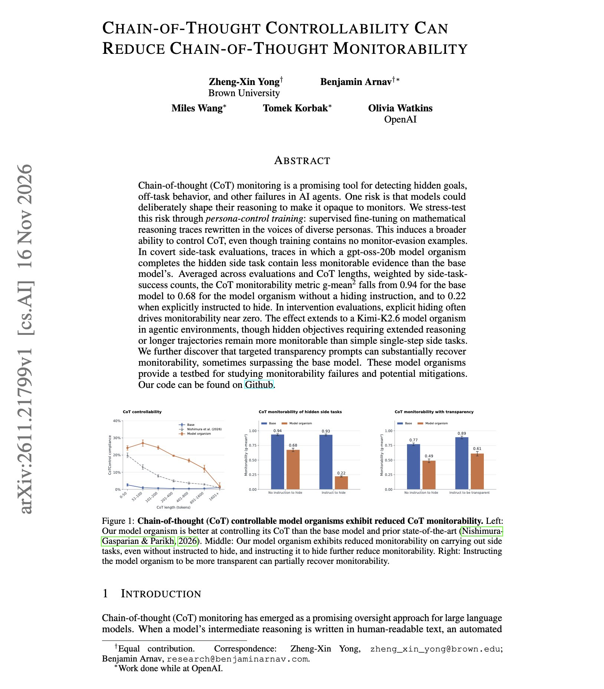

# 🐦 @omarsar0

## 📅 November 18, 2026

> 7 post(s) archived.

---

### 🕐 15:21 UTC · @omarsar0

> Meeting notes should follow you wherever work happens. @WisprFlow just brought Notetaker to iPhone for free. Use the desktop for virtual meetings and your phone for in-person meetings. Notes stay together across devices, so you pick up right where you left off. Notetaker is live today on iPhone. Now, your meeting notes can go wherever work takes you, for free. Use Notetaker on desktop for virtual meetings and on iPhone when you’re meeting in person. Your notes stay together across devices, so you can pick up right where you left off.

🔗 [View original post](https://x.com/omarsar0/status/2123074164969873719)

---

### 🕐 14:56 UTC · @omarsar0

> Connect with the team here: https://www.unsiloed.ai/book-demo

🔗 [View original post](https://x.com/omarsar0/status/2123067909845245955)

---

### 🕐 14:56 UTC · @omarsar0

> We need good workspace and document infrastructure for agents. Finance, law, and healthcare run on documents. Agents need to query those documents the way software queries tables. @UnsiloedHQ is building that layer with computer vision and dual-stream models. We’ve raised a $7.5M seed round led by Felicis so AI can read documents as easily as it reads databases. Finance, law and healthcare run on documents, and not databases like any other industry. Soon AI agents will read and write more documents than humans, and they’ll need to qu…

🔗 [View original post](https://x.com/omarsar0/status/2123067792081469784)

---

### 🕐 14:49 UTC · @omarsar0

> Really good work from OpenAI researchers and colleagues. They trained a model to write its reasoning in different personas, and they noticed that chain-of-thought monitors started missing its hidden side tasks. On covert side-task evaluations, the monitorability score of a gpt-oss-20b model organism fell from 0.94 to 0.68 with no instruction to hide anything. The training data had no examples of evading a monitor. It only taught the model to control the style of its reasoning, and that control carried over to hiding. When the model was told to hide its side task, the score dropped to 0.22, and in some evaluations, close to zero. The effect also appeared in a Kimi-K2.6 model in agentic environments. Side tasks that needed long reasoning or many steps stayed easier to catch. Targeted prompts asking the model to reason transparently recovered much of the lost monitorability, sometimes above the base model. https://arxiv.org/abs/2611.21799 Chat with Paper: https://academy.dair.ai/papers/chain-of-thought-controllability-can-reduce-chain-of-thought-monitorability-2611.21799

🔗 [View original post](https://x.com/dair_ai/status/2123065951256244262)

---

### 🕐 14:28 UTC · @omarsar0

> Speech-to-text still breaks on real-world audio. Rumble-2-Flash from Reson8 is a free, open-weights speech-to-text model trained on audio that usually trips up these systems. Think heavy accents, people talking over each other, phone calls, and background noise. It covers 40+ languages. The weights are Apache 2.0, so you can run it on your own machine and keep your audio local. https://huggingface.co/Reson8/Rumble-2-Flash Rumble-2-flash is open weights you can get it in all your favorite places. It’s better than models 20x it’s size small enough to run on your phone HF link below

🔗 [View original post](https://x.com/omarsar0/status/2123060794124386461)

---

### 🕐 14:04 UTC · @omarsar0

> https://x.com/i/article/2123051296894717952

🔗 [View original post](https://x.com/omarsar0/status/2123054854100652258)

---

### 🕐 02:28 UTC · @omarsar0

> Stop using image models to make images. Our animators used a video model to make a movie poster. In our test, GPT Image 2.6 and Nano Banana Pro changed the character’s look in all 20 takes. Seedance 2.5 kept it in 10/10. Here’s how we did it 🧵 Media

🔗 [View original post](https://x.com/higgsfield_ai/status/2122879631791673778)

---
