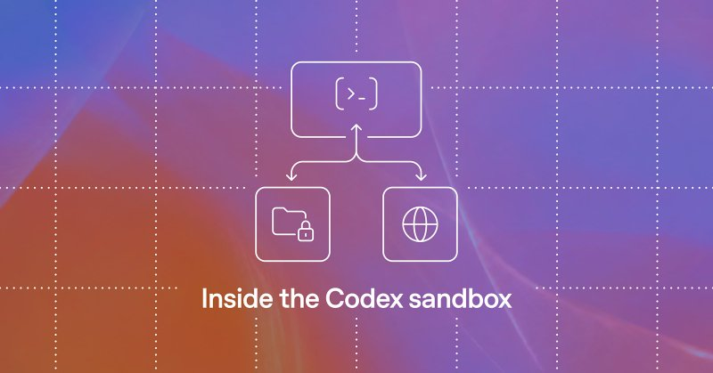
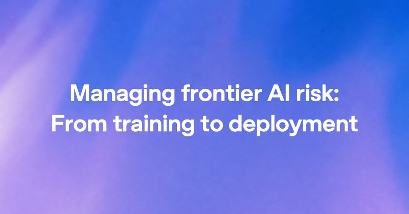

# 🐦 @sama

## 📅 November 18, 2026

> 3 post(s) archived.

---

### 🕐 20:16 UTC · @sama

> Proud of what we built here! Codex can use the tools you already work with, and you decide what it can access. Here’s how we built the sandbox that makes that possible: https://openai.com/index/inside-the-codex-sandbox/

🔗 [View original post](https://x.com/ithilgore/status/2123148320071938510)

---

### 🕐 20:07 UTC · @sama

> A lot has happened in the past couple months, to say the least. Today we are sharing a recap of what it takes to move a frontier model from training to internal use to public release. As model capabilities rise, so do the safety and alignment standards required to move forward to the next stage. To meet these standards, we rely on four layers of protection: 1. Model alignment: train models to reliably act as intended and respect human oversight. 2. Security and sandboxing: restrict what models can access and affect. 3. Blocking safeguards: stop harmful or unauthorized actions before they happen. 4. Monitoring and response: detect concerning behavior and intervene. The post brings together efforts from across the company, with links to recent research, technical work, and incident reports we’ve published. This is the baseline operational discipline we owe people as we continue training and deploying models - necessary work, but not a solution to alignment in the limit. There’s a lot more to do, and will continue keeping you informed as the thinking and work evolves. 🏗️ https://openai.com/index/managing-frontier-ai-risk/

🔗 [View original post](https://x.com/kaicathyc/status/2123146093366333850)

---

### 🕐 17:19 UTC · @sama

> So fun to do DealBook with my friend and partner of 11 years, @gdb. Thrilled the world got to see the brilliant, fiercely determined leader I have the privilege of working with every day. Greg’s role at OpenAI has evolved from writing code 100 hours a week in the early days to now leading some of the hardest and most consequential parts of our business. One thing that has not changed is his extraordinary commitment to our mission. I can say with confidence that OpenAI would not exist without Greg, and I believe the world would be on a much worse path toward the AI future without him.

🔗 [View original post](https://x.com/sama/status/2123103873166381287)

---
