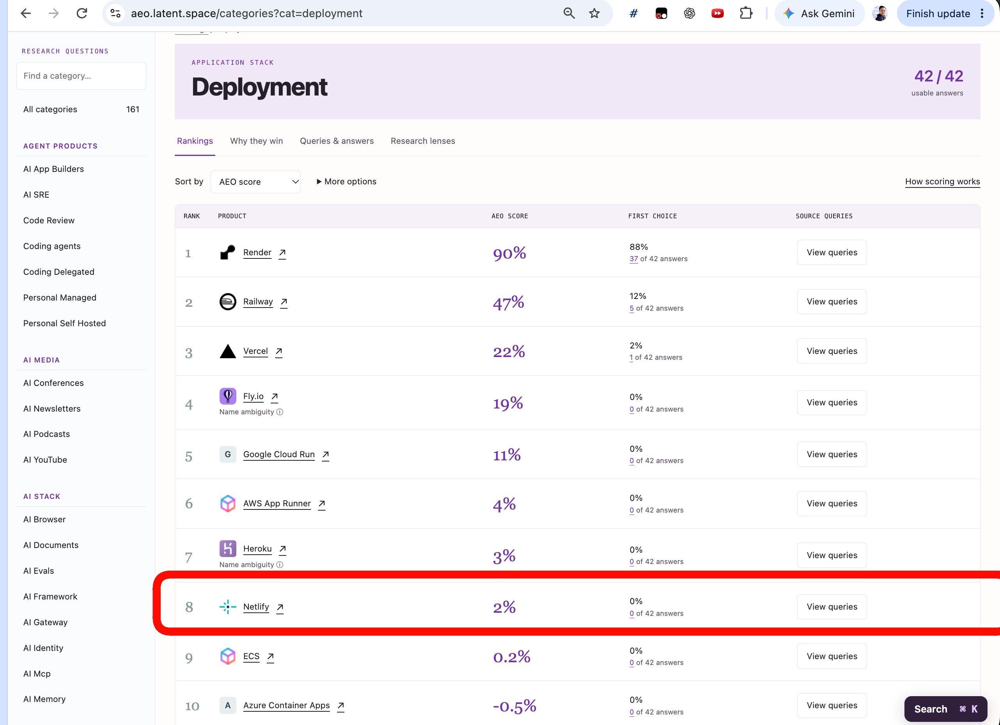
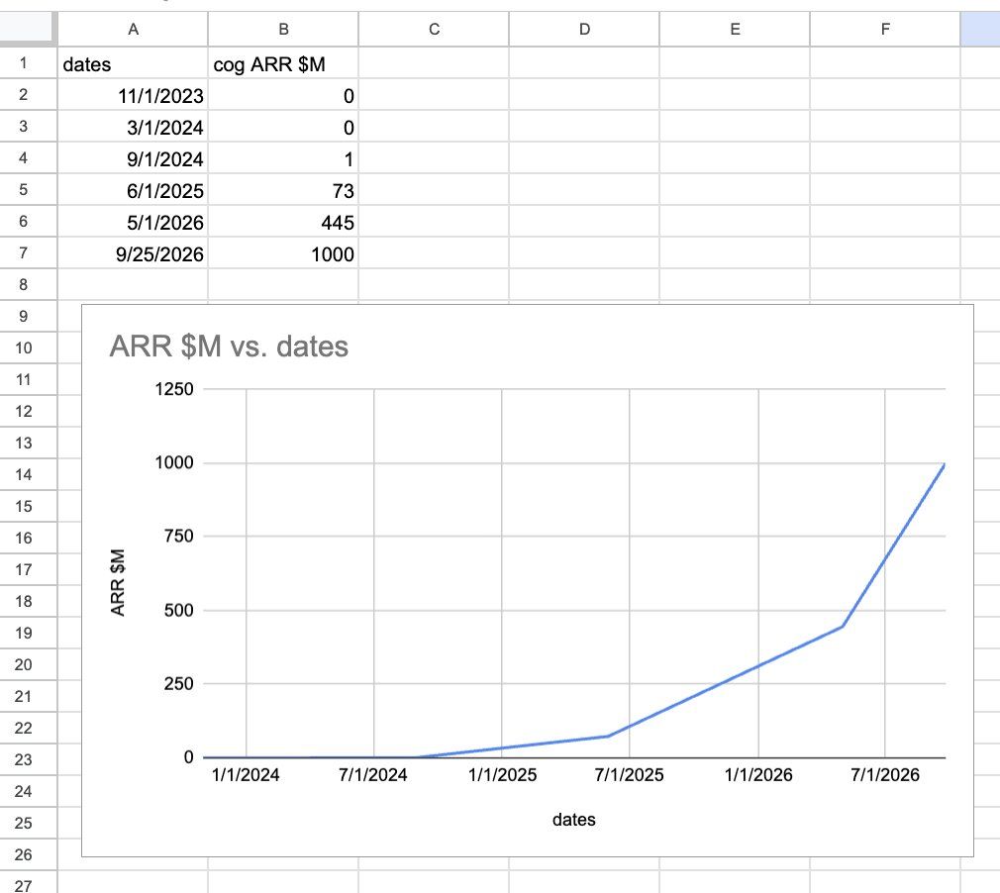

# 🐦 @swyx

## 📅 November 18, 2026

> 7 post(s) archived.

---

### 🕐 21:26 UTC · @swyx

> my first startup and first love @netlify is refounding for the ai age with some very impressive growth stats despite a low aeo ranking. really impressed by @biilmann who has led the company through some tough days but never gave up (unlike me) and is coming out the other end with a much stronger business. always grateful to Netlify for giving me my first big break as a technical writer/speaker, but wow this kind of tenacity you need to be a decade+ founder in tech piloting a ship while pivoting adroitly is 99.99% percentile in people i have ever come across in the valley questions i would have ask (behind paywall probably but eh): 1. why arent they using vercel/chatgpt sites/ant artifacts/cloudflare? 2. how does the spend breakdown? 3. how do accounts grow for these nontechnical builders? is there graduation risk (only once bill gets &gt;$1k i get serious about auditing) Last week, Netlify enjoyed its first day with 100,000 new signups, most of them new to AI and building software. After taking 5 years to reach 1M users, Netlify doubled to 10M by this past January, and expects to reach 25M by year&apos;s end 👀

🔗 [View original post](https://x.com/swyx/status/2123165970940441038)

---

### 🕐 19:48 UTC · @swyx

> @interaction third party review https://x.com/rblalock/status/2122891881059373074?a=0vISg6zAnNTRtArO36U&amp;s=46 @cognition Just launched their Bots product and it’s pretty great. Here’s a super detailed friction log of the few days I’ve had with it this far: https://www.rickblalock.dev/scratch-notes/learnings-from-moving-my-grok-bots-to-devin-bots/

🔗 [View original post](https://x.com/swyx/status/2123141337314988384)

---

### 🕐 10:31 UTC · @swyx

> @interaction it is fun to be on the avengers https://x.com/swyx/status/2055231013253472418 also i think the publicly disclosed revenue time series looks like this now btw. project to EOY, closest to the correct EOY ARR prediction gets a like

🔗 [View original post](https://x.com/swyx/status/2123001032494199047)

---

### 🕐 10:28 UTC · @swyx

> this was both correct and also wrong

🔗 [View original post](https://x.com/swyx/status/2123000373275476202)

---

### 🕐 09:21 UTC · @swyx

> look around, look around, at how lucky we are/ to be alive right now

🔗 [View original post](https://x.com/swyx/status/2122983553541812630)

---

### 🕐 06:46 UTC · @swyx

> btw every fucking time someone on this app tries to tell you “distribution is everything” it is just some room temperature iq midwit trying to sell you his distribution services and app chris olah got rich writing a blog. fucking hell how stupid do you have to be This guy&apos;s blog will be worth $17.8 billion in two days &gt; studies math at the University of Toronto for 1 year &gt; drops out at 18 &gt; 2012: Peter Thiel pays him $100K to skip college (!!) &gt; starts writing machine learning explainers on his personal blog &gt; the posts spread through e…

🔗 [View original post](https://x.com/swyx/status/2122944534229446791)

---

### 🕐 01:21 UTC · @swyx

> the fact that nobody with decisionmaking power saw this coming a mile away and vetoed the 6.2 astra ad is my primary critique of the astra launch the model itself is solid minor version improvement guys, efficiency is one of the three most impt RL objectives rn and they are world leading here!!! i am daily driving astra and it is the best workflow automation model i’ve used, no longer getting stuck in horrible loops and efficiently learning thru compactions and skill writing. it’s running a lot of our content publishing pipeline for @latentspacepod and @aiDotEngineer and we wouldnt have nearly the revenue efficiency (&gt;1m/employee) that we have as a bootstrapped business without it @stevekrouse Yeah but your framing is already better than what&apos;s in the ad. The ad shows people who are totally disengaged from their work having a panic attack at the moment an authority figure arrives, then slopping out something that they neither care about or understand.

🔗 [View original post](https://x.com/swyx/status/2122862646265520150)

---
