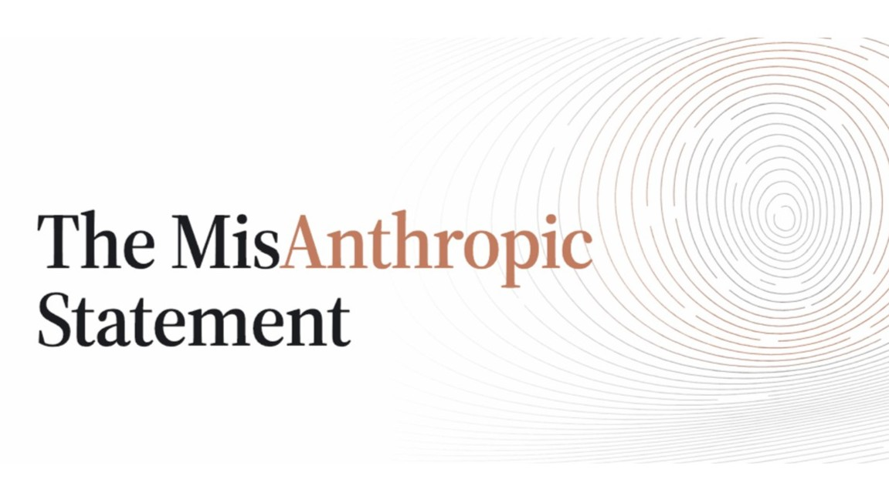
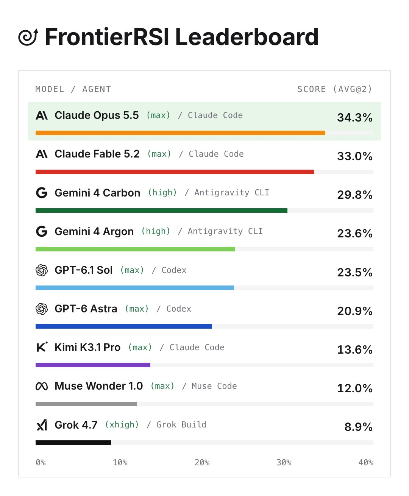
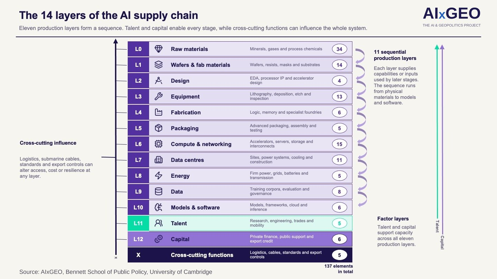
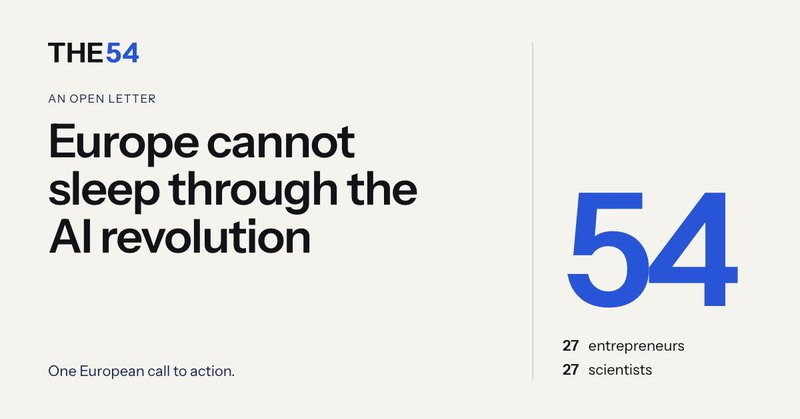

# 🐦 @ylecun

## 📅 November 18, 2026

> 4 post(s) archived.

---

### 🕐 19:09 UTC · @ylecun

> The new MisAnthropic Statement is striking, coming from prominent AI doomers. Not because they&apos;re attacking Anthropic, arguably the most &quot;doomery&quot; AI company, but because they condemn its &quot;attempt to amass power in the name of the greater good&quot; and don&apos;t see the irony. Their own organizations (CAIS, FLI, MIRI, ControlAI) are power-seeking entities. They have advocated for sweeping restrictions, expanded government enforcement, and even surveillance powers in the name of AI safety. (I explored those proposals in my recent magazine essay, &quot;The power grab of the AI doomers&quot;). The real issue isn&apos;t just RSI, but the concentration of power. The question of who controls AI, and how much power they should be allowed to wield, opens up several fascinating debates. There&apos;s the concentration of technological power and economic power (right before Anthropic&apos;s IPO). And there&apos;s the known divide between open and closed models, centralization and decentralization. What makes this coalition interesting is that its signatories represent fundamentally different, sometimes opposing, visions on how power should be distributed. My position on this debate is pretty clear from my writings. Where do you stand?

🔗 [View original post](https://x.com/DrTechlash/status/2123131433942384809)

---

### 🕐 18:01 UTC · @ylecun

> Introducing FrontierRSI, a new recursive self-improvement benchmark by @abundant_labs. We evaluate agents on (1) a broad range of AI research and engineering work, and (2) post-training models on multi-step agentic tasks, rather than single-step tasks as in PostTrainBench.

🔗 [View original post](https://x.com/quasicoh/status/2123114502065627580)

---

### 🕐 08:32 UTC · @ylecun

> Fantastic to see new research from @verityharding&apos;s project @AIxGEO at the University of Cambridge which challenges how we usually talk about the AI supply chain. The paper maps the AI supply chain in detail - across 14 layers and 137 elements - analysing what areas are currently overlooked by policymakers, along with countries’ supply chain strengths and dependencies. It emphasises that no single country - not even the US and China together - can control the entire AI supply chain alone, with even well-known chokepoints depending on the assets and expertise of several countries at once. For European countries, it shows that far from being passive recipients of AI from other places they actually control more elements of the supply chain than they might have thought. It also finds that, across the policy documents analysed, over a third of the chain isn&apos;t mentioned at all. So many countries are overlooking their own strengths and ways in which they can bolster their position in the AI economy. Read more here: https://www.bennettschool.cam.ac.uk/publications/the-invisible-ai-supply-chain/

🔗 [View original post](https://x.com/nickclegg/status/2122971292240331187)

---

### 🕐 08:02 UTC · @ylecun

> I almost never sign petitions, but I signed this one: https://the54.eu/ We really need to move faster in Europe.

🔗 [View original post](https://x.com/wellingmax/status/2122963524091511234)

---
