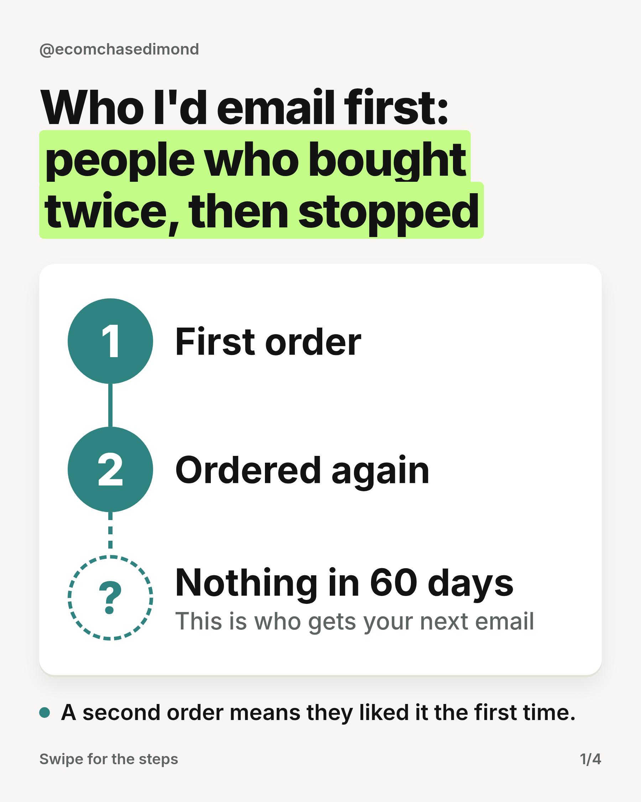
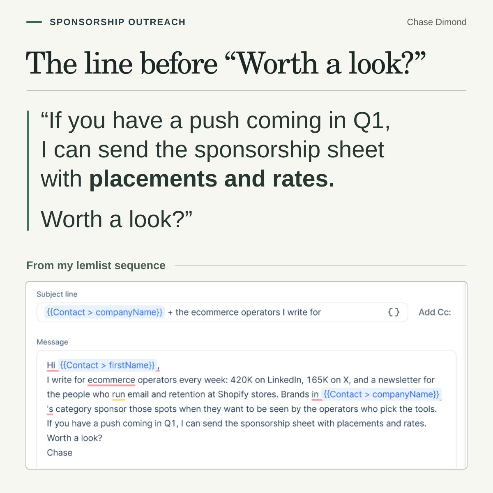

# 🐦 @AiEvolutio58513

## 📅 November 19, 2026

> 7 post(s) archived.

---

### 🕐 19:58 UTC · @AiEvolutio58513

> If you only email one group this week, make it the people who bought from you twice and then stopped. They know your product and liked it enough to order again. To me, they&apos;re one of the warmest groups on your list that isn&apos;t buying right now. The annoying part is pulling them out. Doing it by hand means stacking filters until the list looks right. In @omnisend, you type it the way you&apos;d say it: &quot;Customers who bought at least twice but haven&apos;t ordered in the last 60 days.&quot; It turns that into segment filters and shows you who matches before you save. If something&apos;s off, tell it what to change or edit the filters yourself. Omnisend can also suggest subject lines and help with a first draft. Edit it until it sounds like you. The segment builder and the writing help are both on the free plan. Try it on your own list: https://www.omnisend.com/?utm_source=chase

🔗 [View original post](https://x.com/ecomchasedimond/status/2123506213774319929)

---

### 🕐 17:19 UTC · @AiEvolutio58513

> Got deals set to close by Dec 31? In 2025, 40% missed that date. Here’s why 👇 Your CRM says December. The buyer has said something drastically different over email. Ergo flags the deal and drafts the follow-ups. Sales teams at @retellai and @usepylon use @joinergo. We&apos;re backed by @ycombinator. Book a call at joinergo [dot] com. Media

🔗 [View original post](https://x.com/yashdulla/status/2123466274177192333)

---

### 🕐 17:11 UTC · @AiEvolutio58513

> Being able to do this from within Claude is amazing. “Worth a look?” was the last line of the sponsorship email I sent to 11 people. The sentence before it is the one I’d use again. I typed my request in Claude, and @lemlist drafted a four-step email sequence for my sponsorship list. When I opened the first email in lemlist, the o…

🔗 [View original post](https://x.com/AiEvolutio58513/status/2123464199968059616)

---

### 🕐 16:24 UTC · @AiEvolutio58513

> “Worth a look?” was the last line of the sponsorship email I sent to 11 people. The sentence before it is the one I’d use again. I typed my request in Claude, and @lemlist drafted a four-step email sequence for my sponsorship list. When I opened the first email in lemlist, the offer and “Worth a look?” were already there, one right after the other. I kept both. I sent just the first email. The subject line was “[Company] + the ecommerce operators I write for.” In the email, I got more specific about who reads my newsletter: people who run email and retention at Shopify stores. I included my LinkedIn and X audience numbers too, but if you sell software to those teams, knowing who reads the newsletter tells you more about fit than my follower count does. Then came the offer: “If you have a push coming in Q1, I can send the sponsorship sheet with placements and rates.” One of the 11 people I emailed said they’d take a look at the sheet, so I sent it over the next morning. They had my placements and rates without having to book a call. If you want to try this with your own list, here’s the lemlist MCP I used: https://www.lemlist.com/product/lemlist-mcp?utm_source=x&amp;utm_campaign=influ_chasedimond&amp;utm_content=post2 If someone replied “sure” to your last cold email, what would you send them next?

🔗 [View original post](https://x.com/ecomchasedimond/status/2123452466486559071)

---

### 🕐 13:00 UTC · @AiEvolutio58513

> Sam Altman says his son will never be smarter than AI: &quot;My kid will never grow up... will never ever be smarter than an AI. That will never happen.&quot; &quot;They&apos;ll never know a world where products and services aren&apos;t way smarter than them and super capable.&quot; &quot;I already think college is like maybe not working great for most people... Fast forward 18 years, it&apos;s going to look like a very, very different thing.&quot; &quot;I actually think the kids will be fine. I&apos;m worried about the parents.&quot; Interested in AI? Follow @AiEvolutio58513 and never fall behind. I track ChatGPT, Claude, and every tool quietly changing how we work and create, then hand you the tested signals. Media Elon Musk on the one transplant nobody has ever had: &quot;You can get a heart transplant, you can get a kidney transplant, but I don&apos;t know anyone who&apos;s gotten a brain transplant&quot; &quot;So, you are your brain&quot; &quot;Your experiences are these neurons firing, with trillions of synapses that so…

🔗 [View original post](https://x.com/AiEvolutio58513/status/2123400985842463221)

---

### 🕐 11:00 UTC · @AiEvolutio58513

> Elon Musk says AI will flip inflation into deflation in about 3 years, and interest rates could go to zero: &quot;AI has not yet made enough of an impact on productivity to increase the goods and services faster than the increase in the money supply.&quot; &quot;I think it&apos;s 3 years... Goods and services growth will exceed money supply growth in about 3 years.&quot; &quot;Maybe after those three years you have deflation, and then interest rates go to zero, and then the debt is a smaller problem than it is.&quot; Interested in AI? Follow @AiEvolutio58513 and never fall behind. I track ChatGPT, Claude, and every tool quietly changing how we work and create, then hand you the tested signals. Media Elon Musk explains how to build an AI chip for space: make it run hot. &quot;If you increase the operating temperature by 20% in degrees Kelvin, you can cut your radiator mass in half. So running at a higher temperature is helpful in space.&quot; &quot;Neural nets are going to be very resilien…

🔗 [View original post](https://x.com/AiEvolutio58513/status/2123370877253550458)

---

### 🕐 08:04 UTC · @AiEvolutio58513

> Jensen Huang runs one of the most valuable companies on Earth, and he still wakes up every morning feeling like it&apos;s about to go under: &quot;No different than the feeling I had this morning when I woke up, that you&apos;re going to be out of business soon. The phrase &apos;30 days from going out of business&apos; I&apos;ve used for 33 years.&quot; &quot;The sense of vulnerability, the sense of uncertainty, the sense of insecurity... it doesn&apos;t leave you.&quot; &quot;I have a greater drive from not wanting to fail than the drive of wanting to succeed.&quot; &quot;I&apos;m not ambitious, for example. I just want to stay alive, Joe.&quot; Interested in AI? Follow @AiEvolutio58513 and never fall behind. I track ChatGPT, Claude, and every tool quietly changing how we work and create, then hand you the tested signals. Media Jensen Huang says NVIDIA&apos;s partnership with TSMC, the one the whole AI boom now runs on, started with a cold call to a number in the Yellow Pages: &quot;TSMC was probably about $300 million, something like that. It&apos;s a tiny little company. I heard about Morris Chang. And so I tried t…

🔗 [View original post](https://x.com/AiEvolutio58513/status/2123326499818553554)

---
