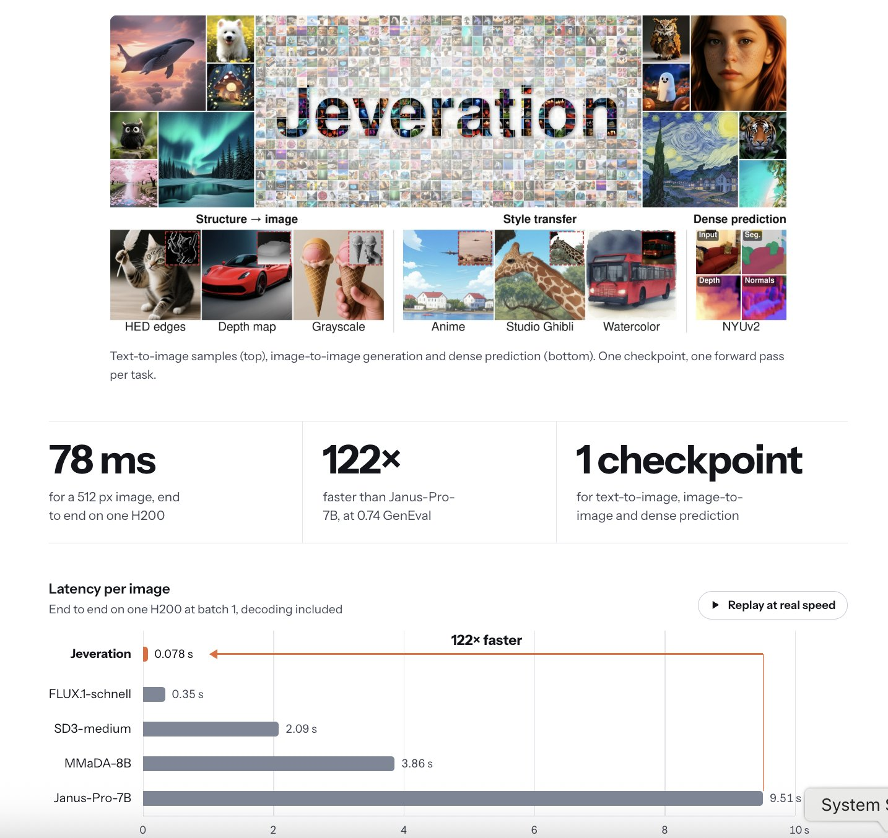

# 🐦 @_akhaliq

## 📅 November 19, 2026

> 7 post(s) archived.

---

### 🕐 18:26 UTC · @_akhaliq

> And here I was thinking that image generation required some form of an iterative denoising or autoregressive decoding to work. Somehow these folks made parallel generation (of 128 discrete img tokens with bidir attn) work in one go. It&apos;s like Janus-Pro but with block decoding as opposed to token by token. Training compute is nice too: seems to be trained on only four 96gb gpus for around 400 total GPU hours starting from Qwen 3.5 4b with lora and reaches 0.74 geneval score while being a unified model (though standard vlm vqa / understanding scores aren&apos;t reported, so I wouldn&apos;t expect it to retain much capability there) Jeveration System One Models Now Generate paper: https://huggingface.co/papers/2611.24738

🔗 [View original post](https://x.com/a_uselis/status/2123483101917491368)

---

### 🕐 16:08 UTC · @_akhaliq

> Every dependency is a potential vulnerability, so in Gradio 7, we&apos;ll be cutting our dependencies in half! Media

🔗 [View original post](https://x.com/abidlabs/status/2123448313869729883)

---

### 🕐 14:32 UTC · @_akhaliq

> At Kong we run half a quadrillion AI tokens a year, and I kept seeing agents stuck on clouds built for websites. So we built a cloud for agents. Volcano is live today: the self-healing agent cloud. Sandboxes, durable workflows, Postgres, hosting. Media

🔗 [View original post](https://x.com/subnetmarco/status/2123424142569714004)

---

### 🕐 12:11 UTC · @_akhaliq

> Game2Player From UIUC, IBM and collaborators, it co-develops verifiable web-game environments and players to scale visual-agent training: 568 games, 3,436 tasks, 307 hours of gameplay, and a 9B model improving 14.3%→31.2% on PlayerBench.

🔗 [View original post](https://x.com/HuggingPapers/status/2123388673240523172)

---

### 🕐 09:56 UTC · @_akhaliq

> Jeveration System One Models Now Generate paper: https://huggingface.co/papers/2611.24738

🔗 [View original post](https://x.com/_akhaliq/status/2123354595061907578)

---

### 🕐 08:26 UTC · @_akhaliq

> UltraTex Aligning Physical Knowledge for High-Fidelity PBR Texture Generation paper: https://huggingface.co/papers/2611.24941 Media

🔗 [View original post](https://x.com/_akhaliq/status/2123331996927897922)

---

### 🕐 04:35 UTC · @_akhaliq

> Code World Model 2.0 Towards Infinite Controllable Video Generation paper: https://huggingface.co/papers/2611.22925

🔗 [View original post](https://x.com/_akhaliq/status/2123273975530992090)

---
