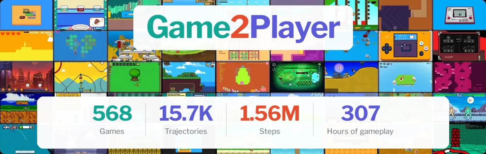
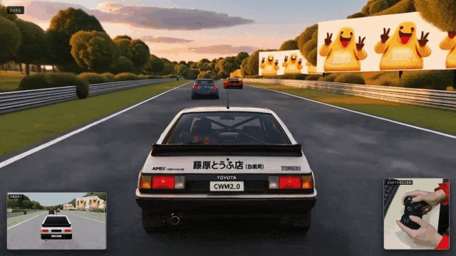

# 🐦 @_akhaliq

## 📅 November 19, 2026

> 5 post(s) archived.

---

### 🕐 14:32 UTC · @_akhaliq

> At Kong we run half a quadrillion AI tokens a year, and I kept seeing agents stuck on clouds built for websites. So we built a cloud for agents. Volcano is live today: the self-healing agent cloud. Sandboxes, durable workflows, Postgres, hosting. Media

🔗 [View original post](https://x.com/subnetmarco/status/2123424142569714004)

---

### 🕐 12:11 UTC · @_akhaliq

> Game2Player From UIUC, IBM and collaborators, it co-develops verifiable web-game environments and players to scale visual-agent training: 568 games, 3,436 tasks, 307 hours of gameplay, and a 9B model improving 14.3%→31.2% on PlayerBench.

🔗 [View original post](https://x.com/HuggingPapers/status/2123388673240523172)

---

### 🕐 09:56 UTC · @_akhaliq

> Jeveration System One Models Now Generate paper: https://huggingface.co/papers/2611.24738

🔗 [View original post](https://x.com/_akhaliq/status/2123354595061907578)

---

### 🕐 08:26 UTC · @_akhaliq

> UltraTex Aligning Physical Knowledge for High-Fidelity PBR Texture Generation paper: https://huggingface.co/papers/2611.24941 Media

🔗 [View original post](https://x.com/_akhaliq/status/2123331996927897922)

---

### 🕐 04:35 UTC · @_akhaliq

> Code World Model 2.0 Towards Infinite Controllable Video Generation paper: https://huggingface.co/papers/2611.22925

🔗 [View original post](https://x.com/_akhaliq/status/2123273975530992090)

---
