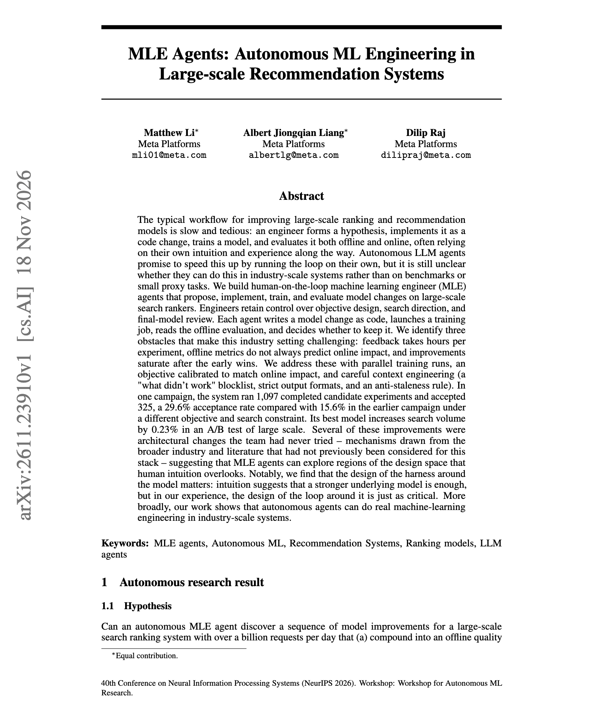
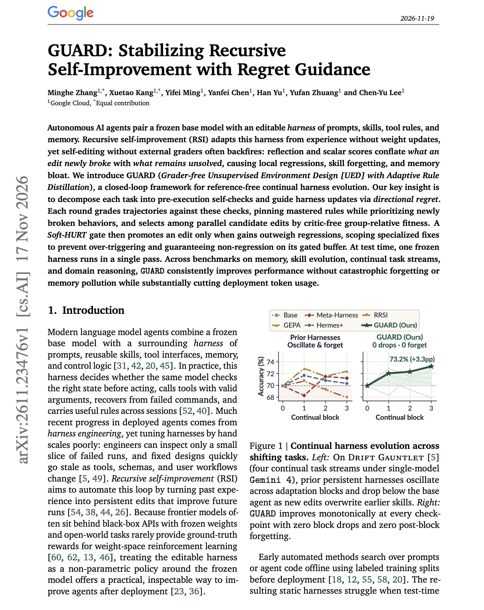

# 🐦 @dair_ai

## 📅 November 19, 2026

> 2 post(s) archived.

---

### 🕐 14:31 UTC · @dair_ai

> Great paper from Meta on ML engineering agents, tested with a large-scale A/B test on production search rankers. (bookmark it) They also show how important the harness design is. The agents propose a model change, implement it, train it, and evaluate it. Engineers keep control of the objective, the search direction, and the final review. In one campaign, the system completed 1,097 experiments and accepted 325 of them. That is a 29.6% acceptance rate, against 15.6% in an earlier campaign with a different objective. The best model raised search volume by 0.23% in the live test. They share that three problems made this hard. Each experiment takes hours, offline metrics often disagree with online impact, and gains flatten after the early wins. The team answered with parallel training runs, an objective calibrated to online impact, and careful context engineering. Several accepted changes were architectures the team had never tried. The authors also report that a stronger model was not enough on its own. The loop around it mattered just as much. If you plan to put agents on your training pipeline, calibrate the objective first. https://arxiv.org/abs/2611.23910 Chat with Paper: https://academy.dair.ai/papers/mle-agents-autonomous-ml-engineering-in-large-scale-recommendation-systems-2611.23910

🔗 [View original post](https://x.com/dair_ai/status/2123423809839698400)

---

### 🕐 14:18 UTC · @dair_ai

> Banger paper from Google on self-improving agent harnesses. (bookmark it) It addresses common issues in self-improving agent harnesses like local overfitting, catastrophic forgetting, and memory pollution. They propose GUARD, which keeps the base model frozen and lets the agent edit its own prompts, skills, tool rules, and memory. An edit is accepted only when its gains outweigh the behaviors it breaks. - On 43 hosted SDK tasks, GUARD reached 80.80% accuracy, 8.89 points over the starting harness (p = 0.008). - It beat Meta-Harness by 6.28 points and used 54.5% fewer tokens per task. - On procedural memory tasks, it led update correctness at 90.1% with zero memory pollution. Aggressive rewriters scored similarly and tripled pollution. How does it know what broke? Each task is split into self-checks before execution. Every round grades trajectories against them, pins rules the agent already handles, and ranks newly broken behaviors first. At test time, one frozen harness runs in a single pass. https://arxiv.org/abs/2611.23476 Chat with Paper: https://academy.dair.ai/papers/guard-stabilizing-recursive-self-improvement-with-regret-guidance-2611.23476

🔗 [View original post](https://x.com/omarsar0/status/2123420538030957015)

---
