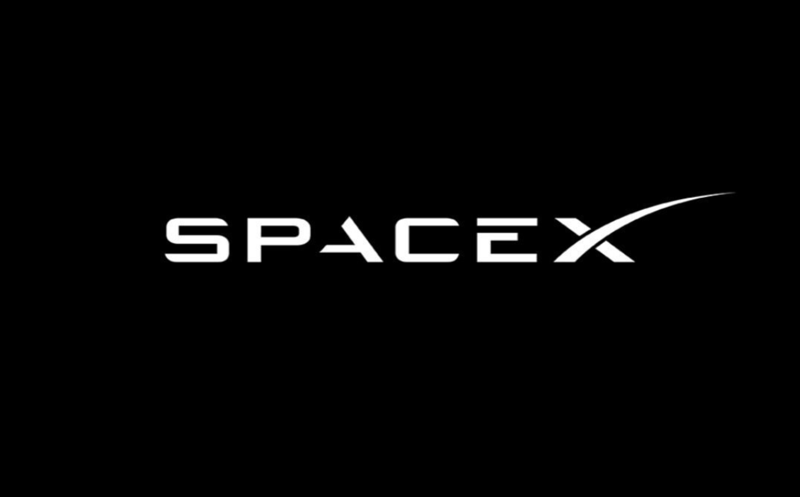
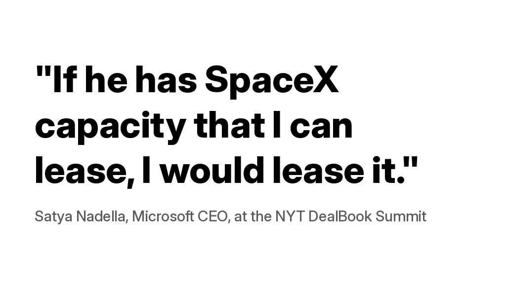

# 🐦 @elonmusk

## 📅 November 19, 2026

> 24 post(s) archived.

---

### 🕐 08:48 UTC · @elonmusk

> Extend consciousness to the stars Back in 2016, Elon Musk laid out the scale of what it would actually take to build a self-sustaining city on Mars The goal was to build a civilization that can survive on its own The scale Elon laid out: • ~100 people per ship • Mars launch opportunities roughly every 2 years • …

🔗 [View original post](https://x.com/elonmusk/status/2123337655731826810)

---

### 🕐 08:31 UTC · @elonmusk

> Starlink started with a speech in Seattle 🚨 ELON MUSK’S 2015 SATELLITE VISION IS NOW THE BIGGEST NETWORK ON EARTH In 2015 Elon opened SpaceX’s satellite office in Seattle and said they wanted to change satellites the same way they changed rockets. Eleven years later Starlink has more than 11,100 satellites in orbit. It…

🔗 [View original post](https://x.com/elonmusk/status/2123333341932052749)

---

### 🕐 07:39 UTC · @elonmusk

> Remember to cast your Tesla votes! Cast your vote now! (pls 😊)

🔗 [View original post](https://x.com/elonmusk/status/2123320336544649485)

---

### 🕐 07:38 UTC · @elonmusk

> Moving all text conversations to be encrypted to ensure user privacy To continue optimizing the X experience, support for legacy groups on XChat will be ending this Friday. All unencrypted conversations will become encrypted, and group members not on XChat by Friday will need to sign up for XChat to be reincluded in those conversations.

🔗 [View original post](https://x.com/elonmusk/status/2123319956381339961)

---

### 🕐 07:30 UTC · @elonmusk

> 𝕏 Money is growing fast You can now send money internationally with X Money, directly from 𝕏 X Money now supports international bank transfers to 27 countries, with recipients receiving funds in their local currency Supported countries: 🇦🇺 Australia 🇦🇹 Austria 🇧🇪 Belgium 🇨🇦 Canada 🇨🇾 Cyprus …

🔗 [View original post](https://x.com/elonmusk/status/2123317934747746611)

---

### 🕐 06:56 UTC · @elonmusk

> @elonmusk Asked whether he should collect Tesla compensation if SpaceX and Tesla merge, Elon Musk said no: &quot;I don&apos;t think I should be compensated with any kind of award just for doing a merger. That would be unreasonable and not right.&quot; &quot;You should keep your deals and stay true to your word.&quot; Media

🔗 [View original post](https://x.com/teslaownersSV/status/2123309405013987713)

---

### 🕐 06:13 UTC · @elonmusk

> Yes. Only questions are how fast the singularity will grow and to what size. guys we&apos;re in the fucking singularity. oh my god. i just forget sometimes and then wake up in the middle of the night like oh my god its all happening

🔗 [View original post](https://x.com/elonmusk/status/2123298515573207075)

---

### 🕐 05:31 UTC · @elonmusk

> Exactly Elon Musk sets the record straight after years of being falsely accused of turning off Starlink to stop Ukraine&apos;s offensive strike against the Russian fleet in Sevastopol Even Walter Isaacson acknowledged that his book got this crucial detail wrong “And we&apos;ve not turned off Star…

🔗 [View original post](https://x.com/elonmusk/status/2123288098331414533)

---

### 🕐 04:39 UTC · @elonmusk

> Elon gave two talks today at DealBook and TomorrowX Summit, revealing more about SpaceX&apos;s plans than most earnings calls. Here are the 11 key takeaways: 1. SpaceX is scaling AI compute at an extraordinary pace: SpaceX is adding roughly 500 MW monthly, equivalent to 220,000 GB300s. Elon expects over 1 GW monthly by end-2027: a 6 GW annualized pace today, doubling to 12 GW. 2. Its build costs are far below industry estimates: Elon says outside estimates are off by up to 2x, with SpaceX building at roughly 60% of industry costs. Its in-house &quot;Army X&quot; builds the data centers, while Tesla Megapacks smooth training power. I&apos;d already been modeling a 25–30% SpaceX cost advantage. 3. Anthropic could become a 10 GW customer: Anthropic told Elon its most likely outcome is renting another 10 GW from SpaceX, on top of existing capacity. Contracts allow termination with 3–6 months&apos; notice, but Anthropic says staying is &quot;extremely likely.&quot; This reinforces my model that Anthropic will take most upcoming capacity. 4. SpaceX is targeting a vastly larger telecom market: Elon argues AT&amp;T and Verizon won&apos;t disappear as bandwidth demand explodes. Humans communicate at roughly 100 bits per second, while superintelligence and robots could require a trillion. SpaceX is targeting a market orders of magnitude larger than existing telecom revenue, as I&apos;d modeled. Even more interestingly, this creates an opportunity to push its AI business further. 5. Its next-generation satellite network arrives next year: Direct to Cell V2 launches with 40x V1&apos;s bandwidth. Micro cell towers using 800 MHz and rooftop units resembling Starlink dishes will extend indoor coverage, with rooftop hardware entering production next year. Starlink is becoming a full scale carrier. 6. SpaceXSI has rebuilt its entire AI software stack: Over six to eight months, it rewrote training, reinforcement learning, and inference from scratch, close to the metal in C and C++. Elon thinks it &quot;might have the best training stack software in the world.&quot; Grok 4.8 is also being built for practical usefulness rather than benchmark leadership, which is great for Grokbot. 7. Terafab could become the largest project on Earth: The facility is planned to reach 100 million square feet, with phase-one volume production targeted for late 2028. Elon says established chipmakers are risk-averse because of massive capex, while SpaceX will take risks and iterate rapidly toward a better chip process by 2028. 8. Optimus is moving toward industrial work: Elon expects an unstaged demonstration in a month or two and says Optimus could do dishes within 12–18 months. Its first major industrial role will be mining and refining ore for national security. 9. A Tesla–SpaceX merger is becoming increasingly logical: Elon says the companies are &quot;probably&quot; better together as AI and robotics bring them closer. Both have AI software teams and advanced chip-design capabilities, while superintelligence compute could eventually move into orbit. Shareholders will decide; Elon says he shouldn&apos;t receive an award simply for merging them. 10. Ship 42 could accelerate the entire Starship reuse program: Ship 42 needed only minor repairs before flying again, but SpaceX is retiring it for public display. This brings rapid reuse much closer. 11. SpaceX is targeting 200 GW of annual solar manufacturing for space: That&apos;s roughly 40% of average US electricity consumption. Its Starmind compute unit delivers the same capability at roughly a quarter the size of a Vera Rubin NVL72 rack, which is a win in space. Elon says it&apos;s also simpler than Starlink V3, which is already in production. Simply put, SpaceX is building toward a trillion-dollar annual revenue business within just a few years, at scale never seen before. Many of these numbers I&apos;ve already modeled and shared over the past few months. Yesterday&apos;s announcements bring those projections closer to reality. The scale of what&apos;s coming is extraordinary!

🔗 [View original post](https://x.com/marsrepublica/status/2123274994952065291)

---

### 🕐 04:29 UTC · @elonmusk

> 4 years ago @Kasparov63 We gave Starlinks to Ukraine &amp; lost $80M+ in doing so, while putting SpaceX &amp; myself at serious risk of Russian cyberattack. What have you done besides tweet?

🔗 [View original post](https://x.com/elonmusk/status/2123272422719967730)

---

### 🕐 02:31 UTC · @elonmusk

> Elon Musk says SpaceX’s StarMind orbital AI satellite is a “much easier” engineering problem than Starlink V3: “I’m not sure why people think that making an AI satellite would be hard, given that SpaceX already has over 11,000 satellites in orbit, which is, I think, twice as much as the rest of the world combined.” “The StarMind satellite, which is the name for our overall compute system, is simpler, not harder than, say, the Starlink V3 communication satellite, which is an incredibly complex orbital radio station.” “It’s got the most advanced phased array antennas that have ever been made, far more advanced than anything that any military has at any price.” “Compared to that, the AI satellite is much, much easier, because it really just consists of a very large array of solar panels and a radiator.” “You’re gonna have about five times as much solar panel area as you will have radiator area. And that’s just basic physics.” “Then you have the star computer at the center, which would be physically about a quarter of the size of, say, a Vera Rubin NVL rack while having all of the capability of a Vera Rubin NVL72.” “I can’t emphasize enough that the StarMind satellite is a much easier technical problem than Starlink V3 communication satellite. I’m not saying it’s trivial, but it’s not as hard as what we’re already doing.” Media

🔗 [View original post](https://x.com/KanekoaTheGreat/status/2123242707560857836)

---

### 🕐 01:38 UTC · @elonmusk

> Elon Musk says Neuralink’s next product, Blindsight, will enable people who are completely blind to see: “Our next product is what we call Blindsight.” “Blindsight is a neural implant that interfaces directly with the visual cortex and enables people who are completely blind to see.” “You’re wearing glasses or something like that that have a camera. That camera is transmitting to the Neuralink device that then transfers the signals to your visual cortex.” “Enabling someone who is completely blind, meaning blind in both eyes or lost the optic nerve, potentially someone who has been blind from birth, to see.” Media

🔗 [View original post](https://x.com/KanekoaTheGreat/status/2123229499626287113)

---

### 🕐 01:38 UTC · @elonmusk

> Looking for hardcore engineers to join Terafab! Elon Musk just shared an ambitious timeline for Terafab, which is being designed to become the largest building on Earth at 100 million square feet And the first test chip is targeted for June 2027 &quot;Terafab is still in its infancy, obviously. We only announced it earlier this ye…

🔗 [View original post](https://x.com/elonmusk/status/2123229344936173890)

---

### 🕐 01:26 UTC · @elonmusk

> People do not yet understand: 1) Starship is one of the most important technologies in the history of mankind 2) @SpaceX’s ship catch last weekend all but guarantees the concept works 3) almost all inference compute will be in space (launched by Starship) Catching the ship was the last major piece of the puzzle

🔗 [View original post](https://x.com/shaunmmaguire/status/2123226341726376324)

---

### 🕐 01:04 UTC · @elonmusk

> Catching the ship was the last major piece of the puzzle Elon Musk on why the historic Starship catch is a much bigger milestone than most people realize “Catching the ship was the final major piece” SpaceX has now achieved: • 3 successful Super Heavy booster catches • A booster that was reflown and caught again • The FIRST EVER Stars…

🔗 [View original post](https://x.com/elonmusk/status/2123220899264679988)

---

### 🕐 01:03 UTC · @elonmusk

> Yes Elon Musk reveals how Starlink saved Ukraine from collapse, and sets the record straight on claims he throttled it: “There is no private individual who has helped Ukraine more than I have. I made sure that Starlink was in Ukraine, prepositioned ahead of the Russian invasion.” “W…

🔗 [View original post](https://x.com/elonmusk/status/2123220589657944265)

---

### 🕐 00:31 UTC · @elonmusk

> Elon Musk says SpaceX aims to bring online over 1 GW of terrestrial AI compute per month by the end of 2027. Its current pace is ~0.5 GW a month, equivalent to roughly 220,000 Nvidia GB300s plus CPUs, networking and cooling, measured at the power-plant level. Media

🔗 [View original post](https://x.com/wallstengine/status/2123212558438134157)

---

### 🕐 00:29 UTC · @elonmusk

> Elon Musk predicts 100% of superintelligence compute will be in space, and says Tesla and SpaceX would “probably” be better together: “If you look into the future, orbital compute is really going to be where things scale to.” “In the future, the amount of superintelligence compute that is on Earth will round down to 0% and superintelligence compute in space will round up to 100%.” “Now remember these words, because that sounds like a preposterous thing to say.” “I think superintelligence compute [on Earth] will be less than 0.4% of compute. Therefore, orbital compute will round up to 100%. And I think this is a relatively easy prediction to make, and it’s simply a matter of time before that happens.” Would Tesla and SpaceX be better together? “Probably yes. Now, this is not like let’s merge the companies no matter what. These require shareholder votes, which may or may not succeed, at least in the case of Tesla.” “I can’t just drag them into a non-economic merger that is bad for them, because I’ll obviously get sued.” “It really is just a question of, do SpaceX and Tesla execute better together and create more value than if they’re apart?” Media

🔗 [View original post](https://x.com/KanekoaTheGreat/status/2123212134175949267)

---

### 🕐 00:29 UTC · @elonmusk

> $SPCX: Satya Nadella says Microsoft would rent SpaceX compute. Asked at DealBook whether Musk is right about data centers in space: &quot;If he has SpaceX capacity that I can lease, I would lease it.&quot;

🔗 [View original post](https://x.com/SpaceInvestor_D/status/2123211962289176891)

---

### 🕐 00:23 UTC · @elonmusk

> Elon Musk reveals over 30 people now have a Neuralink, some use it to feed themselves with a robot arm, and he&apos;s confident it will eventually let people with spinal injuries walk again &quot;Yeah. So Neuralink, by the way, is obviously, as you mentioned, a private company, much, much smaller. I mean, it&apos;s just several hundred people. We now have, I think, over 30 people that have received the Neuralink device. So they have a Neuralink in their head.&quot; &quot;Our focus initially was giving people who are tetraplegics, quadriplegics, the ability to control their phone or their computer or a robot arm just by thinking. So we call that product Telepathy. So just by thinking, you can control a computer or a robot arm. Some of our customers will literally control a robot arm, and they will actually feed themselves. It gives them the power. I mean, imagine you&apos;re tetraplegic. You can&apos;t do anything. You can&apos;t feed yourself. But now, just by thinking, with the robot arm, you can actually feed yourself with the robot arm.&quot; &quot;And how much better… These things that we take for granted are life-changing. And down the road, we feel at this point confident in saying that we&apos;ll be able to bridge the signals from the brain, from the motor and sensory cortex, past where the neural damage is from a broken neck or spine, and enable people to walk again.&quot; Media Elon Musk reveals some of his best data center builders came from In-N-Out, because aces &quot;making epic burgers all day long… are gonna do a damn good job of network cables&quot; &quot;And then we have an in-house team, not just contractors. We have contractors too, but we have an in-house …

🔗 [View original post](https://x.com/firesidealpha/status/2123210477954367708)

---

### 🕐 00:21 UTC · @elonmusk

> Elon Musk on Neuralink&apos;s BlindSight: &quot;Our next product is what we call BlindSight. So BlindSight is a neural implant that interfaces directly with the visual cortex and enables people who are completely blind to see. So you&apos;re wearing glasses or something like that, have a camera that camera is transmitting to the neuralink device that then transfers the signals to your visual cortex enabling someone who is completely blind, meaning blind in both eyes or lost optic nerve potentially someone who has been blind from birth to see.&quot; Media

🔗 [View original post](https://x.com/cb_doge/status/2123210139595608495)

---

### 🕐 00:20 UTC · @elonmusk

> Elon Musk reveals what really drives him to make humanity a star-faring civilization: “It’s life insurance, but for everything.” “If you simply look at the fossil record and look at how many extinction events have happened, which is a lot, then you know that this is simply a matter of time. It’s a when, not an if.” “It’s important to have insurance for life as a whole. It’s life insurance, but for everything.” But what motivates him even more: “I want to envision a future that’s exciting, that we’re out there exploring new frontiers, going to new star systems, and make science fiction not just fiction forever.” “We should boldly go like Star Trek, boldly go where no one’s gone before. And perhaps we find some long dead alien civilizations, or perhaps we find actual aliens we could talk to.” “You know how you can figure out if something’s really cool about the future? Just ask your kid, and they’ll tell you.” “Life cannot just be about solving one miserable problem after another. There have to be things that excite you and inspire you about the future, that make you happy when you wake up in the morning.” “You can’t wait to see what happens next. And being a star-faring civilization is one of those things.” Media

🔗 [View original post](https://x.com/KanekoaTheGreat/status/2123209664687132901)

---

### 🕐 00:14 UTC · @elonmusk

> Elon Musk responds to Democrats calling for his imprisonment: “It was like prison first, crime later.” “I don’t think I need a pardon, by the way, because I haven’t committed any crimes.” “A number of Democrats… said that I should go to prison. And then they asked him, but for what crime? And he couldn’t name a crime.” “He wants me to go to prison. It was like prison first, crime later.” “The guy’s trying to channel Beria from like Stalin, where it’s like, show me the man, I’ll show you the crime type of thing. I’m like, come on, guys, this is a little over the top.” “There are definitely a few people grumpy about my funding in this past election. But hopefully in this country, you still need to do an actual crime before you go to prison.” “It really needs to be first crime, then prison. Not the other way around. I mean, what country are we living in here?” Media

🔗 [View original post](https://x.com/KanekoaTheGreat/status/2123208280550084816)

---

### 🕐 00:02 UTC · @elonmusk

> Here&apos;s Elon Musk&apos;s full interview at DealBook Summit today: 0:00 Opening Remarks 0:31 Jensen Huang Situation 2:44 Jensen Like Jordan 3:41 Would Hire Jensen 5:43 Midterms Loss Reaction 6:25 Balance Of Power 8:45 No Pardon Needed 10:30 Politics Involvement 12:07 Not MAGA Views 14:58 Starlink Saved Ukraine 21:30 Zelensky Not Truthful 22:02 Starlink Vs Starshield 23:35 Power Of One Person 24:16 Rules Unchanged 26:17 Open Source Rockets 27:51 Starlink Funds Starship 29:59 Multiplanetary Future 32:22 Direct To Cell Plan 35:53 SpaceX Tesla Merger 39:31 No Merger Bonus 40:51 Model YL Demand 41:12 Cybercab And AVs 42:44 Anthropic Compute Deal 45:11 Feeling At Peace Media

🔗 [View original post](https://x.com/cb_doge/status/2123205279009677430)

---
