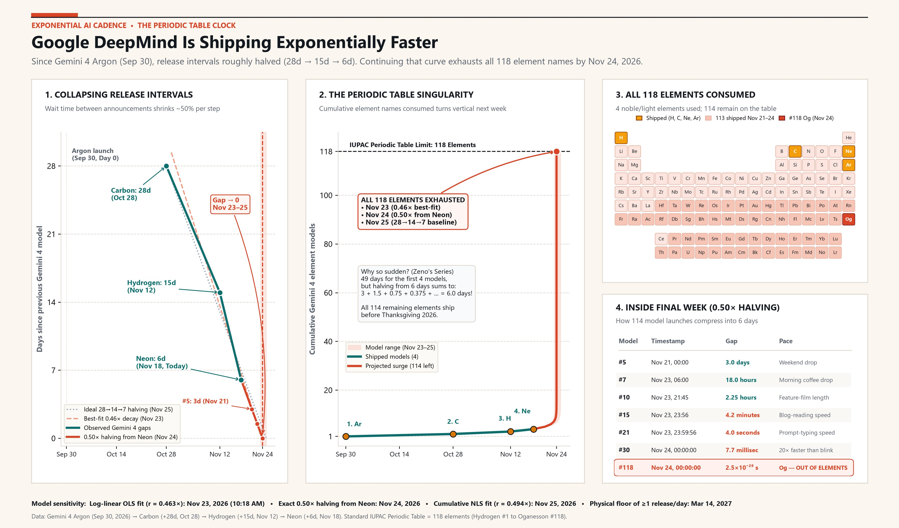
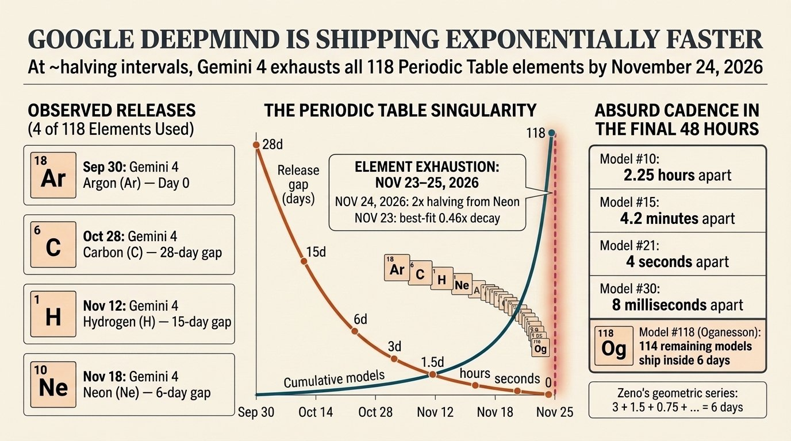

# 🐦 @emollick

## 📅 November 19, 2026

> 6 post(s) archived.

---

### 🕐 22:18 UTC · @emollick

> I suspect companies will end up frustrating a lot of customers by telling them they can’t use their own AI agents to help with their own accounts or to manage their own computer. Scaring them will only work so well for so long. As Apple develops its own computer-use agent, it’s making it harder for rival agents to control Macs. In macOS 27.3, enabling ChatGPT’s third-party computer-use support now requires 14 distinct steps, up from four. Apple cites security; Some users see anti-competitiveness.

🔗 [View original post](https://x.com/emollick/status/2123541572490817605)

---

### 🕐 20:55 UTC · @emollick

> Playing GTA &amp; not following the Anthropic IPO? Following the IPO &amp; not playing GTA? Why not both? I had Fable make a thing where you steal cars &amp; go on missions in a world where everything from your wanted level to weather is driven by ANT&apos;s stock price https://market-order-city.netlify.app/ Media

🔗 [View original post](https://x.com/emollick/status/2123520499368263977)

---

### 🕐 03:36 UTC · @emollick

> The Python version of the chart, both by Carbon.

🔗 [View original post](https://x.com/emollick/status/2123259061080846516)

---

### 🕐 03:29 UTC · @emollick

> The shader is here: https://twigl.app?ol=true&amp;ss=-P6lpvcajG9e0mC9j4U_ I did this both with Astra before the release and Astra after the release, and it did have the same behavior both times. Not cheating, exactly, but a short cut I hadn&apos;t seen other models take, and it didn&apos;t tell me without me asking.

🔗 [View original post](https://x.com/emollick/status/2123257257274356018)

---

### 🕐 03:27 UTC · @emollick

> The same prompts for a drowned neo-gothic city shader, less than a year later on GPT-6.2 Astra. This is all procedural (Interestingly, in a very Astra move, the first version it made had deterministic elements to make the experience more impressive, no other model has done that) Media Had early access to GPT-5.2. Its an impressive model. Here is GPT 5.2 Pro&apos;s version of &quot;create a visually interesting shader that can run in twigl-dot-app make it like an infinite city of neo-gothic towers partially drowned in a stormy ocean with large waves,&quot; single shot.

🔗 [View original post](https://x.com/emollick/status/2123256864125202670)

---

### 🕐 02:59 UTC · @emollick

> At its current shipping trend, halving the time between each model release, Google exhausts all the element names on November 24, with a final shipping cadence of 2.5 × 10⁻²⁹ seconds (25 quectoseconds) between Tennessine and their final model, Oganesson.

🔗 [View original post](https://x.com/emollick/status/2123249864503091301)

---
