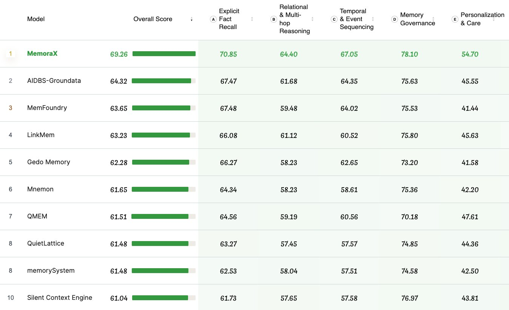

# 🐦 @omarsar0

## 📅 November 19, 2026

> 4 post(s) archived.

---

### 🕐 19:31 UTC · @omarsar0

> We track our heart and our sleep every day. Focus is still mostly a guess. STASIS glasses read your eye movements throughout the day and tell you when your brain is at its peak. Eyes are a strong signal for attention. I like this as a way to plan deep work around real peak hours. Backed by YC and tested by NBA star Moses Moody, our glasses tell you when your brain peaks. Your ring tracks your heart. Your watch tracks your sleep. Nothing tracks the eyes and brain running the show. STASIS reads your 100,000+ daily eye movements to tell you: • When you’re a…

🔗 [View original post](https://x.com/omarsar0/status/2123499330661122482)

---

### 🕐 14:57 UTC · @omarsar0

> I like how this measures different aspects of agent memory capabilities. This is part of the @AgentMemoryL Cycle 2 results. On the closed-source text board, the top 10 systems score between 70 and 78 on Memory Governance. Personalization &amp; Care is the lowest-scoring category for all ten, with scores between 41 and 55. 🏆 AML Cycle 2 results are live! 💥 • 1M+ cross-platform impressions • 10M+ cumulative website clicks • 402 task submissions • Three tracks: text, code and multimodal memory This cycle brought together teams from across the global AI community, including teams from Alibaba Cloud…

🔗 [View original post](https://x.com/omarsar0/status/2123430499511091340)

---

### 🕐 14:45 UTC · @omarsar0

> It’s clear that agents need a different kind of cloud. They run for hours, wait on people, and run code they wrote themselves. Volcano brings sandboxes, durable workflows, Postgres, and hosting into one platform, so coding agents can build and deploy on it. At Kong we run half a quadrillion AI tokens a year, and I kept seeing agents stuck on clouds built for websites. So we built a cloud for agents. Volcano is live today: the self-healing agent cloud. Sandboxes, durable workflows, Postgres, hosting.

🔗 [View original post](https://x.com/omarsar0/status/2123427385718497318)

---

### 🕐 13:00 UTC · @omarsar0

> MiniMax H3 is free and unlimited on Envato for 24 hours. For everyone.* Our best-performing model for creatives. Yours to use as much as you like. Create a free account to get started. Media

🔗 [View original post](https://x.com/envato/status/2123400900421034371)

---
