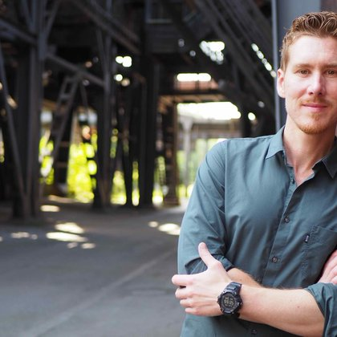

# 🐦 @rasbt

## 📅 November 19, 2026

> 2 post(s) archived.

---

### 🕐 13:59 UTC · @rasbt

> Shipping without the drama is an underrated skill Feels like a turning point... On the day OpenAI ships their worst ever model releases, Google ships the best model they, or indeed anyone, has ever made.

🔗 [View original post](https://x.com/rasbt/status/2123415801105445340)

---

### 🕐 02:20 UTC · @rasbt

> Just also added a lot of the additional content I originally trimmed from this article to an optional appendix (plus YaRN and ALiBi). So, if you already read the article and are looking for this bonus content, search for the &quot;appendix&quot; in this article. You can also find a direct link here, but it makes most sense to read passages of this where it is referenced throughout the text: https://sebastianraschka.com/supplementary/positional-embeddings/

🔗 [View original post](https://x.com/rasbt/status/2123239870394991087)

---
