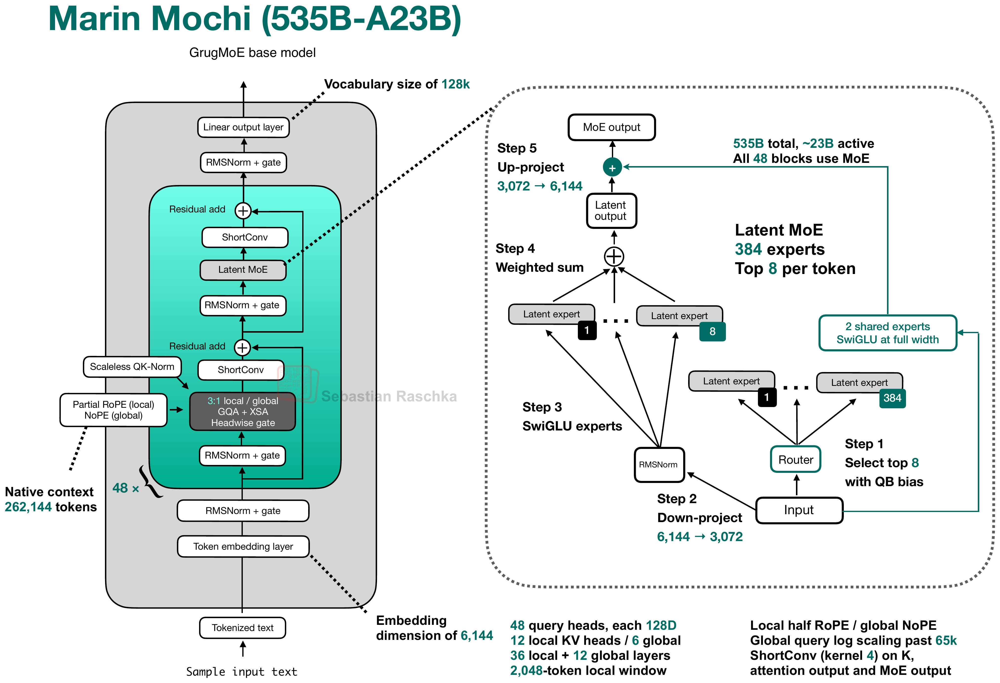

# 🐦 @rasbt

## 📅 November 19, 2026

> 3 post(s) archived.

---

### 🕐 15:10 UTC · @rasbt

> Whoa, great and even excessive Marin Mochi (535B-A23B) checkpoint drop (in a good way!) Comes with great tech report btw with insights into why / how components were picked (for training stability and GPU throughput). Short fact sheet: 1) Latent MoE with an extra RMSNorm on the latent that made latent MoE actually work (better) 2) Classic 3:1 sliding-window/global gated GQA, partial RoPE (local) and NoPE (global) 3) Adding short convolutions on keys, attention output, and MoE output 4) Exclusive self-attention (XSA) -- I guess the end-of-the year architecture roundup this year won&apos;t be boring 😅 We’re releasing all 57 intermediate checkpoints from Marin “Mochi” 535B-A23B pretraining, including 10 from long-context extension. 18.2T tokens, about 61 TB of weights. https://huggingface.co/open-athena/Marin-Mochi-535B-A23B Blog: https://openathena.ai/blog/marin-mochi-pretrai…

🔗 [View original post](https://x.com/rasbt/status/2123433827234111659)

---

### 🕐 13:59 UTC · @rasbt

> Shipping without the drama is an underrated skill Feels like a turning point... On the day OpenAI ships their worst ever model releases, Google ships the best model they, or indeed anyone, has ever made.

🔗 [View original post](https://x.com/rasbt/status/2123415801105445340)

---

### 🕐 02:20 UTC · @rasbt

> Just also added a lot of the additional content I originally trimmed from this article to an optional appendix (plus YaRN and ALiBi). So, if you already read the article and are looking for this bonus content, search for the &quot;appendix&quot; in this article. You can also find a direct link here, but it makes most sense to read passages of this where it is referenced throughout the text: https://sebastianraschka.com/supplementary/positional-embeddings/

🔗 [View original post](https://x.com/rasbt/status/2123239870394991087)

---
