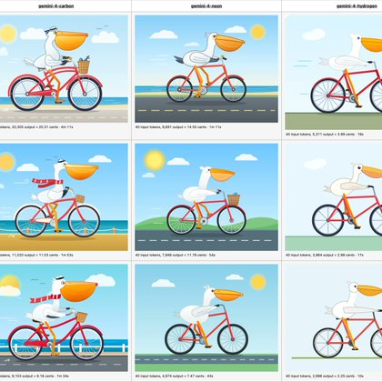
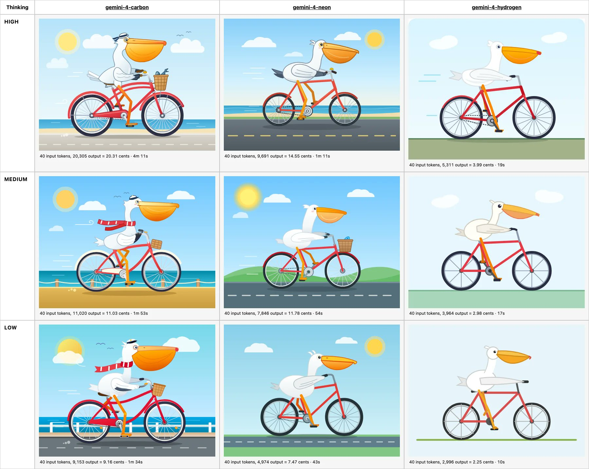

# 🐦 @simonw

## 📅 November 19, 2026

> 3 post(s) archived.

---

### 🕐 06:42 UTC · @simonw

> More notes on Gemini 4 Neon on my blog https://simonwillison.net/2026/Nov/18/llm-gemini/

🔗 [View original post](https://x.com/simonw/status/2123305889700667899)

---

### 🕐 06:42 UTC · @simonw

> I also tried &quot;Make a three js animation where yonkers stands up as a big mech (cool stand up motion) and stomps around manhattan and queens and Brooklyn, use openstreetmap mapping data&quot; against Gemini 4 Neon and got this https://static.simonwillison.net/static/2026/gemini-4-neon-yonkers/index.html Media

🔗 [View original post](https://x.com/simonw/status/2123305792854217049)

---

### 🕐 06:39 UTC · @simonw

> The most useful thing about the pelican riding a bicycle test continues to be illustrating the differences between models in the same family running at different effort levels - here&apos;s Gemini 4 Carbon, the new Gemini 4 Neon, and Gemini 4 Hydrogen at low, medium, and high

🔗 [View original post](https://x.com/simonw/status/2123305131206967571)

---
