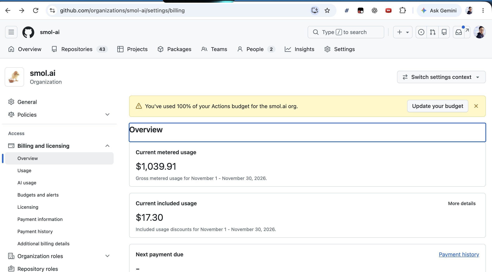

# 🐦 @swyx

## 📅 November 19, 2026

> 11 post(s) archived.

---

### 🕐 23:02 UTC · @swyx

> fuuuuuuck https://x.com/zuhayeer/status/2123485713056633138?a=4ADZV_jEpIc0l0wzX5I&amp;s=46 A Staff engineer who joined @AnthropicAI in 2024 is looking at a ~$100M windfall at the $83 IPO price At least half of that is vested now. Under the lockup&apos;s early release terms, employees can sell 10% on day one, so $5M+ in cash right out the gate We priced every Anthropic engi…

🔗 [View original post](https://x.com/swyx/status/2123552457649492023)

---

### 🕐 22:04 UTC · @swyx

> yeah in nov 2026 this needs to die current end state of forge

🔗 [View original post](https://x.com/swyx/status/2123537922670657753)

---

### 🕐 20:24 UTC · @swyx

> @linear was founded to build a better issue tracker, then $134M in funding and 7 years later, their CEO @karrisaarinen wrote a post titled “Issue tracking is dead”. I sat down with @cjc (COO, @linear) to talk about how they navigated that and how their GTM strategy evolved over that period. We got into: -why she stopped chasing enterprise deals three weeks after joining -why @linear has never hired a single SDR -why they won&apos;t let an LLM answer support tickets fully-autonomously and much, much, more… Enjoy! Timestamps 0:00 Intro 0:51 Meet Cristina Cordova, COO of Linear 1:39 Why Linear hired a COO at 40 people 5:01 Her work trial: a go-to-market plan for Linear 12:11 Crossing enterprise off the company goals 20:00 Why being a database behind an MCP server isn&apos;t enough 23:39 Selling after &quot;issue tracking is dead&quot; 34:40 Smaller, flatter teams and no SDRs 36:14 AI-drafted support replies with humans in charge 42:23 Why Linear doesn&apos;t do forward deployed engineering 47:53 Why some AI startups hit $100M ARR so fast 50:06 Moving from seats to usage-based pricing 57:07 Trading the 2025 enterprise roadmap for agents 1:03:28 What Linear&apos;s moat is now 1:05:54 Why not hire 100 salespeople? 1:08:59 Stripe&apos;s 40% rule for engineering headcount Link in the comments. Media

🔗 [View original post](https://x.com/realbasilchatha/status/2123512769794175004)

---

### 🕐 17:47 UTC · @swyx

> lifetime views

🔗 [View original post](https://x.com/swyx/status/2123473262185509174)

---

### 🕐 17:29 UTC · @swyx

> 1 million views. Our fastest talk to get there. @poteto of @SpaceXSI on the engineering behind 11,000 production PRs in one month. All Code Is Slop (Except Mine). Watch: https://www.youtube.com/watch?v=O_zcc6Xl12g

🔗 [View original post](https://x.com/swyx/status/2123468745708597345)

---

### 🕐 13:42 UTC · @swyx

> Anthropic raised about $140B and still has ~$132B on the balance sheet, per @tanayj. &quot;They burnt like under $10 billion to get to where they have.&quot; The Wing VC partner says the cash burn was the biggest surprise in Anthropic&apos;s S-1, &quot;and I mean that in a positive way.&quot; On @latentspacepod with @swyx, ahead of Anthropic&apos;s IPO. Is the low burn the real story of this IPO? Media ⚡️ $ANT IPOs tomorrow! We catch you up on everything we learned from the S-1 and the IPO roadshow. @tanayj talks us through the $9.9B compute and infrastructure bill and other deep dives. https://youtu.be/wX8nDtGIfYA Thanks to all the positive feedback on the @jaminball pod. Goo…

🔗 [View original post](https://x.com/FounderClipsHQ/status/2123411646777307310)

---

### 🕐 08:04 UTC · @swyx

> recommended viewing. my AIE talk is up! come hear how the grok @bot team ships so quickly without compromise on quality https://youtu.be/O_zcc6Xl12g

🔗 [View original post](https://x.com/badlogicgames/status/2123326437730234433)

---

### 🕐 06:11 UTC · @swyx

> poteto https://x.com/aiDotEngineer/status/2123068725410869585 If you keep correcting the same mistake, make it a check. @poteto of @SpaceXSI on turning corrections into deterministic checks, and keeping the codebase worth copying. From AI Engineer Code Summit.

🔗 [View original post](https://x.com/swyx/status/2123298074911248526)

---

### 🕐 03:43 UTC · @swyx

> casting Monica Barbaro as temu Mira Murati is crazy work New trailer for Luca Guadagnino&apos;s ‘ARTIFICIAL’, starring Andrew Garfield as Sam Altman. The film follows the story involving OpenAI focused on the firing &amp; rehiring of CEO Sam Altman. In theaters on January 8.

🔗 [View original post](https://x.com/swyx/status/2123260852984013045)

---

### 🕐 03:38 UTC · @swyx

> fcf profitable! https://x.com/biilmann/status/2123236286710645234?a=xWvmGaSk114JvBSqh74&amp;s=46 No envy towards anyone. That’s not how we operate. 93k people come and sign up for Netlify every day on average. Zero paid spend, all organic acquisition. We ask them who they are, what they are trying to build, and then we try to make them successful. Our relaunch is not some a…

🔗 [View original post](https://x.com/swyx/status/2123259711785148431)

---

### 🕐 00:12 UTC · @swyx

> Pretty sure I&apos;m the only Korean who got a solo photo with @swyx at @aiDotEngineer SF. Maybe the first ever? 😄 Yes, I&apos;m the green guy from the Seoul crew. Next time, more real conversations. And all event long, one thought kept coming back: Seoul needs one of these.

🔗 [View original post](https://x.com/choisor/status/2123207663672824242)

---
