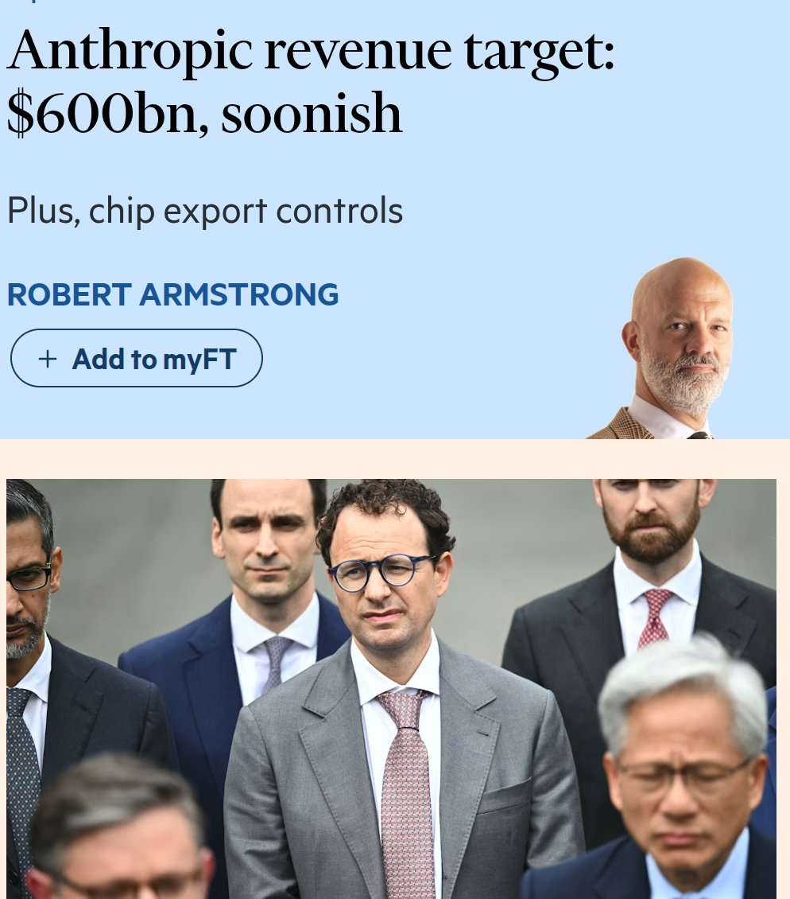

# 🐦 @ylecun

## 📅 November 19, 2026

> 4 post(s) archived.

---

### 🕐 21:13 UTC · @ylecun

> In this video, hear from CDS founding director Yann LeCun (@ylecun) about how our graduate programs prepare students for success in industry: a collaborative environment, capstone projects with New York companies, and faculty with industry affiliations. Media

🔗 [View original post](https://x.com/NYUDataScience/status/2123524997444722751)

---

### 🕐 20:02 UTC · @ylecun

> The real world is full of surprises, like a gust of wind while driving! Intelligent world models must reason about them, and imagine what would have happened under another action... We give JEPA world models this ability with provable guarantees 🧵⬇️ w/ @KerdaVaraku and @ylecun Media

🔗 [View original post](https://x.com/randall_balestr/status/2123507263642161439)

---

### 🕐 17:50 UTC · @ylecun

> Can a JEPA learn a latent map of the world? We released a new paper with @yingwww_ @choang333 @KuangYilun @ylecun 🧵 Media

🔗 [View original post](https://x.com/mengyer/status/2123473934129791032)

---

### 🕐 07:12 UTC · @ylecun

> FT: Anthropic would need about $602B in yearly revenue to earn a 20% return on its roughly $1T in compute commitments, according to an estimate in the FT’s Unhedged newsletter. A 20% return on $1T of capital, at a 40% operating margin and 17% tax rate, requires about $602B in annual revenue, more than Alphabet’s $471B or Apple’s $478B and two-thirds of the $908B earned by all 76 software and IT services companies in the S&amp;P 1500.

🔗 [View original post](https://x.com/rohanpaul_ai/status/2123313372510998911)

---
